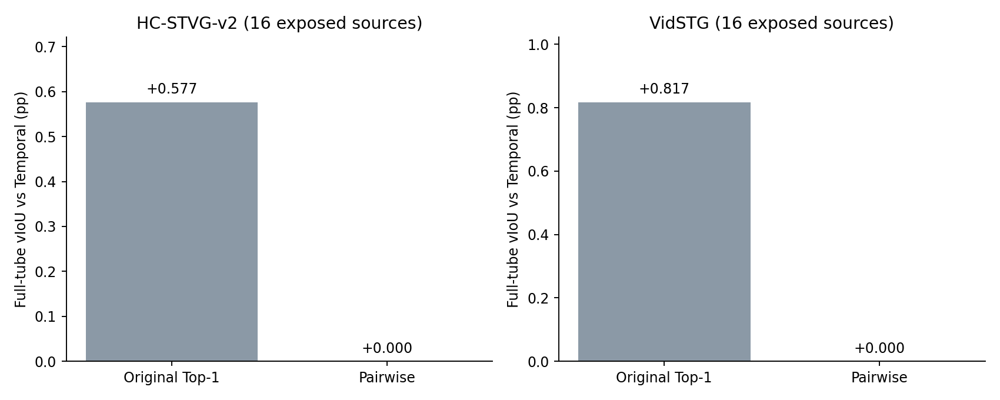

# Contrastive Referent Correction: fixed-pool development experiment

This is a finite development test on 32 previously exposed sources, 16 per domain. Frozen STVG-R1 compares the original Source and the original Top-1 non-Source choice using exactly the same two videos and nine-slot geometry. No new proposals, detectors, segmentation models, temporal feedback or hyperparameter search. This is not independent confirmation or Table 1.

All 128 original Top-1 slots are retained. Only 49 valid non-Source selections across 23 sources receive a pairwise request; Source, Uncertain and invalid replies add no reference. Alternative retains the exact original geometry. The candidate pool is fixed, so this verifier cannot introduce a correct object absent from that pool.

## Full Student predictions

| Arm | HC vIoU (%) | VidSTG vIoU (%) |
|---|---:|---:|
| F | 32.587386 | 9.701443 |
| T | 34.066991 | 9.966696 |
| S_historical | 33.117666 | 10.515552 |
| TS_historical | 34.643557 | 10.784159 |
| S_Pair | 32.587386 | 9.701443 |
| TS_Pair | 34.066991 | 9.966696 |

Teacher counts: `{'hc2': {'Source': 16, 'Uncertain': 2}, 'vidstg': {'Source': 20, 'Uncertain': 11}}`.

New actual fitter invocations: 0; accepted Adam steps from new invocations: 0. Exact historical fit/readout reuse and no-reference prediction reuse are counted separately in receipts. Arm-level totals can include historical reuse and are not all new execution. Gaussian IoU OPD, 1792 Query/LN parameters, query-based seed and per-domain configurations are fixed. This run has zero new fits, backward steps, source captures, or complete Student model redecodes because every Pair reference is empty. The 64 Pair arm identities are independently verified exact Frozen/Temporal reuse; no new OPD/decoder numerical qualification is claimed. Frozen/Temporal/historical predictions are exact reuse; no teacher tube substitutes the adapted Student.

All 32 complete prediction records and independent source/reference/no-update identity checks precede GT opening. New sampled-reward and optimizer checks have denominator zero; this is not evidence that a new OPD update works. New GT is used only for post-seal evaluation, never reference construction, fitting, token repair or configuration selection. No bootstrap or oracle fitting. Supervised/unsupervised splits use actual Pairwise anchor support consistently within each source; reference diagnostic IoU is measured only at common real labeled anchor positions and cannot be numerically equated to full-tube vIoU. Unknown anchor positions are retained.

## Common observed reference diagnostics

| Domain | Retained | Total | Labeled | Positive | Negative | Neutral | Unknown | Mean IoU delta vs Source (pp) |
|---|---|---:|---:|---:|---:|---:|---:|---:|
| hc2 | False | 18 | 15 | 4 | 10 | 1 | 3 | -17.139994 |
| hc2 | True | 0 | 0 | 0 | 0 | 0 | 0 | unknown |
| vidstg | False | 31 | 16 | 7 | 8 | 1 | 15 | -5.748577 |
| vidstg | True | 0 | 0 | 0 | 0 | 0 | 0 | unknown |

## Cost and execution

The finite teacher → reference lock → cached Student arm seal → independent readback → scoring chain took 79.292 seconds. It includes one R1 cold load and49 new calls; summed model generation/request times were 22.598/24.787 seconds, with peak allocated GPU memory 17168480768 bytes. There was no new OPD fit or Student forward. Existing candidate generation, original Top-1 and Temporal costs are reused, so this is not raw end-to-end method latency or a Table1 estimate.

The initial CPU preflight rejected a self-referential job-file hash requirement before model launch. Original locks/source are preserved; dispatch002 removes only that impossible inside-file check, while the external runtime still pins the exact job-file SHA. AST readback confirms model loading, video input processing, generation and parsing code are unchanged. No OOM or resource-guard stop occurred. No new ID-swap/occlusion control was run; legal labels alone do not prove semantic discrimination.

## Decision and limits

stop_fixed_pairwise_prompt_search_before_P1_P2_confirmation_or_full

All49 valid pairwise replies discard the original alternatives; zero useful references remain in either domain.
All31 labeled common anchor diagnostics were discarded, including11 beneficial,18 harmful and2 tied references;18 additional anchors have no observed GT. This is suppression, not selective reliable correction.
Pairwise Spatial is exact Frozen; Pairwise T+S is exact Temporal, below historical Top1 T+S on both development domains.
Saved propagation is broad in negative HC02 and positive HC14/V04, so distance-only restriction is not justified by the audit. No unsupported generic motion or L2 is added.
The attachment explicitly stops prompt search when P0 remains nearly all keep/abstain. Conditional P1/P2/P3 are not launched with an empty fixed reference set.

Complete positive, negative, neutral and unknown source outcomes are available in the accompanying anonymous JSON. Propagation analysis of saved Delta-b trajectories is a separate CPU mechanism audit; teacher reference agreement is not semantic identity or GT correctness. Boundary-quality temporal adaptation and a new propagation constraint are not claimed as executed by this P0. CURRENT and the human-paused full run remain unchanged.

[Protocol](../protocols/stvg_contrastive_correction_v1.md) · [All anonymous outcomes](../results/stvg_contrastive_correction/2026-10-15).
