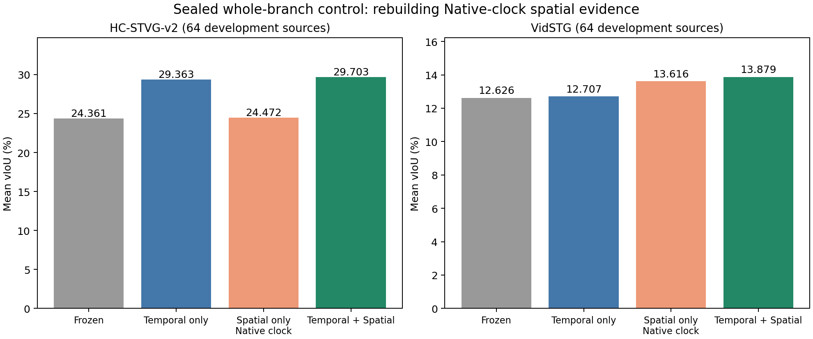
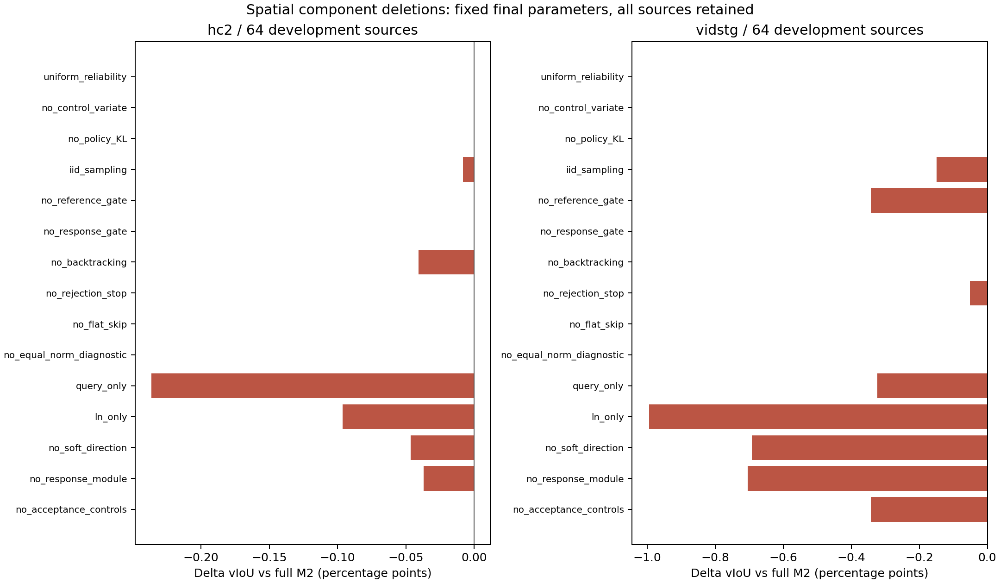
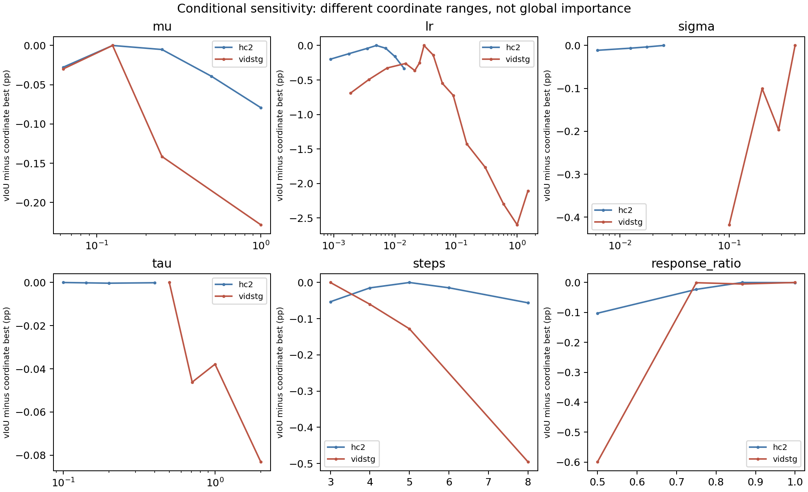

# Coordinate128 parameter search and hierarchical component ablations

Measurement publication, 2026-10-16. All 128 sources (HC64 + Vid64), one query per parent, have been used for development. These are not independent confirmation or Table 1 results. No bootstrap was run. No CURRENT promotion or automatic full evaluation was performed.

## Whole-branch comparison

| Arm | HC vIoU (%) | VidSTG vIoU (%) |
|---|---:|---:|
| Frozen | 24.360891 | 12.625615 |
| Temporal | 29.363396 | 12.706507 |
| Spatial_Native_clock | 24.471504 | 13.616376 |
| Spatial_QA_clock | 24.628037 | 13.905704 |
| Full | 29.703254 | 13.878606 |
| Separately_tuned_M0 | 29.690786 | 13.664853 |
| Separately_tuned_M1 | 29.679510 | 13.569796 |
| Separately_tuned_M2 | 29.703254 | 13.878606 |

Spatial_Native_clock truly removes Temporal: it rebuilds candidate evidence at Source Native times, runs the same frozen R1 protocol, and performs the fixed final M2 update before full Student re-decoding. Spatial_QA_clock retains the original Temporal QA observation clock and only emits Native time; it is a conditional output control, not a complete removal of Temporal.

Full minus true Native-clock Spatial is +5.231751 pp on HC and +0.262229 pp on VidSTG. On the original QA-clock spatial predictions, changing the output time contributes +5.075218 / -0.027099 pp. QA-clock versus Native-clock spatial evidence with Native output differs by +0.156533 / +0.289328 pp. These are descriptive matched-arm comparisons, not an additive unique causal identification. VidSTG Temporal output has no positive increment in this comparison; the observation clock still helps the spatial path on average.

Native control executed 512 R1 jobs, produced 197 non-Source anchors across 95 sources, and performed 95 real M2 fits / 95 full final Student readouts / 349 optimizer steps. The other 33 sources retain the prescribed no-reference fallback. Four arm records per source are not four independent trainings.

Full M2 versus Temporal-only improves +0.339858 / +1.172098 pp. Separately tuned M2 versus separately tuned M0 improves only +0.012469 / +0.213753 pp; HC is effectively a near tie in this development study, and no statistical significance claim is made. M0 uses the same current Weight-free/R1 references, not the historical DINO population.

## Spatial ablations

| Deletion / change | HC delta vIoU (pp) | Vid delta vIoU (pp) |
|---|---:|---:|
| A001 uniform_reliability | +0.000090003 | +0.000000000 |
| A002 no_control_variate | +0.000012932 | +0.000000934 |
| A003 no_policy_KL | +0.000000000 | +0.000000000 |
| A004 iid_sampling | -0.008261399 | -0.149355642 |
| A005 no_reference_gate | +0.000000000 | -0.342733987 |
| A006 no_response_gate | -0.000451342 | +0.000000000 |
| A007 no_backtracking | -0.040671803 | +0.000000000 |
| A008 no_rejection_stop | +0.000000000 | -0.051697234 |
| A009 no_flat_skip | +0.000000000 | +0.000000000 |
| A010 no_equal_norm_diagnostic | +0.000000000 | +0.000000000 |
| A011 query_only | -0.236424026 | -0.322825394 |
| A012 ln_only | -0.096412433 | -0.994748550 |
| A013 no_soft_direction | -0.046511874 | -0.692825116 |
| A014 no_response_module | -0.036916946 | -0.704653549 |
| A015 no_acceptance_controls | -0.000451342 | -0.342733987 |

Deleting current analytic policy-KL and extra equal-norm diagnostics individually preserved all 128 saved boxes/intervals in the earlier root tensor readback. This does not prove arbitrary combined deletions equivalent. The flat-reward skip also preserved predictions but its removal added 39 proposals, so it should remain for efficiency. Equal reliability and no control variate change means by only about 1e-4 pp or less, not a meaningful improvement. Query/LN, paired samples, reference admission, and decoder-response direction have supporting deletion evidence in this scope. Runtime speedups from code deletion have not been benchmarked.

## Temporal component controls

These four variants condition on fixed full-M2 spatial boxes and the original QA-clock references; they replay the saved 512-parameter temporal interface on CPU, not a fresh visual-model forward per arm. The current interface is Offset-Trust / L-BFGS, not the historical Adam recipe. Original baseline replay is exact for 111 fitted caches; 17 no-fit cases remain explicit Native fallbacks.

| Temporal deletion | HC delta vIoU (pp) | Vid delta vIoU (pp) |
|---|---:|---:|
| TS_no_grid_trust | -3.270620971 | -1.010593237 |
| TS_no_temporal_l2 | +0.051636581 | -0.011103269 |
| TS_shared_offset_candidate | +0.230158340 | -0.035409598 |
| TS_projection_only | +0.401268325 | -0.303911100 |

HC Projection-only is better than the full temporal adapter in this conditional comparison; VidSTG is worse. L2 and offset sharing are small and mixed across domains. Removing full-grid trust causes a substantial loss in both domains. The user-proposed combined simplification was explicitly held as an idea and has NOT been implemented or run.

## Parameter sensitivity

Each coordinate fixes the other parameters of its stage. The following range is max minus min across measured values, not a normalized global importance ranking.

| Coordinate | HC measured spread (pp) | Vid measured spread (pp) |
|---|---:|---:|
| lr | 0.332402 | 2.597485 |
| response_ratio | 0.102534 | 0.598787 |
| steps | 0.056079 | 0.495057 |
| sigma | 0.011220 | 0.417555 |
| mu | 0.079141 | 0.228307 |
| tau | 0.000323 | 0.083056 |

Vid learning rate is most sensitive in the measured ranges; rates up to 1.5 did not win. Sigma winners lie at the tested upper boundaries and are not global optima. All three applicable families receive the same coarse coordinate opportunities and frozen neighbor refinement. Configuration slots include exact fit reuse and must not be counted as 42 independent GPU reruns.

## Protocol, evidence, and limitations

Student: cross-domain TA-STVG from original source checkpoints, 256 Query residual + 1536 LN spatial parameters, episodic Source restore / Query and Adam reset. The writeback fields identify historical dataset configuration but do not enable cross-query LN carry here. Current teachers/candidate support remain fixed during coordinate search and spatial deletion; the Native control changes the observation clock by design. Frozen R1 evaluates Weight-free proposals; no new YOLO/SAM/DINO/tracker was introduced in this study.

All candidate formation, teacher selection, parameter updates, and update acceptance are GT-free. Saved predictions are globally sealed and independent saved-witness checks passed before official labels were used for offline scoring. Development GT is used to choose hyperparameters and therefore this is target-development tuning, not a blind target evaluation. Saved source/state/reward/loss/Adam/solver readbacks do not repeat a full independent model backward.

Five metrics and their unknown values are included for every logical row. Supervised/unsupervised sIoU compares the declared per-arm support; Native-clock and QA-clock reference supports differ, so those support-specific averages must not be presented as identical-support propagation comparisons. The complete source-level positive/negative/neutral/unknown data are retained. No cherry-picked query removal, GT-selected online steps, or GT-generated references were used.

All engineering failures and partial outputs remain locally preserved. ENGINEERING_RECOVERY.json describes the corrected dispatch/binding/schema/CPU-lineage issues; none is converted into scientific success by a root pass. Earlier role-prompt P1 was separately completed and public; its P2 trigger did not fire, and the original P0 prompt remains the spatial search input.

## Public package

This package contains 52864 logical scored arm rows across 42 coordinate slots, 16 spatial trials, 9 conditional temporal readouts, and 4 Native-clock readouts. Shared/reused baselines are present for audit and are not independent observations. It includes full per-domain summaries, paired contrasts with unknowns, final configurations, every trial configuration, execution counters, source bindings, and the runtime-pinned Python source snapshot. Five historical workspace/attachment path references in the broad source closure are normalized for privacy; original and public SHA256 are both recorded. No attachment contents, private media/annotations, weights, checkpoint tensors, prompts containing real query/caption text, or raw model responses are published.

To inspect: start with FINAL_COMPARISONS.json, PARAMETER_SENSITIVITY.json, CROSS_TRIAL_PAIRED.json and each trials/*/ROWS.json. source_snapshot/ mirrors the original repository paths for source review; it is not a standalone data/checkpoint distribution. Restoring an execution environment still requires the original authorized private data, caches, locks and checkpoints. The exporter itself is a no-model/no-raw-GT reader and refuses incomplete measurement receipts.

This is a completed measurement release. Full research closing and method qualification remain distinct; this publication does not claim independent confirmation, overall study FINAL, or production registration.

