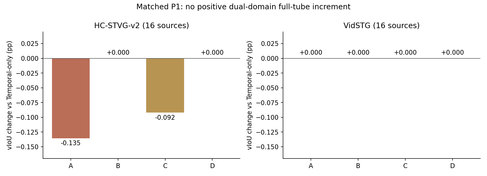
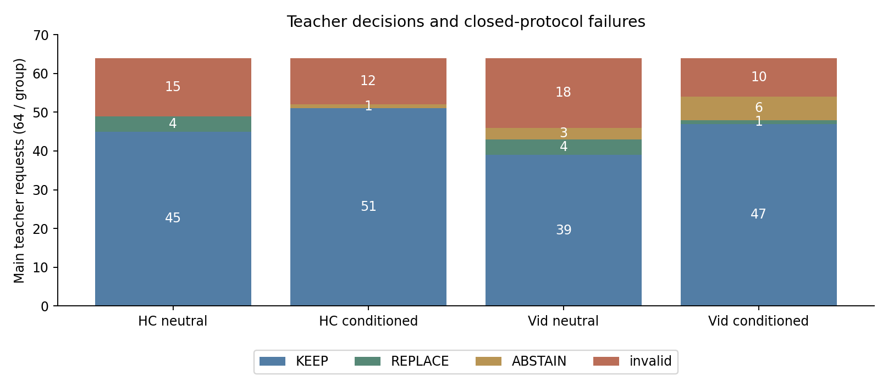

# Evidence-Conditioned STVG: bounded P0/P1 completed

**Decision: this fixed recipe is not frozen or expanded.** Complete numerical/readback checks passed, but the matched experiment did not establish useful dual-domain spatial transfer. No new confirmation or 13,785-query run was triggered; CURRENT and the paused old full run remain protected.

The cohort is the same 32 historically exposed development sources (16/domain), one registered query per source. These are development means, not independent confirmation or Table 1 results. Temporal Offset-Trust, exact candidate geometry/pixels/clocks, source weights, 1,792 spatial parameters, five steps and the prior domain-specific settings were fixed. No new detector, segmentation model, tracker, bootstrap or GT-oracle fit was used.

## Actual full-tube results

| Arm | HC vIoU (%) | VidSTG vIoU (%) |
|---|---:|---:|
| Frozen | 32.587386 | 9.701443 |
| Temporal-only | 34.066991 | 9.966696 |
| Historical top-1 + original OPD (separate output protocol) | 34.643557 | 10.784159 |
| A: neutral + original OPD | 33.931496 | 9.966696 |
| B: conditioned + original OPD | 34.066991 | 9.966696 |
| C: neutral + evidence-aware OPD | 33.974859 | 9.966696 |
| D: conditioned + evidence-aware OPD | 34.066991 | 9.966696 |

Historical top-1 is an explicit separate control: its task/output schema differs, so its gap against A is not a one-factor student-conditioning effect. A versus B and C versus D are matched.

A adds -0.135494 pp on HC relative to Temporal; C adds -0.092132 pp. B/D add exactly zero full-tube vIoU in both domains, which does not mean their parameters never changed. Both perform two accepted updates on V09, whose time interval has zero overlap and whose dense spatial score worsens. Do not call this successful safe adaptation.

HC02 remains negative: A/C full-tube -2.181364 pp, despite reference-anchor agreement improving; supervised sIoU increases about 1.418 pp while unobserved-frame sIoU falls about 2.277 pp. This shows the present pseudo-reference gate does not protect propagation. HC14 is a retained positive: C versus Temporal +0.707253 pp, versus A +0.693798 pp; dense sIoU changes from A -0.208292 pp to C +1.076504 pp relative to Frozen. V04 retains a substantial spatial improvement (A dense sIoU +11.774665 pp; C +11.763339 pp), but both Native and fixed Temporal have tIoU=0, so final vIoU remains zero. These are distinct spatial and temporal readouts, not interchangeable scores.

## Teacher feedback and input controls

320 actual generations completed: 256 main requests and 64 fixed controls; one accepted prefix response was reused exactly and 319 were generated after an engineering-only cache fix. Main outputs contain 201 valid / 55 invalid observations, with no token-cap truncation. Neutral A produces 8 references across 5 sources; conditioned B produces one across one source and none on HC. The same references feed C/D respectively.

Across all main/control outputs, 90 violate the closed protocol: 54 ABSTAIN responses do not set every evidence label to unclear, 25 KEEP responses choose a non-Source ID, and 11 REPLACE responses choose Source. Abstention-label violations are not proof of referent errors. Contradictory decisions and IDs were retained as invalid rather than repaired after viewing scores. This format/task burden and the conditioned prompt’s conservatism limit interpretation of the teacher; they do not establish that all student-conditioned feedback is useless.

Of 32 ID-permutation comparisons, 19 have valid outputs on both sides; all 19 preserve the stable candidate. The other 13 are unknown/invalid, not counted as consistent. Visual-null produces 9 valid abstentions and 23 invalid outputs; none asserts all three grounded labels. Only 7 base/null pairs are valid on both sides, so the control supports a limited visual-sensitivity observation rather than a calibrated semantic guarantee. Four-frame context pacing retains the previously disclosed mean-gap approximation.

## Actual optimization and independent checks

12 fitter invocations completed; 10 have accepted updates, totalling 42 actual accepted Adam steps. Reuse/no-reference and zero-accepted-step cases remain in all 32 denominators. Complete Student decoder readouts match the cached decoder, frozen source weights restore, all 32 predictions seal before GT, and independent saved arithmetic checks 2,496 sampled rewards (maximum IoU difference 8.282e-7). No independent decoder backward replay is claimed. All 384 case-arm rows, 120 summary scalars and 40 source-paired comparisons are retained; root reaggregation checked 760 values with zero difference. Fixed-observation/non-observation sIoU uses the union of A–D reference positions, not a claim that every such frame received a nonzero gradient.

P0 independently audited 49 old anchors / 241 anchor rounds: 214 have varying rewards and 27 zero overlap; 95 proposals were accepted and one rejected. Original code already centers weights by 1/32, skips globally flat reward rounds and applies reliability outside loss. These are not new fixes. Four missing historical transitive source pins remain a disclosed old-provenance limitation. No cold-start was added because this evidence does not show a dominant lack of reward support.

## Cost and engineering history

Revision002’s complete teacher → references → Student → independent readback → scoring chain took 441.101 seconds. The failed first worker adds 40.291 seconds of actual execution; wall time from its launch through the final handoff was 758.020 seconds including the engineering repair gap. Student stage took 95.744 seconds. All 320 generation calls sum to 282.196 model seconds / 296.055 request seconds; both cold model loads are disclosed separately. Total input/visual/output tokens were 583896/409600/9042; maximum allocated teacher GPU memory was 17314840576 bytes.

This is the complete actual cost of the bounded cache-reusing experiment, not a fresh full-method cold latency: candidate generation, Temporal feedback/adaptation and historical predictions were reused. It cannot be extrapolated into a reliable Table1 estimate or advertised as the whole method’s runtime. No OOM or resource-guard stop occurred. The first launch failed because tensor nbytes was compared to NPY file bytes including its header; original code/log/runtime and the one response are preserved, and revision002 only fixes that check while retaining disk SHA checks. Old full/background queues were not restarted.

## Scope decision

Do not freeze this D recipe or open confirmation/full evaluation: its Teacher correction and usable full-tube increment have not both been demonstrated. Keep HC14 and V04 as positive mechanism evidence, HC02/V09 as failures, all no-reference and unknown cases, and the format failures. The present results do not isolate candidate coverage as the main bottleneck, so they do not trigger new proposal generation, cold-start, broad parameter search or a new teacher. Boundary verification remains a separate unexecuted mechanism, not a claimed component of this tested method.

[Protocol](../protocols/stvg_evidence_conditioned_v1.md) · [All anonymous P1 outcomes](../results/stvg_evidence_conditioned/2026-10-15/p1) · [P0 source-support audit](../results/stvg_evidence_conditioned/2026-10-15/p0).

The first independent teacher-output reader rejected historical auxiliary bindings because it assumed the wrong legacy fields and mixed raw-text and response-file hashes. Its failed receipt is retained; the corrected 002 reader verifies the actual projection and all 320 outputs with zero failed checks. This was a reader-schema error, not a new model/GPU failure. Public source bindings cover the static local import closure; five inherited authorization/notebook-path aliases differ only in approved metadata string constants, with all other AST fields matching. No private authorization values are exported.
