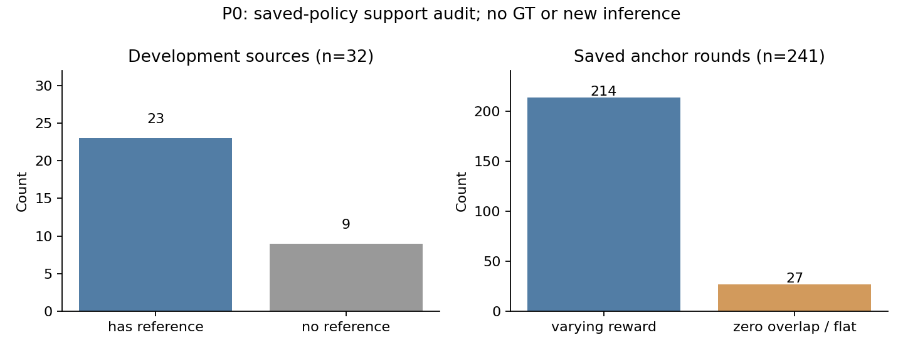

# Evidence-Conditioned STVG — P0 audit and bounded P1 protocol

2026-10-15. **P0 saved-state audit complete; P1 four-cell inference is being prepared. This is not a new-method performance result or Table 1 completion.**

The study retains TA-STVG and the frozen STVG-R1 teacher. Existing weight-free Selective Search/GrabCut/DIS candidate inputs are reused exactly. It adds no YOLO, SAM, DINO or pretrained model. Temporal Offset-Trust outputs and the existing domain-specific spatial settings are fixed.

The old separately evaluated confirmation32 already measured spatial-versus-temporal vIoU increments of -0.330358 pp on HC and +0.576171 pp on VidSTG. These results do not establish stable spatial improvements in both domains, and those evaluated sources cannot be called untouched in a new study. The old full evaluation stays paused.

## Actual P0 readback

All 32 historically exposed development sources remain in the denominator: 23 have references (7 actual fits in the corrected parent phase and 16 exact parent-fit reuses), 9 have none. Saved records contain 49 anchors and 241 evaluated anchor rounds: 214 have nonconstant rewards and 27 have zero overlap and flat rewards. Across 111 non-skipped fit rounds, 96 proposals contain 95 accepted and 1 rejected update; 15 rounds have no information, and 4 further rounds are skipped after rejection.

The root independently reran the audit. Maximum independent differences: reward IoU 9.42e-7, policy probability 1.09e-8, loss 3.30e-8, reference IoU 2.52e-7 and parameter-state displacement 2.33e-10. This is saved numerical readback, not an independent decoder backward pass. Reward support does not establish referent correctness or a useful task direction.

The old code already centers score-function weights by 1/32, skips globally flat reward rounds before Adam, and applies anchor reliability outside its loss. Those properties are **not newly introduced fixes**. The new fitter tests per-anchor support/novelty admission and normalized external weights. Historical RUNTIME006 omitted four transitive import pins; present hashes are recorded, but the historical execution cannot be declared fully source-closed.

## Four matched cells

| Cell | Teacher | Student update |
|---|---|---|
| A | Neutral candidate identification | Original validated OPD |
| B | Student-conditioned correction | Original validated OPD |
| C | Neutral candidate identification | Evidence-aware OPD |
| D | Student-conditioned correction | Evidence-aware OPD |

Both teacher tasks have identical KEEP/REPLACE/ABSTAIN options, candidate videos, ID schema and 160-token output cap. The limit is 256 main generations and 64 preselected ID-permutation/visual-null controls. Invalid and truncated responses remain explicit observations. Visual-null and ID invariance diagnose sensitivity; neither certifies the correct object. Context encoding retains the historical four-frame mean-gap FPS approximation.

The 32 cases retain Frozen, Temporal, each cell's Spatial and Temporal+Spatial predictions, plus historical top-1 controls. Per-case complete Student redecoding must match the cached decoder, Source weights must restore, and all 32 predictions must be sealed and independently read back before the scorer opens annotations. All positive, negative, neutral and unavailable results are retained. No bootstrap, oracle fits or prompt/parameter search.

Cold-start, boundary verification and student-aware 3+3+2 proposals remain separate conditional tests. No effect is claimed for them here. Method freezing and any fresh confirmation depend on this bounded study; the controller never resumes the old full queue or promotes CURRENT.

[Protocol](../protocols/stvg_evidence_conditioned_v1.md). [Anonymous P0 data](../results/stvg_evidence_conditioned/2026-10-15/p0/SUPPORT_AUDIT.json).
