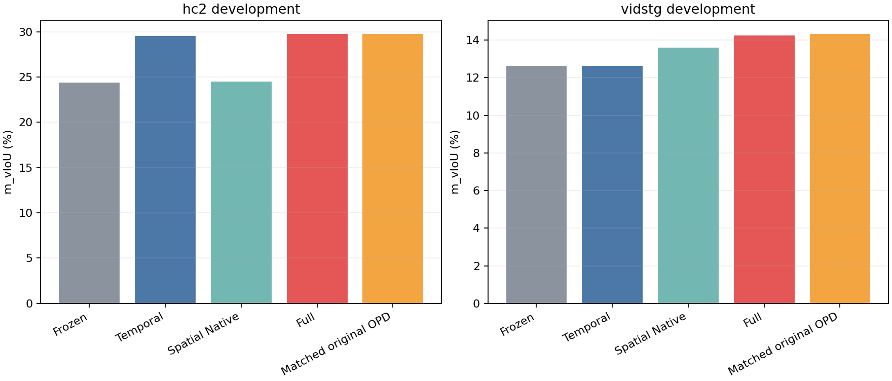

# Lite actual-clock development closed loop — batch 003

This cohort completed both real Full and Native-clock Student pipelines, independent source/saved-mathematics/readout checks and a joint pre-GT seal before five-arm scoring. Subsequent cohorts are not required for this incremental publication. This is not whole-study FINAL or CURRENT promotion.

## Fixed method and cohort

TA-STVG cross-domain Source checkpoints; 128 sources, 64 per target domain, one query per parent. All128 sources were exposed development; no new selection is made from this closed-loop result.

Temporal-Lite: shared candidate supervision multiplied by offset count, no parameter L2, original full-grid per-offset trust and 512-parameter L-BFGS. Spatial: Lite-fullstep/full-grid decoder-response direction update, 1792 Query/LN parameters, episodic reset. HC lr0.0045/sigma0.025/tau0.1/5steps; Vid lr0.027/sigma0.4/tau0.5/3steps. Frozen R1 and existing weight-free candidates remain unchanged. No DINO, YOLO or SAM is added.

The Full branch reconstructs candidates and R1 references at the selected Temporal-Lite interval. Spatial-only uses actual Native-clock references, not Full-clock geometry with a different final interval. Matched_original_OPD uses the same Full references and final parameters as Full, with the original validated OPD update; it is not its separately retuned optimum. No GT enters candidates, references or online step acceptance.

## Complete five-arm result

| Method | HC m_vIoU (%) | VidSTG m_vIoU (%) |
|---|---:|---:|
| Frozen | 24.360891276 | 12.625615355 |
| Temporal | 29.545823121 | 12.626783131 |
| Spatial_native_clock | 24.472384567 | 13.604344901 |
| Full | 29.771396040 | 14.237517558 |
| Matched_original_OPD | 29.775741999 | 14.333832144 |

Full minus Frozen: HC +5.410505 pp; VidSTG +1.611902 pp.

Full minus Temporal: HC +0.225573 pp; VidSTG +1.610734 pp.

Full minus Matched_original_OPD: HC -0.004346 pp; VidSTG -0.096315 pp.

Full improves over Frozen in both domains in this cohort. It is below the same-parameter original OPD control in both domains. All negative findings are retained and do not trigger another parameter search. Development evidence is not independent generalization evidence.

JSON scores are fractions, paired deltas percentage points. Every positive/negative/neutral/unknown source is retained with the saved1e-6 pp neutral tolerance. Native and Full supervision clocks differ: their supervised/unsupervised-frame means do not share identical supports and must not be mixed as a matched-support contrast. Dense GT-frame metrics and complete Tube metrics remain separately labelled. No bootstrap.

Costs contain actual worker elapsed times, including separately labelled failed engineering attempts if present, and Student fit/capture/readout counts. Development Native teacher evidence is exact reuse of the prior sealed same-input run. These are not cold-start deployment or official full-set speed measurements. The frozen external expert may carry target-domain prior; overlap-free external training is not established.

Videos, annotations, weights, raw tensor caches, real-query prompts, raw teacher responses and private conversation are excluded. Source snapshots inherit the previously audited complete batch001 closure and add only the necessary new engineering source files.

[All anonymous rows, summaries, paired cases, actual configuration, costs and source bindings](../results/stvg_lite_event_support/2026-10-16/batch003/)

