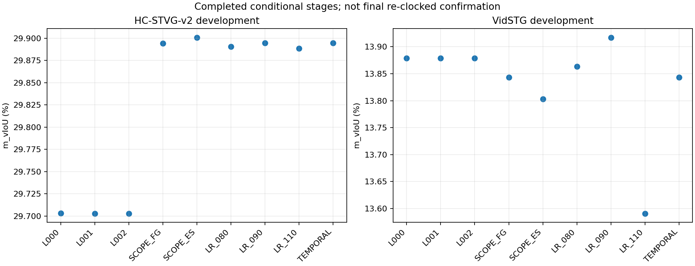

# Lite STVG development measurements — incremental batch 001

This immutable batch publishes completed stages while the study continues. It is not the final recipe, independent confirmation, or Table 1.

## Cohort and protocol

TA-STVG cross-domain Source checkpoints; 128 exposed development sources, HC-STVG-v2 64 and VidSTG 64, one query per parent. Frozen R1, existing weight-free eight-candidate references and original Source weights are unchanged. Query/LN/Adam reset each query; writeback configuration fields do not activate online LN carry.

All prediction stages were sealed and independently read before GT scoring. GT is used for offline development selection and final metrics, never for references, online acceptance, or candidate generation. No bootstrap, CURRENT promotion or official full-set execution.

## Completed measurements

| Block | HC m_vIoU (%) | VidSTG m_vIoU (%) |
|---|---:|---:|
| L000 | 29.703254239 | 13.878605753 |
| L001 | 29.702905842 | 13.878606687 |
| L002 | 29.702905842 | 13.878606687 |
| SCOPE_FG | 29.894280956 | 13.843186752 |
| SCOPE_ES | 29.900785018 | 13.802806395 |
| LR_080 | 29.890349618 | 13.863530985 |
| LR_090 | 29.894382221 | 13.917258263 |
| LR_110 | 29.888476376 | 13.590971244 |
| TEMPORAL | 29.894629349 | 13.843185830 |

L000/L001/L002 compare Full, Lite-backtrack and Lite-fullstep with the old Temporal clock. TEMPORAL is a conditional CPU readout using fixed original A000 spatial geometry, not a freshly re-clocked end-to-end experiment. SCOPE_FG/SCOPE_ES use selected Lite Temporal and fixed reference geometry; they isolate decoder-response support. LR blocks differ only in the locked spatial learning-rate multiplier; the 1.0 center is SCOPE_FG under strict identity reuse. EFFECTIVE_RECIPE_SEMANTICS.json distinguishes active operations from inherited inactive writeback/response/backtracking configuration fields. The Temporal optimizer remains the original L-BFGS.

Event support changes HC by +0.006504 pp and VidSTG by -0.040380 pp relative to full-grid. The prelocked equal-domain non-degradation rule therefore retains full-grid. The 0.1 pp per-domain structural budget selects Lite-fullstep and Temporal-Lite; this is a development choice, not evidence of both-domain improvement.

## Costs and complete results

Full cached spatial decoder calls: 1688; Lite-fullstep: 732. These measured costs exclude teacher/video preparation and are not end-to-end deployment speedups.

The linked result directory contains every anonymous per-source scalar, paired positive/negative/neutral/unknown case, actual trial configuration, matched fit costs, source hashes, complete pinned Python source snapshot, and engineering recovery history. Scores are fractions in JSON; contrasts are percentage points. Repeated baselines are logical readouts, not independent training runs.

## Pending at this batch boundary

LR_120 and final recipe selection, actual re-clocked development pipelines, new 64-source confirmation, and the later 8/16/32-frame visual-evidence P0 are outside this batch. The pending status is fixed at export time, even if workers finish subsequently. Subsequent batches will append their results; no negative result is omitted.

No videos, annotations, model weights, raw tensors, real query/caption prompts, raw teacher responses or personal conversations are published. The frozen expert may have target-domain prior; no claim of overlap-free external training is made.

[All anonymous results and source snapshot](../results/stvg_lite_event_support/2026-10-16/batch001/)

