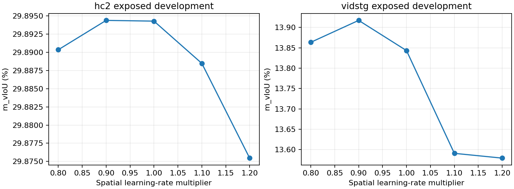

# Completed event-support and five-point learning-rate study — batch 002

The locked search is complete. Actual re-clocked development pipelines and 64-source confirmation are now the next stage; their outcomes are not reported here. This is not whole-study FINAL or a CURRENT promotion.

## Fixed development selection

TA-STVG cross-domain Source checkpoints, 128 exposed sources (HC64/Vid64), one query per parent. Temporal-Lite, Spatial Lite-fullstep and full-grid response support are fixed. Only spatial Adam learning rate changes; original references, clocks, stochastic keys, other parameters and acceptance rules remain matched.

| Multiplier | HC LR | HC m_vIoU (%) | Vid LR | Vid m_vIoU (%) |
|---|---:|---:|---:|---:|
| 0.8 | 0.00400 | 29.890349618 | 0.02400 | 13.863530985 |
| 0.9 | 0.00450 | 29.894382221 | 0.02700 | 13.917258263 |
| 1.0 | 0.00500 | 29.894280956 | 0.03000 | 13.843186752 |
| 1.1 | 0.00550 | 29.888476376 | 0.03300 | 13.590971244 |
| 1.2 | 0.00600 | 29.875459130 | 0.03600 | 13.579255276 |

Both domains select 0.9×: HC lr=0.0045, VidSTG lr=0.027. Relative to center, HC improves only 0.000101 pp and VidSTG 0.074072 pp; the HC difference is negligible and neither proves confirmation/generalization. The center reuses SCOPE_FG under strict identity, so five logical points are four new GPU runs.

Event-output support was not selected: it failed the prelocked equal-domain non-degradation condition. This batch does not add another parameter search. Spatial retains 1792 episodic Query/LN parameters; inherited writeback and amplitude fields do not activate LN carry or removed Lite checks. Temporal remains the original 512-parameter L-BFGS interface.

GT is used only for post-seal offline development scoring/selection, never for candidates, references or online step acceptance. All positive, negative, neutral and unknown cases are preserved. No bootstrap, official full-set run or new teacher.

[Complete first-batch results and pinned source snapshot](../results/stvg_lite_event_support/2026-10-16/batch001/)
[New LR_120 results, final development configuration and selection evidence](../results/stvg_lite_event_support/2026-10-16/batch002/)

