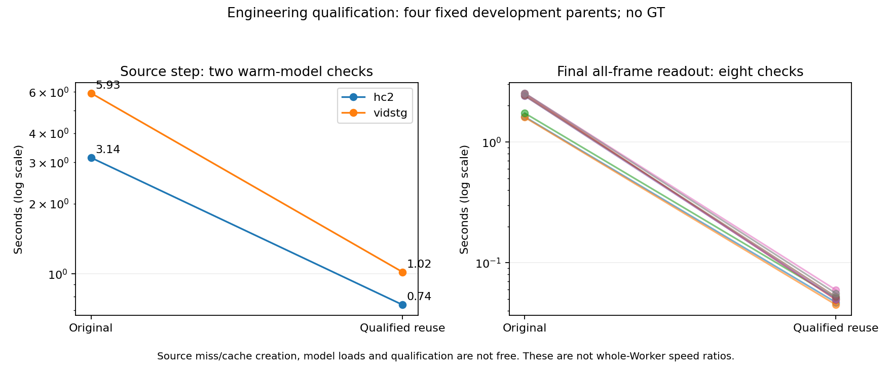

# Exact pipeline reuse qualification001

Four fixed development parents (HC2 two, VidSTG two), two original recipes, eight paired recipe comparisons and sixteen actual fits. This is an engineering equivalence panel, not a256-source task result, semantic identity evaluation or untouched confirmation. No GT was read. Selection used the first eligible-reference parents in the fixed roster, before any outcome comparison.

The original versus cached Source path matched initial predictions and trainable initialization. Every complete gradient/Adam/solver/proposal/acceptance path matched exactly under full-step and finite-backtrack recipes. Final boxes, temporal logits and intervals over all output frames matched the original complete-model RGB forward. Assertions ran on actual GPU values; saved qualification receipts and pinned code are supplied, not a claim of an additional independent GPU reexecution. The four original Source feature caches remain private.

Warm-model Source checks took3.141 and5.931 seconds originally, versus0.738 and1.019 seconds to restore and verify the exact prefix. Other Source checks include first model loads and are itemized separately. Eight original complete-model final readouts took1.60–2.54 seconds, versus0.0449–0.0595 seconds for complete two-pass Decoder readout from the frozen prefix. Shared qualification itself took78.128 seconds. These component checks do not establish a whole-Worker or whole-study speed ratio; cache creation/misses, IO, model loads, Solver and mandatory roots remain.

Only features before trainable spatial LNs are cached. Every final frame still recomputes the original LNs, both Decoder passes and action gates. Old R1 features are losslessly represented by their original BF16 bits; no model precision is reduced. Original inputs/parameters, Solver budget, step budget, reference admission, rejection, rollback, early stopping and Gaussian sampling remain fixed. All original research step snapshots remain; the bounded asynchronous CPU writer passed real snapshot/state/Adam/SHA readback on the first16 running outputs. That partial engineering check is not a complete256 prediction seal or a task score.

The original Full_E1 Teacher finished1024 requests normally and was adopted without interruption or rerun. The replacement coordinator has already resumed Full_E1 Student256; the other five fixed groups and deferred global32 remain automatically scheduled. Each complete scientific group will publish all same-parent Frozen/Temporal/A comparisons separately. No current256 Spatial performance or global-context benefit is claimed here. CURRENT was not promoted.

The historical ABC16 timing file contains48 logical output reads from the same16-parent panel, not48 independent sources. Solver/Decoder timing is inside fit timing; residual Worker time also includes final full forward, hashing/checks and saving, and must not be called pure IO. Private media, GT coordinates, query/caption prompts, raw Teacher replies, parameter tensors, caches, weights and credentials are excluded.

