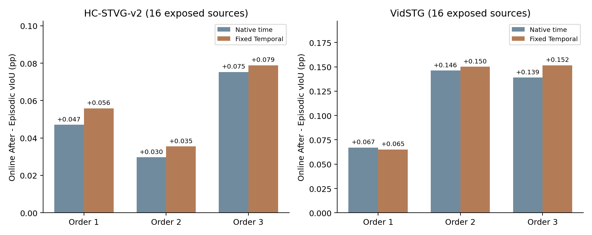

# Fixed-reference and LN-state recovery

This experiment separates an update-configuration package from persistent LN state using 32 previously exposed development sources, 16 per domain. It is not an untouched confirmation or full Table 1. All 49 frozen Weight-free Top-1 anchors across 23 sources are retained. No new teacher, candidate generator, GT-assisted reference, bootstrap or CURRENT promotion.

## E1: strictly matched cached reference swap

Existing cache supports no same-frame E1 reference swap on the current 49 Top1 anchors. Eight old Native/R1 sources have zero exact source/query/video matches against the current 32. The old clean P1 DINO cache has two strict same-source matches, HC03 and HC16, including same locked PLAN row/ordinal and source video, exact current/old loaded source model-state SHA, source checkpoint SHA, pixel SHA, frame grid, interval and native predictions. But their current Top1 anchors are at different source-grid positions and physical frames from every DINO observation saved in the cache; the cache holds four sparse independent DINO observations and has no dense track or persistent ID. Any same-support E1 for these two would require new DINO inference at the exact QA frame; both were previously P1 confirmation queries, so are historically exposed.

No reference-swap fit was executed: missing same-frame cached expert evidence is an execution support limitation, not evidence that stronger expert references would fail.

## E2: original configuration package, fixed reference and Source reset

| Arm | HC vIoU (%) | VidSTG vIoU (%) |
|---|---:|---:|
| F | 32.587386 | 9.701443 |
| T | 34.066991 | 9.966696 |
| S_current | 33.117666 | 10.515552 |
| TS_current | 34.643557 | 10.784159 |
| S_original | 26.821628 | 11.687013 |
| TS_original | 28.066390 | 11.901840 |

The original HC package is lr .01, sigma .025, tau .05, 40 steps; Vid is .03, .1, .25, 10 steps. Both retain 32 antithetic samples, the current validated-IoU gate and the same reference weights/loss. The controls reuse exact parent current-five-step predictions. New Source-reset fits and actual complete Student readouts were executed only for the 23 sources with references. Thus this changes the full configuration package, not a single parameter, and does not reproduce the original DINO/online system.

## E3: original LN writeback, current five-step update

| Dataset | Order | Frozen | Temporal | Episodic S | Online Before S | Online After S | Episodic T+S | Online Before T+S | Online After T+S |
|---|---|---:|---:|---:|---:|---:|---:|---:|---:|
| hc2 | order1 | 32.587386 | 34.066991 | 33.117666 | 32.701002 | 33.164757 | 34.643557 | 34.186993 | 34.699354 |
| hc2 | order2 | 32.587386 | 34.066991 | 33.117666 | 32.656070 | 33.147350 | 34.643557 | 34.139964 | 34.679038 |
| hc2 | order3 | 32.587386 | 34.066991 | 33.117666 | 32.705838 | 33.192911 | 34.643557 | 34.184980 | 34.722381 |
| vidstg | order1 | 9.701443 | 9.966696 | 10.515552 | 9.796808 | 10.582525 | 10.784159 | 10.053654 | 10.849309 |
| vidstg | order2 | 9.701443 | 9.966696 | 10.515552 | 9.894429 | 10.661695 | 10.784159 | 10.157478 | 10.934336 |
| vidstg | order3 | 9.701443 | 9.966696 | 10.515552 | 9.981756 | 10.654627 | 10.784159 | 10.240948 | 10.935721 |

Across the three prelocked orders, Online T+S is 34.700258% HC and 10.906455% Vid, versus Episodic 34.643557%/10.784159%: +0.056701/+0.122296 pp. Every order is positive in this matched contrast. Dense spatial IoU rises by +0.057029/+0.423407 pp. This is a small development-stream effect and does not reproduce the old full-population inherited-state advantage. The original configuration package is harmful on HC and helpful on Vid relative to current5; no universal rollback is justified.

Each stream uses the exact cohort subsequence of an original P1 ordinal order; these are six 16-query streams, not full historical streams. Every arrival resets Query256 and Adam; only LN1536 carries. The commit is incoming LN + alpha*(accepted fit LN - incoming LN), with alpha .0625 HC and .125 Vid. Each new stream resets to Source. The query-key random sampling is identical to the saved Episodic fit. Empty-reference arrivals preserve and actually decode their incoming memory.

Before and After are independently executed complete Student readouts for every arrival, verified against the saved decoder replay and Source model restoration. Native and fixed Offset-Trust intervals share identical spatial boxes. F/T and Episodic controls are exact saved reuse, not three new independent Episodic runs. There are 32 independent sources and 96 arrivals, not 96 independent sources.

The three primary descriptive contrasts are Before-Frozen, After-Before, and OnlineAfter-Episodic. All per-source gains/losses, order sensitivity and dense/supervised/unsupervised spatial metrics are in the anonymous JSON. Full vIoU cannot be equated with anchor IoU or dense sIoU. These descriptive contrasts do not prove that inherited state has semantically correct knowledge.

## Validation and limits

Every stage sealed all predictions and passed independent source, saved policy/reward/softmax, state-chain/Adam/rollback and complete-readout checks before GT scoring. GT was never used in reference construction, acceptance, carry, stream order or update configuration. Independent saved arithmetic does not constitute an independent backward recomputation. No best-order/step/source selection and no bootstrap.

Root corrected the unpinned draft carry worker ABI (parent arm names, Source capture, readout calling convention and stable seed) before any GPU execution. The locked code is the actual executed revision. The actual resources and wall times are recorded separately; no historical teacher latency is counted as zero cost for the whole method.

Current conclusions apply to this fixed Weight-free reference pool and these short development streams. Do not generalize a mean or a negative order to all online LN memory, all OPD, or a new target cohort. CURRENT and the human-paused full evaluation remain unchanged.

[Locked protocol](../protocols/stvg_reference_recovery_v1.md) · [Complete anonymous outputs](../results/stvg_reference_recovery/2026-10-15).
