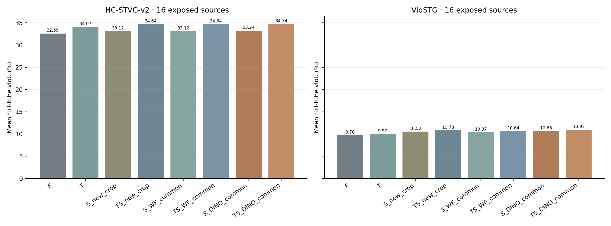
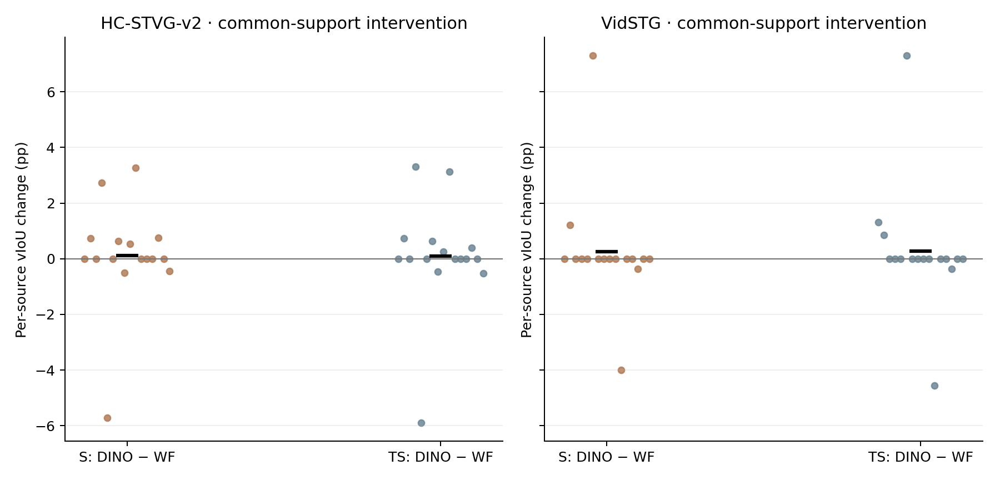

# E1: same-frame original-DINO versus Weight-free reference geometry

This is a bounded comparison on 32 previously exposed development sources (16 per domain), not an untouched confirmation or the full Table 1 cohort. It tests a same-frame geometry swap under the locked current five-step Student adaptation. It does not reproduce the full original DINO/online pipeline, and it does not select or promote a production method.

## Teacher support and audit boundary

The frozen DINO expert received 49 prelocked observation attempts. 40 had actual model forwards: 38 passed the original admission gate and form the common support; 2 were rejected; 9 were parser abstentions without a forward. The accepted references provide 38 same-frame anchors over 19 sources; 13 sources have empty common support and use exact no-update F/T fallback.

The DINO and Weight-free references are paired on identical physical observation positions and use the original Weight-free reliability weights. Rejected and unknown DINO positions are not repaired or interpolated. The selected candidate index was reconstructed from the saved admitted-pool candidate IDs and winner index. The serialized admitted-pool target scores allow replay of the saved gate, margin and selected score; raw logits and per-target scores over all 900 detector candidates were not stored, so the all-candidate score derivation cannot be independently replayed without rerunning the model.

## Eight-arm full-tube results

Values are source means in percent. `n` is the number of known per-source scores; `unknown` rows remain null rather than being imputed. The five metrics are kept separate because vIoU is not the product of mean tIoU and mean sIoU.

### HC-STVG-v2

| Arm | vIoU | tIoU | dense sIoU | supervised sIoU | unsupervised sIoU | n (vIoU) | unknown (vIoU) |
|---|---:|---:|---:|---:|---:|---:|---:|
| F | 32.587386 | 54.448394 | 53.922657 | 60.958929 | 53.908950 | 16 | 0 |
| T | 34.066991 | 60.145183 | 53.922657 | 60.958929 | 53.908950 | 16 | 0 |
| S_new_crop | 33.117666 | 54.448394 | 54.685281 | 63.391272 | 54.668589 | 16 | 0 |
| TS_new_crop | 34.643557 | 60.145183 | 54.685281 | 63.391272 | 54.668589 | 16 | 0 |
| S_WF_common | 33.117666 | 54.448394 | 54.685281 | 63.391272 | 54.668589 | 16 | 0 |
| TS_WF_common | 34.643557 | 60.145183 | 54.685281 | 63.391272 | 54.668589 | 16 | 0 |
| S_DINO_common | 33.241644 | 54.448394 | 54.698718 | 63.554748 | 54.682259 | 16 | 0 |
| TS_DINO_common | 34.741339 | 60.145183 | 54.698718 | 63.554748 | 54.682259 | 16 | 0 |

### VidSTG

| Arm | vIoU | tIoU | dense sIoU | supervised sIoU | unsupervised sIoU | n (vIoU) | unknown (vIoU) |
|---|---:|---:|---:|---:|---:|---:|---:|
| F | 9.701443 | 33.628222 | 33.353589 | 59.319677 | 33.324976 | 16 | 0 |
| T | 9.966696 | 34.185907 | 33.353589 | 59.319677 | 33.324976 | 16 | 0 |
| S_new_crop | 10.515552 | 33.628222 | 35.357687 | 62.038003 | 35.326087 | 16 | 0 |
| TS_new_crop | 10.784159 | 34.185907 | 35.357687 | 62.038003 | 35.326087 | 16 | 0 |
| S_WF_common | 10.371622 | 33.628222 | 34.813034 | 61.887086 | 34.782694 | 16 | 0 |
| TS_WF_common | 10.640229 | 34.185907 | 34.813034 | 61.887086 | 34.782694 | 16 | 0 |
| S_DINO_common | 10.630311 | 33.628222 | 37.009485 | 67.238201 | 36.969404 | 16 | 0 |
| TS_DINO_common | 10.924565 | 34.185907 | 37.009485 | 67.238201 | 36.969404 | 16 | 0 |

The four parent arms F, T, S_new_crop and TS_new_crop are exact saved reuse. The WF_common and DINO_common arms use the same current5 domain configuration, 1,792 active parameters, five declared steps, 32 samples, stable query key, Source reset and per-query Adam reset. If common support is empty, no new fit is run and the arm is exact F/T. All eight arms are represented in the source-level JSON; no support case was dropped.

## Paired differences and source-level outcomes

Differences are in percentage points (pp). Positive, negative and neutral counts use the locked scorer tolerance of 1e−10 pp; unknown means at least one compared metric is missing. No bootstrap was run. The full JSON preserves every per-source delta and null.

| Domain | Contrast (left − baseline) | Metric | Mean Δ (pp) | Positive | Negative | Neutral | Unknown |
|---|---|---|---:|---:|---:|---:|---:|
| HC-STVG-v2 | S_DINO_common_minus_S_WF_common | vIoU | +0.123977 | 6 | 3 | 7 | 0 |
| HC-STVG-v2 | S_DINO_common_minus_S_WF_common | tIoU | +0.000000 | 0 | 0 | 16 | 0 |
| HC-STVG-v2 | S_DINO_common_minus_S_WF_common | dense sIoU | +0.013437 | 6 | 4 | 6 | 0 |
| HC-STVG-v2 | S_DINO_common_minus_S_WF_common | supervised sIoU | +0.163475 | 6 | 3 | 1 | 6 |
| HC-STVG-v2 | S_DINO_common_minus_S_WF_common | unsupervised sIoU | +0.013670 | 6 | 4 | 6 | 0 |
| HC-STVG-v2 | TS_DINO_common_minus_TS_WF_common | vIoU | +0.097782 | 6 | 3 | 7 | 0 |
| HC-STVG-v2 | TS_DINO_common_minus_TS_WF_common | tIoU | +0.000000 | 0 | 0 | 16 | 0 |
| HC-STVG-v2 | TS_DINO_common_minus_TS_WF_common | dense sIoU | +0.013437 | 6 | 4 | 6 | 0 |
| HC-STVG-v2 | TS_DINO_common_minus_TS_WF_common | supervised sIoU | +0.163475 | 6 | 3 | 1 | 6 |
| HC-STVG-v2 | TS_DINO_common_minus_TS_WF_common | unsupervised sIoU | +0.013670 | 6 | 4 | 6 | 0 |
| HC-STVG-v2 | S_WF_common_minus_S_new_crop | vIoU | +0.000000 | 0 | 0 | 16 | 0 |
| HC-STVG-v2 | S_WF_common_minus_S_new_crop | tIoU | +0.000000 | 0 | 0 | 16 | 0 |
| HC-STVG-v2 | S_WF_common_minus_S_new_crop | dense sIoU | +0.000000 | 0 | 0 | 16 | 0 |
| HC-STVG-v2 | S_WF_common_minus_S_new_crop | supervised sIoU | +0.000000 | 0 | 0 | 10 | 6 |
| HC-STVG-v2 | S_WF_common_minus_S_new_crop | unsupervised sIoU | +0.000000 | 0 | 0 | 16 | 0 |
| HC-STVG-v2 | TS_WF_common_minus_TS_new_crop | vIoU | +0.000000 | 0 | 0 | 16 | 0 |
| HC-STVG-v2 | TS_WF_common_minus_TS_new_crop | tIoU | +0.000000 | 0 | 0 | 16 | 0 |
| HC-STVG-v2 | TS_WF_common_minus_TS_new_crop | dense sIoU | +0.000000 | 0 | 0 | 16 | 0 |
| HC-STVG-v2 | TS_WF_common_minus_TS_new_crop | supervised sIoU | +0.000000 | 0 | 0 | 10 | 6 |
| HC-STVG-v2 | TS_WF_common_minus_TS_new_crop | unsupervised sIoU | +0.000000 | 0 | 0 | 16 | 0 |
| HC-STVG-v2 | S_WF_common_minus_F | vIoU | +0.530280 | 7 | 2 | 7 | 0 |
| HC-STVG-v2 | S_WF_common_minus_F | tIoU | +0.000000 | 0 | 0 | 16 | 0 |
| HC-STVG-v2 | S_WF_common_minus_F | dense sIoU | +0.762623 | 6 | 3 | 7 | 0 |
| HC-STVG-v2 | S_WF_common_minus_F | supervised sIoU | +2.432344 | 6 | 3 | 1 | 6 |
| HC-STVG-v2 | S_WF_common_minus_F | unsupervised sIoU | +0.759639 | 6 | 3 | 7 | 0 |
| HC-STVG-v2 | TS_WF_common_minus_T | vIoU | +0.576566 | 6 | 3 | 7 | 0 |
| HC-STVG-v2 | TS_WF_common_minus_T | tIoU | +0.000000 | 0 | 0 | 16 | 0 |
| HC-STVG-v2 | TS_WF_common_minus_T | dense sIoU | +0.762623 | 6 | 3 | 7 | 0 |
| HC-STVG-v2 | TS_WF_common_minus_T | supervised sIoU | +2.432344 | 6 | 3 | 1 | 6 |
| HC-STVG-v2 | TS_WF_common_minus_T | unsupervised sIoU | +0.759639 | 6 | 3 | 7 | 0 |
| VidSTG | S_DINO_common_minus_S_WF_common | vIoU | +0.258689 | 2 | 2 | 12 | 0 |
| VidSTG | S_DINO_common_minus_S_WF_common | tIoU | +0.000000 | 0 | 0 | 16 | 0 |
| VidSTG | S_DINO_common_minus_S_WF_common | dense sIoU | +2.196452 | 5 | 2 | 9 | 0 |
| VidSTG | S_DINO_common_minus_S_WF_common | supervised sIoU | +5.351115 | 5 | 0 | 0 | 11 |
| VidSTG | S_DINO_common_minus_S_WF_common | unsupervised sIoU | +2.186710 | 5 | 2 | 9 | 0 |
| VidSTG | TS_DINO_common_minus_TS_WF_common | vIoU | +0.284336 | 3 | 2 | 11 | 0 |
| VidSTG | TS_DINO_common_minus_TS_WF_common | tIoU | +0.000000 | 0 | 0 | 16 | 0 |
| VidSTG | TS_DINO_common_minus_TS_WF_common | dense sIoU | +2.196452 | 5 | 2 | 9 | 0 |
| VidSTG | TS_DINO_common_minus_TS_WF_common | supervised sIoU | +5.351115 | 5 | 0 | 0 | 11 |
| VidSTG | TS_DINO_common_minus_TS_WF_common | unsupervised sIoU | +2.186710 | 5 | 2 | 9 | 0 |
| VidSTG | S_WF_common_minus_S_new_crop | vIoU | -0.143930 | 1 | 2 | 13 | 0 |
| VidSTG | S_WF_common_minus_S_new_crop | tIoU | +0.000000 | 0 | 0 | 16 | 0 |
| VidSTG | S_WF_common_minus_S_new_crop | dense sIoU | -0.544653 | 1 | 2 | 13 | 0 |
| VidSTG | S_WF_common_minus_S_new_crop | supervised sIoU | -0.150917 | 0 | 1 | 4 | 11 |
| VidSTG | S_WF_common_minus_S_new_crop | unsupervised sIoU | -0.543393 | 1 | 2 | 13 | 0 |
| VidSTG | TS_WF_common_minus_TS_new_crop | vIoU | -0.143930 | 1 | 2 | 13 | 0 |
| VidSTG | TS_WF_common_minus_TS_new_crop | tIoU | +0.000000 | 0 | 0 | 16 | 0 |
| VidSTG | TS_WF_common_minus_TS_new_crop | dense sIoU | -0.544653 | 1 | 2 | 13 | 0 |
| VidSTG | TS_WF_common_minus_TS_new_crop | supervised sIoU | -0.150917 | 0 | 1 | 4 | 11 |
| VidSTG | TS_WF_common_minus_TS_new_crop | unsupervised sIoU | -0.543393 | 1 | 2 | 13 | 0 |
| VidSTG | S_WF_common_minus_F | vIoU | +0.670179 | 3 | 1 | 12 | 0 |
| VidSTG | S_WF_common_minus_F | tIoU | +0.000000 | 0 | 0 | 16 | 0 |
| VidSTG | S_WF_common_minus_F | dense sIoU | +1.459444 | 4 | 3 | 9 | 0 |
| VidSTG | S_WF_common_minus_F | supervised sIoU | +2.567409 | 3 | 2 | 0 | 11 |
| VidSTG | S_WF_common_minus_F | unsupervised sIoU | +1.457718 | 4 | 3 | 9 | 0 |
| VidSTG | TS_WF_common_minus_T | vIoU | +0.673532 | 3 | 2 | 11 | 0 |
| VidSTG | TS_WF_common_minus_T | tIoU | +0.000000 | 0 | 0 | 16 | 0 |
| VidSTG | TS_WF_common_minus_T | dense sIoU | +1.459444 | 4 | 3 | 9 | 0 |
| VidSTG | TS_WF_common_minus_T | supervised sIoU | +2.567409 | 3 | 2 | 0 | 11 |
| VidSTG | TS_WF_common_minus_T | unsupervised sIoU | +1.457718 | 4 | 3 | 9 | 0 |

## Same-frame anchor quality (separate from full-tube vIoU)

The following diagnostic compares Source, WF and DINO boxes only at the shared observation positions with an actual GT annotation. It is a box IoU readout on the 38 locked common anchors, not an oracle fit, not candidate selection, and not the full-tube vIoU endpoint.

| Domain | Common anchors | GT observed | GT unknown | Source anchor IoU | WF anchor IoU | DINO anchor IoU | DINO − WF (pp) | + / − / neutral |
|---|---:|---:|---:|---:|---:|---:|---:|---:|
| HC-STVG-v2 | 18 | 15 | 3 | 49.776498% | 32.636503% | 67.794761% | +35.158257 | 12 / 3 / 0 |
| VidSTG | 20 | 9 | 11 | 49.071208% | 30.563670% | 65.447100% | +34.883430 | 6 / 3 / 0 |

At the annotated shared anchors, the DINO-minus-WF mean box-IoU difference was +35.158257 pp for HC-STVG-v2; the corresponding TS full-tube vIoU change was +0.097782 pp (6 positive, 3 negative, 7 neutral, 0 unknown). These are distinct endpoints on this exposed panel; the anchor result does not imply an equal-sized tube-level gain.
At the annotated shared anchors, the DINO-minus-WF mean box-IoU difference was +34.883430 pp for VidSTG; the corresponding TS full-tube vIoU change was +0.284336 pp (3 positive, 2 negative, 11 neutral, 0 unknown). These are distinct endpoints on this exposed panel; the anchor result does not imply an equal-sized tube-level gain.

## Execution cost and limits

| Stage | Measured work | Wall time |
|---|---|---:|
| DINO reference worker | 49 attempts; 40 actual forwards; 9 abstentions without a forward | 28.988 s sealed; 38.585 s across all launches |
| Student reference swap | 32 cases; 38 fit records sealed; 40 actual fit invocations and 40 reported full readouts; 164 retained / 174 execution-chain optimizer steps | 164.852 s sealed; 282.016 s across all launches |
| Failed engineering launches | 5 total (2 teacher, 3 student) | 121.561 s combined |
| Full execution chain | 34 source-capture calls; 16 prefix fits/69 steps in student005, 22 new fits/95 steps in student007, and 2 HC11 partial fits/10 steps | 320.600 s across all launches |

The 38 retained fit records comprise 16 student005 prefix fits reused exactly in the final seal and 22 new student007 fits. Two additional HC11 Weight-free attempts in student005 and student006 each completed five optimizer rounds before their pre-seal failure. The independent CPU math reader confirms the saved partial optimizer chains and 10 extra steps, but did not independently verify a separately serialized full-model readout artifact for those attempts; the two partial readouts are recorded by the execution-cost audit. The float32 edge case used the locked 1e−7 geometry validity tolerance without clipping; all 76 paired anchor tensors were preserved exactly.

Stage barrier elapsed time is shown separately from launch-to-exit totals. Launch-to-exit includes failed attempts, model loading and other worker work; those substage timings were not separately serialized. The two HC11 partial fit chains are independently math-read, but no separate serialized partial full-model readout artifact was verified by that reader. Historical source/temporal/parent arms are exact reuses, so these stage timings are not fresh end-to-end method latency.

The report is a finite analysis of exposed development sources. No confidence interval, bootstrap, full-cohort extrapolation, hyperparameter search, CURRENT change, or full evaluation was performed. Anchor-IoU quality and whole-tube vIoU answer different questions; neither is used to revise the locked teacher references or selected student checkpoint.

## Validation and artifacts

The scorer outputs were checked against all 256 source/arm rows, 80 domain/arm/metric summaries and 60 paired contrasts. The independent CPU scalar receipt preserves 136 null metric cells and reaggregates the sign counts shown above. A separate CPU optimizer-math reader checked 12,032 reward scalars, 562 loss scalars, 190 Adam parameter-group transitions, 164 accepted steps and two rejected proposals; its largest reported absolute discrepancy was 9.42e-07. It did not rerun inference or backward passes, and it did not independently verify a serialized full-model readout artifact for the two partial HC11 attempts. Neither CPU audit read GT, loaded a model or used a GPU. This report does not independently recompute GT metrics from annotations. Teacher gate and same-frame custody were independently audited before scoring.

[Locked protocol](../protocols/stvg_reference_swap_v1.md) · [Anonymous outputs](../results/stvg_reference_swap/2026-10-15).
