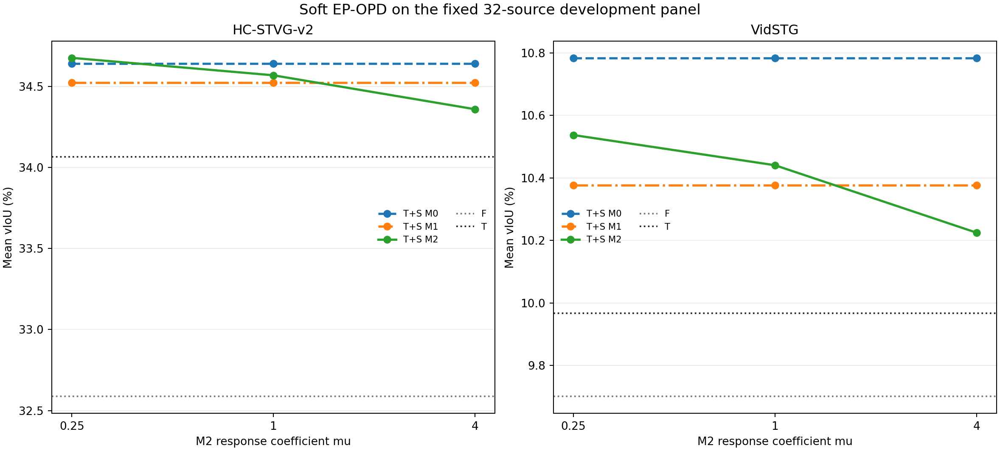
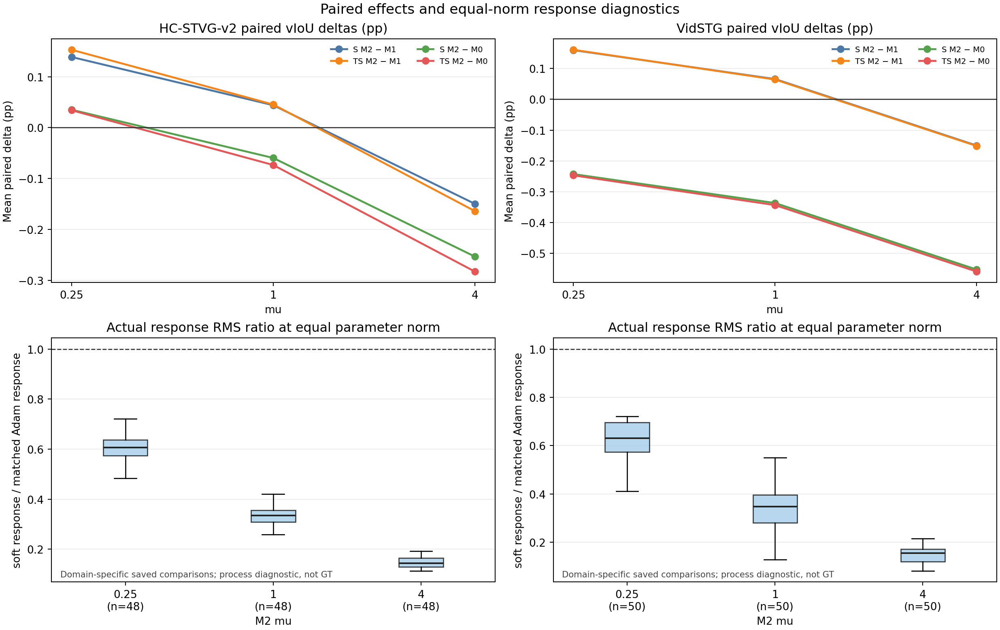

# Soft EP-OPD: three finite 32-source development trials

This report covers the sealed primary `mu=1`, `mu=0.25`, and `mu=4` trials on the same historically exposed 32-source development panel (16 per domain). It is not the separately authorized 128-source search, a clean confirmation result, or a method freeze. The deployed method registry is unchanged.

## Main vIoU means

Values are source means in percent. `S_M*` denotes spatial-only; `TS_M*` denotes the original temporal branch plus the spatial arm. F/T and M0/M1 are fixed across the three `mu` trials; only M2's response coefficient changes.

### HC-STVG-v2

| Arm | mu=1 | mu=0.25 | mu=4 |
|---|---:|---:|---:|
| F | 32.587386 | 32.587386 | 32.587386 |
| T | 34.066991 | 34.066991 | 34.066991 |
| S M0 | 33.117666 | 33.117666 | 33.117666 |
| TS M0 | 34.643557 | 34.643557 | 34.643557 |
| S M1 | 33.014014 | 33.014014 | 33.014014 |
| TS M1 | 34.524684 | 34.524684 | 34.524684 |
| S M2 | 33.058037 | 33.152791 | 32.864273 |
| TS M2 | 34.570115 | 34.677683 | 34.360714 |

### VidSTG

| Arm | mu=1 | mu=0.25 | mu=4 |
|---|---:|---:|---:|
| F | 9.701443 | 9.701443 | 9.701443 |
| T | 9.966696 | 9.966696 | 9.966696 |
| S M0 | 10.515552 | 10.515552 | 10.515552 |
| TS M0 | 10.784159 | 10.784159 | 10.784159 |
| S M1 | 10.113205 | 10.113205 | 10.113205 |
| TS M1 | 10.376598 | 10.376598 | 10.376598 |
| S M2 | 10.178843 | 10.272685 | 9.962962 |
| TS M2 | 10.440765 | 10.537287 | 10.225103 |

## Paired T+S vIoU differences

Differences are in percentage points. Positive/negative/neutral counts are per source; the paired neutral tolerance is `1e-10` pp. Every metric, contrast, sign list, per-source alias delta, and null is retained in the JSON exports.

| Domain | mu | Contrast | Mean delta (pp) | + | − | = | unknown |
|---|---:|---|---:|---:|---:|---:|---:|
| HC | 1 | TS_M2 − TS_M1 | +0.045431 | 5 | 4 | 7 | 0 |
| HC | 1 | TS_M2 − TS_M0 | -0.073442 | 4 | 5 | 7 | 0 |
| Vid | 1 | TS_M2 − TS_M1 | +0.064167 | 5 | 2 | 9 | 0 |
| Vid | 1 | TS_M2 − TS_M0 | -0.343394 | 2 | 5 | 9 | 0 |
| HC | 0.25 | TS_M2 − TS_M1 | +0.153000 | 6 | 3 | 7 | 0 |
| HC | 0.25 | TS_M2 − TS_M0 | +0.034127 | 5 | 4 | 7 | 0 |
| Vid | 0.25 | TS_M2 − TS_M1 | +0.160689 | 6 | 1 | 9 | 0 |
| Vid | 0.25 | TS_M2 − TS_M0 | -0.246872 | 3 | 4 | 9 | 0 |
| HC | 4 | TS_M2 − TS_M1 | -0.163970 | 3 | 6 | 7 | 0 |
| HC | 4 | TS_M2 − TS_M0 | -0.282843 | 3 | 6 | 7 | 0 |
| Vid | 4 | TS_M2 − TS_M1 | -0.151495 | 4 | 3 | 9 | 0 |
| Vid | 4 | TS_M2 − TS_M0 | -0.559056 | 2 | 5 | 9 | 0 |

The full exports contain 768 source-arm rows (256 per trial), 240 summary cells (80 per trial), and 360 paired cells (120 per trial). The five metrics are preserved separately: vIoU, tIoU, dense sIoU, supervised-anchor sIoU, and unsupervised-frame sIoU. Unknown metric values remain null.

## Saved-step and response diagnostics

The independent CPU readback checked 46 fit records and 18 no-fit records per trial. The primary stages recorded 49 total fit invocations: 9 in qualification and 40 in development. Of these, 46 are M1/M2 fits with actual final full-model readouts; three M0 qualification entries are bitwise cached-output replays. Each child reuses 23 M1 fits exactly from primary and performs 23 new M2 fits. Across each trial, the saved record contains 194 proposals, 192 accepted updates, 2 full rollbacks, 36 skips, 98 CG witness steps, and 98 equal-parameter-norm response comparisons. The mean soft-to-matched-Adam output response ratios were:

| mu | mean soft/matched response RMS | steps lower than matched | max CG relative residual |
|---:|---:|---:|---:|
| 1 | 0.3248 | 98/98 | 0.000914616 |
| 0.25 | 0.6055 | 98/98 | 0.00097255 |
| 4 | 0.1764 | 96/98 | 0.000990607 |

## Measured execution work

Counts and stage wall times come from sealed qualification/development barriers. Primary used 49 fit invocations (9 qualification + 40 development), 24 source captures, and 46 actual full-model final readouts; the three remaining M0 qualification records were cached bitwise replays. Each child used 23 new M2 fit invocations and 23 source captures, and reused 23 M1 fit records from primary. The three trials therefore contain 95 fit invocations, 70 source captures, 92 actual full-model final readouts, and 46 child M1 reuse records.

| Trial stage | Fit invocations | Source captures | Actual full-model final readouts | Worker-reported wall (s) |
|---|---:|---:|---:|---:|
| primary qualification | 9 | 4 | 6 | 52.026 |
| primary development | 40 | 20 | 40 | 216.111 |
| mu025 | 23 | 23 | 23 | 187.047 |
| mu4 | 23 | 23 | 23 | 204.674 |
| all three trials | 95 | 70 | 92 | 659.858 |

Teacher/Temporal inference was not repeated in these trials. Those upstream artifacts were reused, so their earlier cost is unknown here and is not zero end-to-end deployment cost. The wall-time table reports sealed worker stage seconds, not complete deployment latency.

Primary finite-difference checks cover three fixed qualification cases at two step sizes (six checks); relative errors span 7.64%–19.58%. The original high-accuracy full-decoder finite-difference qualification remains false. The `mu=0.25` and `mu=4` children add no FD checks.

These are saved-process measurements, not correctness guarantees: a smaller equal-norm response does not establish better GT alignment. The CPU auditor verifies saved arithmetic and solver witnesses; it does not rerun backward or reconstruct the full decoder Jacobian. The earlier 13-scope numerical qualification failure remains unresolved.

## Fixed design and interpretation limits

The trials keep the same 32 historically exposed development cases, parent prediction seal, reference lock, temporal configuration, and domain-specific spatial settings. M2 is the only changed factor (`mu`). Query/Adam reset and the five-step/32-sample settings remain fixed. Scoring is post-seal; GT-derived metrics are not used for adaptation or selecting a best step. No bootstrap was run.

The 32 cases were previously exposed during development, so these results are not blind confirmation evidence. As of this report cut on 2026-10-15, the separately authorized 128-source coordinate search (64 per domain) is still in preparation and is not represented here as a completed result. Its source-capture seal contains 128 cases: 64 new captures and 64 exact reuses. Temporal/teacher preparation has not produced a complete prediction seal or score; an initial environment attempt stopped because `accelerate` was unavailable, not because of GPU memory exhaustion, and the separately recorded continuation remains incomplete. No method is frozen or promoted here; `methods/CURRENT_METHOD.json` is unchanged.

## Figures and machine-readable data

The complete anonymous source-arm rows, all summaries and paired contrasts, saved-step scalar audit, and hash-only source bindings are in `results/stvg_soft_ep_opd/2026-10-15/`. The locked protocol is [here](../protocols/stvg_soft_ep_opd_v1.md).
