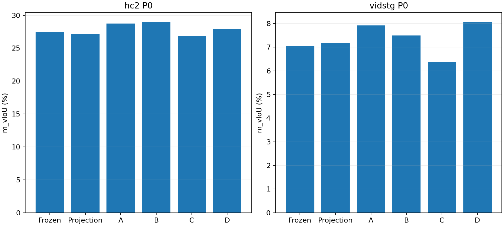

# Visual evidence budget P0: frozen temporal expert

16 prelocked exposed-development parents (HC8, Vid4 questions+4 statements), selected by parent hash before P0 outcomes, excluding the64 confirmation parents. Frozen cross-domain TA-STVG Source geometry/candidate intervals, R1 weights, original query-free description and own-query A/B/C probability prompts,160 output-token cap, and original512-parameter offset-trust L-BFGS/full-grid trust are fixed. No Spatial updates or hyperparameter selection in P0. All four arms16 predictions and exact independent CPU fit replays seal before GT evaluation. No bootstrap or CURRENT promotion.

| Arm | Visual input |
|---|---|
| A | Uniform8 frames,448 square canvas |
| B | Uniform16 frames,320 square canvas |
| C | Uniform32 frames,224 square canvas |
| D | Existing query-conditioned frozen temporal-feature guided uniform8-frame family,448 canvas |

D ranks up to9 uniform-stride families using fixed coverage(.5), feature change(.3) and feature norm(.2), with at least75% candidate-span coverage. Feature norm is not claimed as a calibrated query similarity or Q-Frame reproduction. No additional CLIP/DINO model is loaded; features only select RGB inputs. Original missing candidate hypotheses are not manufactured, short inputs retain actual unique even frame counts, and failed/missing feedback retains its unknown/Native fallback.

## Time encoding qualification and implementation recovery

The installed native Qwen code cast seconds-per-temporal-grid to int before multiplying its time tick rate. Subsecond intervals could therefore collapse to zero. The original CPU-only attempt was stopped before Teacher inference; inputs and locks remain preserved. A separate per-model method copy changes only that dtype to float64 for every arm; weights, installed model source, processor and prompts remain unchanged. Twelve synthetic clock checks preserve integer-second outputs exactly and recover fractional-second arithmetic. Every actual video mRoPE position was checked against floor(grid_index × actual_seconds × 2). Native tick quantization remains. A uses fresh corrected-clock inference, not unqualified reuse of legacy Teacher outputs. D is restricted to uniform families instead of disguising nonuniform timestamps with average FPS.

A second CPU-only reader correction uses the original int(start)/int(end) physical-frame convention for fractional candidate boundaries; no candidate frames or intervals changed. All prepared inputs were reused with exact hashes;0 Teacher GPU reruns were caused by this correction. Original failures are preserved.

## Final Student localization

| Dataset | Arm | m_vIoU (%) | tIoU (%) | Dense sIoU (%) |
|---|---|---:|---:|---:|
| hc2 | Frozen | 27.437458 | 47.146804 | 49.767378 |
| hc2 | Projection | 27.124803 | 51.665920 | 49.767378 |
| hc2 | A | 28.741706 | 54.059845 | 49.767378 |
| hc2 | B | 28.957495 | 54.189601 | 49.767378 |
| hc2 | C | 26.871104 | 51.957507 | 49.767378 |
| hc2 | D | 27.937309 | 52.850326 | 49.767378 |
| vidstg | Frozen | 7.054628 | 28.585514 | 38.733078 |
| vidstg | Projection | 7.171357 | 30.361527 | 38.733078 |
| vidstg | A | 7.915239 | 32.524425 | 38.733078 |
| vidstg | B | 7.501177 | 32.552817 | 38.733078 |
| vidstg | C | 6.366819 | 29.499779 | 38.733078 |
| vidstg | D | 8.061131 | 32.768137 | 38.733078 |

All per-source positive/negative/neutral outcomes, Vid question/statement strata, candidate-pool best tIoU, reward-pair ranking, sampling event hits and actual per-request tokens/grids/latencies/peak memory are exported. Candidate oracle values and event hits are postseal diagnosis only. No labels choose input frames, references or parameters. Improved ranking does not imply better final intervals; this P0 does not establish a new dual-branch result.

The separate sealed-confirmation spatial diagnosis found exact same Temporal/Full intervals, but worse Vid geometry: all10 negative Vid cases had lower mean reference IoU than Source at known exact GT anchors while Teacher agreement improved. This is a different bottleneck from missing temporal observations. Low geometric IoU does not by itself prove incorrect instance identity.

Actual processed video grids and token counts, rather than nominal pixels alone, define the cost comparison. No cold-start full-set runtime prediction is made. Query/caption text, raw Teacher responses, RGB, annotations, weights and tensors stay private. Caption role correctness is not claimed to be comprehensively human-annotated by this automated P0.

[Complete anonymous results, fixed configuration, ranking/coverage/costs and source bindings](../results/stvg_temporal_evidence_budget/2026-10-16/p0_001/)

## Reward ranking and measured cost

| Dataset | Arm | Ranking query-macro (%) | Evaluable queries | Actual visual tokens/candidate | Caption+alignment seconds (sum) |
|---|---|---:|---:|---:|---:|
| hc2 | A | 71.875000 | 8 | [1024] | 33.831 |
| hc2 | B | 48.958333 | 8 | [968] | 25.674 |
| hc2 | C | 55.208333 | 8 | [1024] | 26.816 |
| hc2 | D | 55.208333 | 8 | [1024] | 27.993 |
| vidstg | A | 37.500000 | 6 | [1024] | 28.370 |
| vidstg | B | 52.777778 | 6 | [968] | 24.513 |
| vidstg | C | 54.166667 | 6 | [1024] | 26.249 |
| vidstg | D | 59.722222 | 6 | [1024] | 25.375 |

Candidate tIoU ties have no ordering evidence and are excluded from ranking accuracy, not converted to incorrect pairs. Vid has6 evaluable query rankings out of8; all8 remain in final localization. The unchanged candidate-pool oracle is diagnostic only. No baseline is selected using this table.

B improves HC vIoU over A but harms Vid; C harms both. D improves Vid query-macro ranking from37.5% to59.7222%, but final Vid vIoU improves only0.145891pp while HC loses0.804397pp. C also improves Vid ranking over A while worsening final vIoU. This exposes a ranking-to-update/readout gap; it does not establish a dataset-independent winning visual recipe. Density and spatial resolution change together in B/C, so their effects are not independently identified.

The four arms used one hot model load (10.158s) and244 new caption/alignment pairs (243.938s teacher-worker wall excluding model load). Original61 actual candidates yield244 arm-candidate pairs;12 of256 nominal candidate slots were not instantiated. Three sources have only three candidates and retain Native fallback for adaptation. A/D have31 equal visual arrays and30 different arrays; actual calls are still reported as new, not silently relabelled reuse.

The frozen external expert may carry target-domain prior; overlap-free external pretraining is not established. This exposed16-source P0 cannot predict official full-set performance.

## Per-source limits on the apparent D benefit

D minus A in Vid is1 positive,0 negative and7 neutral sources. The entire0.145891pp average gain comes from one statement-query source (+1.167132pp); all four question-query final outputs are unchanged. D minus A in HC is1 positive,3 negative,4 neutral. B minus A in HC is1 positive,1 negative,6 neutral; B in Vid is0 positive,2 negative,6 neutral. These exposed8-per-domain results do not justify selecting a different recipe per dataset or expanding a supposedly reliable winner.

Matched original OPD also falls below Temporal-only on the separate64-source Vid confirmation (−0.603859pp); the response-guided Lite version falls0.531916pp. Thus reverting only the spatial optimizer to the matched original does not eliminate the observed harm under these same references. This supports prioritizing reference quality while retaining optimization amplification as an unresolved contributor.
