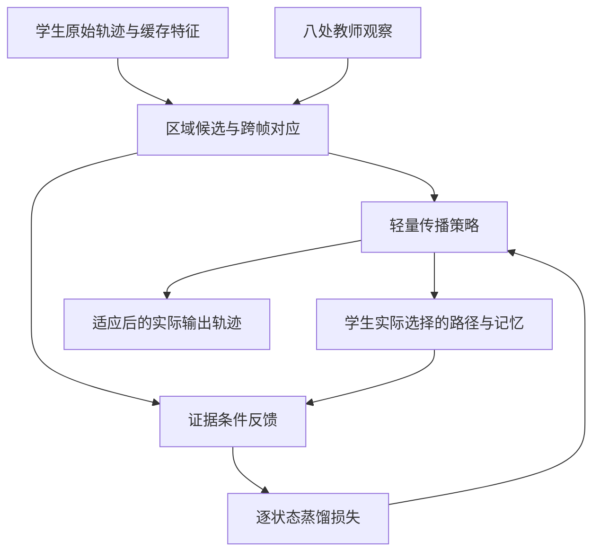

下面把方案固定为一个 **v0 原型**。它的核心是：

> **冻结 STVG 主干，复用八处教师观察和整段视频的缓存特征；在输出侧适应一个轻量传播策略，通过学生自己生成的匹配路径获得逐步反馈，修正未观测帧。**

这是一个新方案，尚无实验结果证明有效。它改变了适应位置：**最终模型是“原 STVG 模型＋可适应的传播头”**，不能把效果写成原 decoder 本身获得了新的定位能力。

还需要明确：**OPD 本身也使用反向传播。这里要研究的区别，是固定路径上的蒸馏与学生自生路径上的蒸馏，而不是“Direct 有梯度、OPD 没梯度”。**

下面依次给出完整的数据流、模块定义、更新方法和验证标准。

---

**首先固定任务范围和计算接口。**这一版只研究空间适应，时间区间沿用现有时间分支的输出，不同时改动时间算法。

| 项目 | v0 的规定 |
|---|---|
| 输入 | 视频、文本、适应前轨迹、现有时间区间 |
| 教师 | 现有 ReferDINO，仅使用已经获得的八处观察 |
| 可用视觉信息 | STVG 学生已有的逐帧特征 |
| 冻结部分 | 编码器、时空 decoder、原始预测头 |
| 适应部分 | 输出侧的小型候选评分头 |
| 输出 | 适应后的单条目标轨迹，时间区间保持不变 |
| 重置方式 | 每条查询重置适应参数和传播记忆 |
| 可见信息 | 按整段视频已可用的视频级 TTA 设计，允许使用前后观察 |

这里的“未观测帧”指学生有视觉特征、但没有调用教师的帧。该方案不会为没有视觉信息的位置创造新证据。

整体关系如下：



**第一步，把稀疏教师证据转换成固定的区域支持与跨帧对应。**这部分优先复用当前证据构建代码，避免同时更换传播器、奖励和优化器。

记：

- \(F_t\)：第 \(t\) 帧的缓存视觉特征；
- \(b_t^0\)：适应前的学生框；
- \(O\)：教师观察位置；
- \(U\)：没有教师观察的位置；
- \(M_o\)：教师区域在特征网格上的表示。若教师只提供框，就使用框区域，不把它称为真实分割掩码。

用归一化特征建立稀疏对应：

\[
A_{t\leftarrow o}(p,q)
=
\operatorname{TopKSoftmax}_{q}
\left(
\frac{F_t(p)^\top F_o(q)}{\tau_F}
\right).
\]

教师区域向目标帧传播：

\[
P_t^{(o)}=A_{t\leftarrow o}M_o.
\]

每帧使用最近的前方、后方有效观察，分别得到 \(P_t^L,P_t^R\)。两者都保留，不能先平均成一个框，因为两处证据可能支持不同区域。

可利用往返匹配的一致程度给每个传播结果赋权：

\[
r_{o,t}
=
\operatorname{Dice}
\left(
M_o,\,
A_{o\leftarrow t}P_t^{(o)}
\right).
\]

这些值是**匹配可靠性的代理指标，不是定位正确率**。视觉相似的错误对象也可能往返一致。

用这些权重形成支持图 \(P_t\)，同时保存各来源的支持图和可靠性。双向分歧可以表现为多个峰值；不应把所有分歧都直接删除。

HTR 提供了“参考帧信息通过跨帧匹配支持其余帧”的文献依据，但它的传播模块经过监督训练；这里复用现有特征进行匹配，效果需要单独验证。[arxiv.org](https://arxiv.org/html/2403.19407v2?utm_source=chatgpt.com)

**第二步，每帧构造最多三个真实可输出的区域候选。**v0 不在整个框空间里随机搜索。

候选集合为：

\[
\mathcal C_t
=
\{b_{t,0},b_{t,1},b_{t,2}\},
\qquad b_{t,0}=b_t^0.
\]

具体规则如下：

1. 始终保留原始学生框。
2. 从前后传播支持图中提取空间上分离的高响应区域，将区域转换为矩形候选。
3. 合并高度重合的候选，最多保留两个替代区域。
4. 在教师观察帧，将教师框作为一个替代候选。
5. 无有效替代区域时，只保留原始框。

一个可复现的起始实现是：对每张支持图采用相对峰值阈值提取连通区域，按支持质量排序，并用区域外接框形成候选。初始阈值和去重阈值必须固定，不能根据测试 GT 调整。

**这一阶段可能成为整个方案的瓶颈。**如果特征网格太粗、支持区域跨越多个对象，生成的候选可能没有定位价值。因此第一项诊断就是候选上限，而不是直接训练 OPD。

为每个候选缓存区域特征：

\[
f_{t,j}
=
\operatorname{Normalize}
\left(
\operatorname{Pool}(F_t,b_{t,j})
\right).
\]

同时缓存相邻帧候选之间的对应分数 \(L_t(i,j)\)。后续循环只访问这些小张量，不重新运行 ROI 特征提取或重网络。

**第三步，定义一个具有真实历史依赖的轻量学生策略。**策略决定当前选择哪个候选，前面的选择会影响后面的目标记忆。

\[
a_t\sim\pi_\phi(\cdot\mid s_t),
\qquad
B=(b_{1,a_1},\ldots,b_{T,a_T}).
\]

因此整条轨迹的分布为：

\[
\pi_\phi(a_{1:T})
=
\prod_t\pi_\phi(a_t\mid s_t).
\]

状态 \(s_t\) 包括：

- 当前帧候选及其缓存特征；
- 上一帧实际选择的候选；
- 当前目标记忆 \(h_t\)。

第一版使用一个共享的线性评分头，避免从零训练复杂跟踪网络。每个候选的输入可以固定为六个标量：

| 特征 | 含义 |
|---|---|
| \(\cos(f_{t,j},h_t)\) | 与累积目标记忆的相似程度 |
| 与上一选择区域的特征相似度 | 短期外观联系 |
| \(L_t(a_{t-1},j)\) | 跨帧区域对应 |
| 与当前原始学生区域的特征相似度 | 原模型提供的参照 |
| 与原始框的几何偏离 | 约束无依据的大幅修正 |
| 是否为原始候选 | 保留原预测的偏置 |

策略写为：

\[
\pi_\phi(j\mid s_t)
=
\operatorname{softmax}_j
\left[
\log\pi_0(j\mid t)+\phi^\top x_{t,j}(s_t)
\right].
\]

其中，\(\phi\) 只有六个可学习权重。

初始化时令 \(\phi=0\)。例如让原始候选的先验概率为 \(0.7\)，其他候选均分剩余概率。这样：

- 初始贪心解码严格返回原始学生轨迹；
- 采样仍有机会访问替代路径；
- 新模块的初始效果不会被误算为适应收益。

目标记忆从有效教师区域的缓存特征初始化，之后根据学生实际选择更新：

\[
h_{t+1}
=
\operatorname{Normalize}
\left[
(1-\omega_t)h_t+\omega_t f_{t,a_t}
\right].
\]

\(\omega_t\) 由固定证据可靠性和所选区域的支持程度控制。证据弱时减少写入，证据无效时不更新记忆。

**不能为了制造 OPD 的优势，故意让错误候选无条件污染记忆。**需要验证的是：采用合理记忆更新后，是否仍存在值得修正的传播偏移。

**第四步，在学生实际访问的状态上构造教师反馈。**教师反馈必须有独立于当前学生选择的依据。

先定义三个可以缓存或低成本计算的量：

- \(u_{t,j}\)：候选受到传播区域支持的程度；
- \(L_t(a_{t-1},j)\)：与上一实际选择的跨帧对应；
- \(G_{t,j}\)：相对原始框的有界几何偏离。

其中 \(u_{t,j}\) 可以沿用现有的范围匹配评分，例如比较框与支持图在横、纵方向上的投影 Dice。这里不再使用教师坐标的 L1＋GIoU 作为主监督。

再加入候选与当前目标记忆的相似度 \(H_t(s_t,j)\)，构造：

\[
r_E(j\mid s_t)
=
u_{t,j}
+\lambda_L L_t(a_{t-1},j)
+\lambda_H H_t(s_t,j)
-\lambda_G G_{t,j}.
\]

归一化得到：

\[
q_E(j\mid s_t)
=
\operatorname{softmax}_j
\left[
r_E(j\mid s_t)/\tau_E
\right].
\]

这里需要遵守三条规则：

- **区域支持是主要依据。**历史相似度只提供补充信息，不能让“延续错误身份”始终得到高分。
- 不因候选与历史不匹配，就把其概率硬置零；需要保留重新识别正确目标的可能。
- \(q_E\) 是根据教师证据构造的条件目标分布，不能写成 ReferDINO 原生输出了完整轨迹概率。

例如，学生已经偏向对象 B，但前后观察仍支持对象 A。只要当前候选中包含 A，独立的区域支持就应有机会使 A 获得更高反馈，而不是继续奖励与 B 的自匹配。

**第五步，OPD 只采样历史状态，当前状态下的候选反馈全部计算。**这是控制成本的关键。

每轮由当前策略生成 \(K\) 条路径，记录实际访问的状态 \(s_t^{(k)}\)。对每个状态，枚举最多三个候选，计算完整的 \(q_E\)。

损失为：

\[
\mathcal L_{\mathrm{dist}}
=
\frac{
\sum_{k,t}c_t
D_{\mathrm{KL}}
\left[
q_E(\cdot\mid s_t^{(k)})
\;\middle\|\;
\pi_\phi(\cdot\mid s_t^{(k)})
\right]
}{
\sum_{k,t}c_t+\epsilon
}.
\]

再加入对初始策略的轻量约束：

\[
\mathcal L
=
\mathcal L_{\mathrm{dist}}
+
\lambda_0
\operatorname{Mean}_{k,t}
D_{\mathrm{KL}}
\left[
\pi_\phi(\cdot\mid s_t^{(k)})
\;\middle\|\;
\pi_0(\cdot\mid t)
\right].
\]

固定采样得到的状态和教师目标，只对 \(\phi\) 求梯度。这属于 on-policy imitation/distillation 的更新方式，不是完整序列期望回报的无偏策略梯度。GKD 也明确采用学生自生序列，并且不通过采样过程反向传播；其散度可以使用 forward KL、reverse KL 或其他形式。[arxiv.org](https://arxiv.org/html/2306.13649v3?utm_source=chatgpt.com)

因此，该版本的成本主要是：

> 生成少量轻量路径 → 批量计算所有状态上的三分类蒸馏损失 → 更新六个权重。

不会为每个动作重新运行 STVG decoder，也不需要通过几十条轨迹的单一总奖励估计全部更新方向。

**第六步，每次更新后，检查更新策略真正生成的轨迹。**最终输出不能用采样过程中得分最高的临时轨迹替代。

每轮更新之后：

1. 用更新后的策略重新贪心解码；
2. 计算这条实际轨迹的固定证据评分；
3. 评分下降就回退参数，并停止本条查询的适应。

检查评分沿用“观察位置支持＋未观察位置支持＋跨帧连接－原轨迹偏离”的结构。观察位置和未观察位置分别归一化，避免某一组仅因数量多而主导评分。

**检查评分不奖励策略自身的记忆一致性。**否则算法可能通过强化错误记忆，让自己的评价更高。

证据无效的帧强制保留原始预测，时间区间之外也保持原预测。低置信度阈值由固定证据决定，所有对照使用相同规则。

这个检查只能确认固定代理目标没有下降，不能保证真实 IoU 提升。

完整执行流程可以写为：

```text
输入：原始轨迹 B0、固定时间区间 I0、缓存特征 F、八处教师观察 E

1. 构建或读取传播支持 P、可靠性 c、跨帧对应 A
2. 为每帧构建候选 C，始终保留原始框
3. 缓存候选特征、区域支持分数和候选间连接分数
4. 初始化评分参数 φ = 0
5. 当前接受轨迹 = B0

重复最多 3 轮：
    a. 当前策略采样 2 条路径，真实执行记忆更新
    b. 在访问到的状态上，计算所有候选的教师分布 qE
    c. 批量计算蒸馏损失与先验约束
    d. 对轻量评分参数执行一次更新
    e. 更新后的策略重新贪心解码
    f. 若固定证据评分下降：
           回退参数并停止
       否则：
           接受新轨迹

输出：I0 与最终接受的轨迹
```

**v0 的预算应先锁定，避免再次膨胀为大规模搜索。**下面数值是原型起点，不是文献证明的最优值。

| 项目 | 起始配置 |
|---|---|
| 每帧候选数 | 最多 3 个，包含原始框 |
| 每轮路径数 | 2 |
| 更新轮数 | 最多 3 |
| 可学习参数 | 6 个共享评分权重 |
| 初始化 | 权重为零，原始候选先验概率 0.7 |
| 优化器 | Adam，学习率 0.1，梯度范数上限 1 |
| 教师分布温度 | 0.2 |
| 初始策略约束权重 | 0.05 |
| 记忆单步写入上限 | 0.2 |
| 反馈权重起点 | 区域支持 1；连接 0.25；记忆 0.1；偏离惩罚 0.1 |
| 更新失败后的处理 | 回退并停止，不追加回溯搜索 |

学习率对应六个有界特征的评分权重，不能照搬到原神经网络参数上。

计算结构可以保证：**适应循环里没有重 decoder 回放。**但候选构建、稀疏匹配和小张量循环仍然需要测时，不能据此承诺具体秒数。报告应同时保留缓存条件下的增量耗时和端到端耗时。

**这个方案为什么可能改善未观测帧，需要通过三个环节解释。**

首先，传播为这些帧提供了独立于原始学生框的候选。其次，前后教师观察为候选提供区域与身份支持。最后，适应后的策略直接决定这些帧输出哪个候选。

OPD 的额外假设是：**学生在传播时会访问固定参考轨迹未充分覆盖的状态，而在这些状态上学习，有助于减少后续错误延续。**

这不是原非自回归 STVG backbone 已经被证实存在的曝光偏差，而是新传播模块中的潜在问题。必须证明这个带记忆模块整体有收益，不能先引入不必要的错误传播，再把修复它作为贡献。

**完整对照必须把“传播收益”“适应收益”和“on-policy 收益”分开。**

| 对照 | 用途 |
|---|---|
| 原始学生 | 判断最终是否真正改善 |
| 直接使用证据解码，不训练策略 | 判断蒸馏是否比直接使用传播结果更有价值 |
| 固定路径 KD | 同一评分头、目标分布与更新预算，固定参考状态，隔离 on-policy 的作用 |
| 同接口的连续松弛 Direct | 使用相同候选、证据和记忆，以软关联计算目标，保留完整可用梯度 |
| 本方案 OPD | 每轮重新访问当前学生生成的状态 |

连续松弛 Direct 的最终评价也必须使用实际解码轨迹，不能拿两个对象之间的平均框作为它的最终输出。

还有一个必须承认的强对照：**如果轨迹评分只有固定的一元区域项和相邻帧二元连接项，有限候选图上可以用动态规划求最优路径。**因此，不能把“OPD 更善于最大化这个固定分数”当作贡献。需要证明它在真实定位质量上优于这种直接解码，或者证明历史状态带来了有用信息。

如果所谓 Direct 也每轮生成同样的学生路径，并在这些状态上使用同样的 KL 更新，那么它已经属于这里的 on-policy 蒸馏，不能再人为拆成两种方法比较。

**验证应先在已有缓存的小集合完成，避免直接重跑大规模实验。**

先做三项诊断：

1. **候选上限。**用 GT 仅做离线评估，计算未观测帧候选中的最佳 IoU。它是宽松上界，不代表策略一定能达到；但如果它都没有改善空间，就停止。
2. **反馈质量。**检查较高教师反馈是否倾向于选择真实 IoU 更好的候选。如果反馈无法区分改善与破坏，增加 OPD 更新没有依据。
3. **历史依赖是否有净收益。**比较带记忆与无记忆的传播。不能只证明 OPD 修好了新模块自己引入的错误。

通过后，再运行上表的轻量对照。保留已有原 Direct 结果作为实用参照，不能把适应接口变化带来的收益全部归给 OPD。

主要评价包括：

- 全体未观测帧的 \(\Delta\mathrm{sIoU}_U\)；
- 观察帧的变化，确认没有明显牺牲锚点定位；
- 未观测帧退化的查询比例；
- 距离最近观察较远的帧是否仍然受益；
- 标准 vIoU，以及每条查询的增量耗时中位数和 P90。

未观测帧指标必须包括没有触发适应、被保守回退的帧，不能只报告算法成功修改的部分。所有 GT 都只进入评估，不进入候选选择、反馈、停止或回退规则。

**这版方案的贡献边界也要预先固定。**

| 可以由设计直接说明的性质 | 必须通过实验才能说明的性质 |
|---|---|
| 重网络不进入适应循环 | 实际延迟达到要求 |
| 使用现有教师观察和学生特征 | 传播证据能够可靠定位未观测帧 |
| 在学生自生状态上进行蒸馏 | 自生状态训练优于固定路径 KD |
| 只需要逐帧特征与框的通用接口 | 在多个 STVG backbone 上有效 |
| 最终输出来自适应后的策略 | 最终质量超过直接传播和强 Direct |

**执行顺序固定为：候选上限与反馈诊断 → 小集合轻量对照 → 验证 on-policy 的独立收益 → 再扩大数据与 backbone。**如果直接传播或同预算 Direct 已经达到相同效果，就不继续增加策略复杂度，也不把已有传播收益包装成 OPD 的必要性。