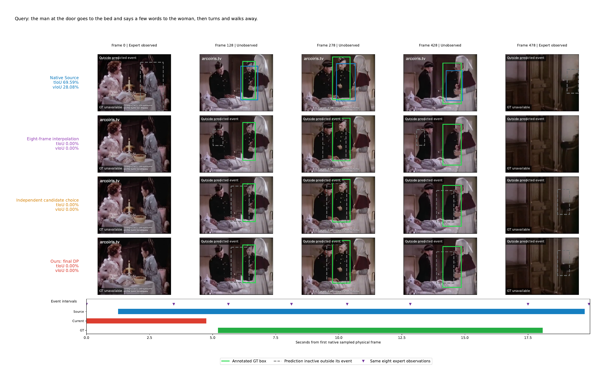
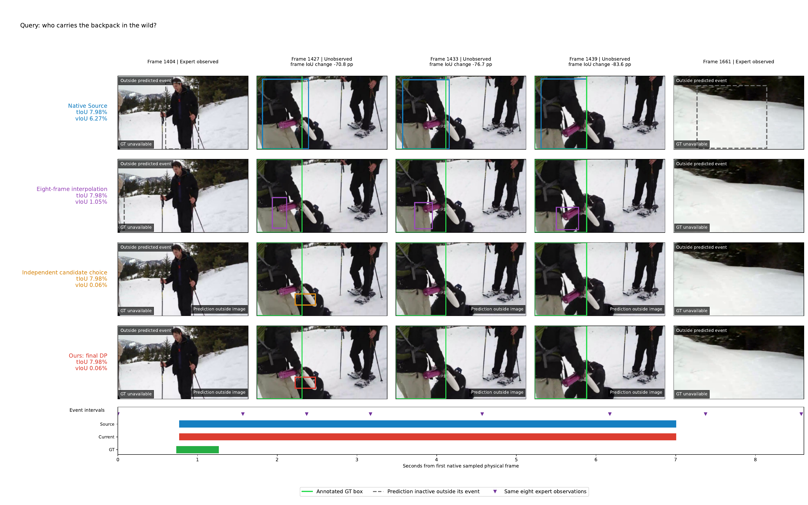
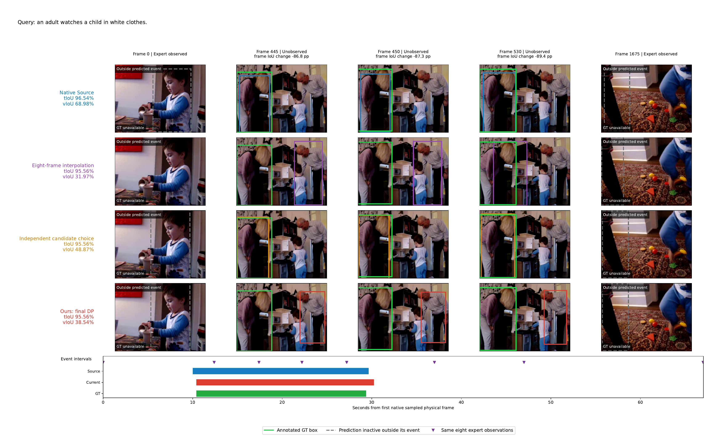
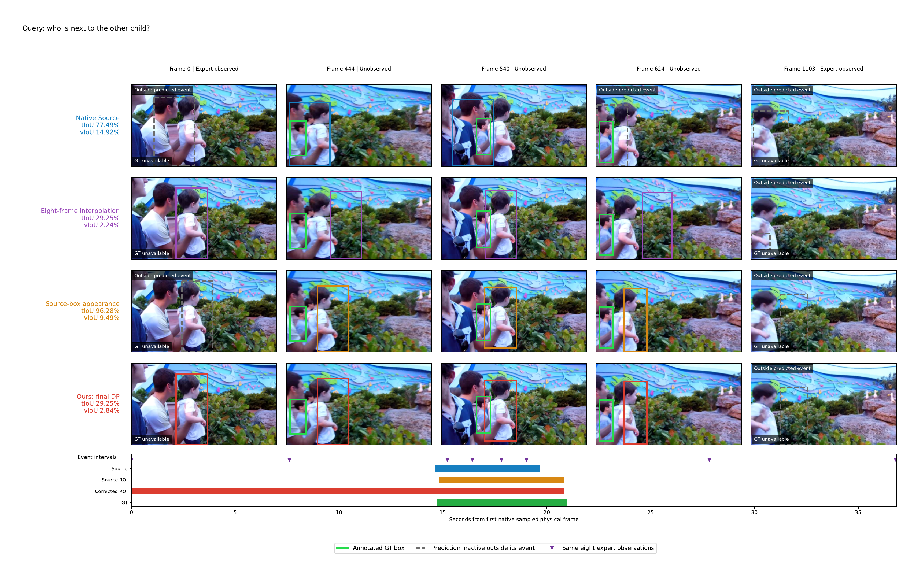

# Failure case visualizations

The user explicitly authorized publishing these four existing inspected failure figures on 2026-10-26. The PNG and PDF bytes are unchanged from the final local display_v3 version, including visible RGB frames, query captions and actual GT overlays. This authorization is limited to these eight files.

These are fixed post-hoc negative extremes from whole-domain, independently scored and audited predictions. They illustrate failure mechanisms; they do not estimate their frequency. Each figure shows five actual sampled frames, two observed and three unobserved positions, eight expert markers, method event timelines, and GT only where supported. Gray dashed boxes are inactive outside the method event. Predictions outside the image are explicitly labeled without clipping or repairing coordinates.

| Case | Failure | PNG | PDF |
|---|---|---|---|
| 1 | Temporal event selected too early | [View](failure_01_temporal.png) | [Download](failure_01_temporal.pdf) |
| 2 | Unobserved spatial trajectory drifts outside the image | [View](failure_02_spatial.png) | [Download](failure_02_spatial.pdf) |
| 3 | Final DP selects another person | [View](failure_03_final_DP.png) | [Download](failure_03_final_DP.pdf) |
| 4 | Corrected-box temporal pooling expands the event too early | [View](failure_04_pooling_ROI.png) | [Download](failure_04_pooling_ROI.pdf) |

Case 1 includes the native-to-joint temporal readout change and does not isolate posterior attribution. Case 2 uses identical Source and current event intervals. Case 3 uses the same interval and candidates for independent and final-DP decoding. Case 4 changes only temporal appearance ROI while preserving the main spatial construction and DP parameters; neither spatial trajectory is claimed fully correct. See the [parent evidence](../README.md) for signed metrics and limitations. No new model inference, expert calls, optimization or official scoring was performed for this upload.

## 1. Temporal event failure

## 2. Spatial trajectory failure

## 3. Final DP failure

## 4. Temporal appearance ROI failure

2026-10-27 display revision: the figure header now contains only Query. Case/dataset titles, header deltas and explanatory notices were removed at the user's request. All below-header image pixels and all original image/geometry operators are exactly preserved. See results/figure_query_only_v1 for the independent edit and inspection receipts; earlier publication_authorization.json documents historical original figure bytes.
