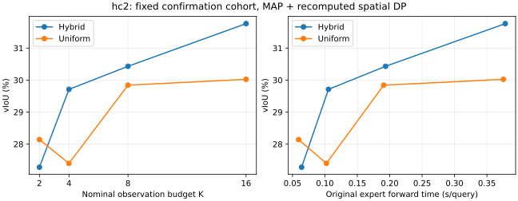

# hc2: complete fixed-cohort current-MAP observation budgets

All original128 fixed queries /128 parents in this direction are present. Eight configurations (Hybrid/Uniform K2/4/8/16) each use their own original jointly acquired expert contexts, geometry, auxiliary trajectories, genuinely repooled native-grid features and q1. Every old corresponding MBR box/interval replays bitwise before current MAP interval and final DP. Hybrid8 reproduces the main MAP arrays for these exact queries. No eight-frame subset impersonates other budgets.

Original native-MAP Source on THIS cohort: 25.124253 vIoU, 46.509478 tIoU. This is not the full-domain mean; do not compare budget subset means directly to the fullset component table.

| Schedule | K | vIoU (%) | R.3 (%) | R.5 (%) | Original expert forward (s/query) |
|---|---:|---:|---:|---:|---:|
| Hybrid | 2 | 27.279322 | 44.531250 | 19.531250 | 0.064057 |
| Uniform | 2 | 28.142200 | 45.312500 | 17.968750 | 0.059465 |
| Hybrid | 4 | 29.711953 | 47.656250 | 23.437500 | 0.105522 |
| Uniform | 4 | 27.398957 | 41.406250 | 18.750000 | 0.102314 |
| Hybrid | 8 | 30.431495 | 46.875000 | 20.312500 | 0.193621 |
| Uniform | 8 | 29.842199 | 50.000000 | 20.312500 | 0.190714 |
| Hybrid | 16 | 31.764163 | 50.781250 | 23.437500 | 0.378321 |
| Uniform | 16 | 30.024778 | 45.312500 | 20.312500 | 0.375483 |

The right-hand curve uses the measured ORIGINAL expert forward costs, not new calls, end-to-end latency or CPU cache speed. Each genuine K context has its own original expert cost; original acquisition is not zero-cost deployment. No new Source/prefix/expert/RGB/GPU/optimizer work was performed in this reconstruction.

## All predefined paired comparisons

| Contrast | v delta (pp) | 95% parent-cluster CI | Improved / harmed / tied | Severe v loss >5pp |
|---|---:|---|---|---:|
| Hybrid2-Source | +2.155069 | [-0.508560, +4.828919] | 69 / 46 / 13 | 24 |
| Uniform2-Source | +3.017947 | [+0.311836, +5.757287] | 77 / 38 / 13 | 22 |
| Hybrid4-Source | +4.587700 | [+2.206610, +7.072464] | 80 / 35 / 13 | 18 |
| Uniform4-Source | +2.274704 | [-0.843572, +5.286300] | 76 / 38 / 14 | 22 |
| Hybrid8-Source | +5.307242 | [+2.696017, +7.980195] | 79 / 36 / 13 | 20 |
| Uniform8-Source | +4.717947 | [+2.234335, +7.197918] | 77 / 38 / 13 | 15 |
| Hybrid16-Source | +6.639910 | [+4.195083, +9.206024] | 81 / 34 / 13 | 15 |
| Uniform16-Source | +4.900525 | [+2.595759, +7.250365] | 77 / 38 / 13 | 18 |
| Hybrid2-Hybrid8 | -3.152173 | [-5.291379, -1.164400] | 48 / 66 / 14 | 33 |
| Hybrid4-Hybrid8 | -0.719542 | [-2.370080, +0.899792] | 47 / 67 / 14 | 22 |
| Hybrid16-Hybrid8 | +1.332668 | [+0.495032, +2.206255] | 70 / 44 / 14 | 6 |

## Severe outcomes relative to original Source

| Arm | Severe t loss >5pp | Severe v loss >5pp | Union counted once |
|---|---:|---:|---:|
| Source | 0 | 0 | 0 |
| Hybrid2 | 17 | 24 | 32 |
| Uniform2 | 17 | 22 | 32 |
| Hybrid4 | 16 | 18 | 27 |
| Uniform4 | 16 | 22 | 30 |
| Hybrid8 | 17 | 20 | 30 |
| Uniform8 | 16 | 15 | 25 |
| Hybrid16 | 17 | 15 | 26 |
| Uniform16 | 16 | 18 | 27 |

## Event duration groups

| Contrast | Short <=5s: v delta / CI | Long >5s: v delta / CI |
|---|---|---|
| Hybrid2-Source | +1.456734 [-2.013602, +4.812439] | +2.496117 [-1.121603, +6.015217] |
| Uniform2-Source | +0.472834 [-3.160001, +3.876202] | +4.260909 [+0.621934, +7.990080] |
| Hybrid4-Source | +2.454065 [-1.204582, +6.043374] | +5.629708 [+2.471930, +8.914714] |
| Uniform4-Source | -0.165644 [-4.731291, +4.117738] | +3.466502 [-0.557194, +7.397435] |
| Hybrid8-Source | +3.299942 [-0.492833, +7.269924] | +6.287551 [+2.905153, +9.809932] |
| Uniform8-Source | +2.470593 [-1.275270, +6.223013] | +5.815491 [+2.684353, +9.051949] |
| Hybrid16-Source | +4.783105 [+1.029470, +8.826452] | +7.546721 [+4.379308, +10.843450] |
| Uniform16-Source | +1.643662 [-2.043226, +5.271062] | +6.491086 [+3.615840, +9.509475] |
| Hybrid2-Hybrid8 | -1.843209 [-4.899446, +1.042721] | -3.791434 [-6.612376, -1.249441] |
| Hybrid4-Hybrid8 | -0.845877 [-2.957344, +1.434958] | -0.657843 [-2.794546, +1.556270] |
| Hybrid16-Hybrid8 | +1.483163 [+0.256277, +2.987155] | +1.259170 [+0.225825, +2.365028] |

Hybrid16 minus Hybrid8 is +1.332668pp [0.495032,2.206255] while expert forward time rises from0.193621 to0.378321s/query. Hybrid4-minus-Hybrid8 CI crosses zero. Uniform means are not monotonic (K4 is belowK2); do not claim every added observation or Hybrid schedule always improves the mean. Parameters and main K8 remain fixed, not retuned from this curve.

## Exact audit and preserved numeric failure

1,152 official dense checks per domain after the entire128-query/domain seal. Post-score256 prediction/receipt SHA checks, all derived arrays replayed exactly and all means recomputed. The root actually ran budget_restore_export_v3.py and visually inspected the generated PNG before publishing the scalar-derived SVG.

The original one-thread HC execution stopped at query68; its67 outputs/failure/source/plan remain untouched. Independent Torch4 numeric restoration passed all67 old MAP arrays/fileSHA and failed-query/Vid repeated exact bridges. Only the original numerical derive uses4Torch threads; affinity still14-15/nice19/idleIO, other stages1thread. Array equality is never relaxed. See [failure and independent protocol](../../README.md).

Actual cached-worker segments: `{"546999:241089476": {"conditional_CPU_wall_seconds": 95.80050340341404, "queries": 67}, "551447:241100660": {"conditional_CPU_wall_seconds": 88.31368014216423, "queries": 61}}`. The67 adopted outputs are charged their actual canonical-recheck worker/time; prior one-thread compute is preserved as separate historical provenance, not added as deployment zero-cost or double-counted in a single query. Query sums exclude outerGC/setup, original source/expert/load and other stages; they are not whole-study or uncached deployment times.

All fixed requested cases, signed positive/negative/tied results, tail counts and old K32/dense failures remain preserved. Parent bootstrap CIs are pointwise, not familywise. All evaluation sets have historical exposure; the old "confirm" cohort name is provenance, not a new independent unseen test.
