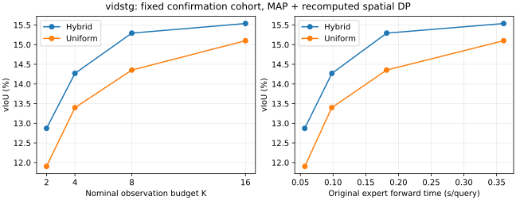

# vidstg: complete fixed-cohort current-MAP observation budgets

All original128 fixed queries /128 parents in this direction are present. Eight configurations (Hybrid/Uniform K2/4/8/16) each use their own original jointly acquired expert contexts, geometry, auxiliary trajectories, genuinely repooled native-grid features and q1. Every old corresponding MBR box/interval replays bitwise before current MAP interval and final DP. Hybrid8 reproduces the main MAP arrays for these exact queries. No eight-frame subset impersonates other budgets.

Original native-MAP Source on THIS cohort: 13.322903 vIoU, 32.121535 tIoU. This is not the full-domain mean; do not compare budget subset means directly to the fullset component table.

| Schedule | K | vIoU (%) | R.3 (%) | R.5 (%) | Original expert forward (s/query) |
|---|---:|---:|---:|---:|---:|
| Hybrid | 2 | 12.870785 | 17.187500 | 7.031250 | 0.056671 |
| Uniform | 2 | 11.902865 | 15.625000 | 7.031250 | 0.056889 |
| Hybrid | 4 | 14.268926 | 17.968750 | 9.375000 | 0.098214 |
| Uniform | 4 | 13.396799 | 17.187500 | 8.593750 | 0.097979 |
| Hybrid | 8 | 15.293220 | 20.312500 | 10.937500 | 0.181962 |
| Uniform | 8 | 14.353086 | 19.531250 | 8.593750 | 0.181769 |
| Hybrid | 16 | 15.537721 | 20.312500 | 10.937500 | 0.360705 |
| Uniform | 16 | 15.100509 | 18.750000 | 9.375000 | 0.360741 |

The right-hand curve uses the measured ORIGINAL expert forward costs, not new calls, end-to-end latency or CPU cache speed. Each genuine K context has its own original expert cost; original acquisition is not zero-cost deployment. No new Source/prefix/expert/RGB/GPU/optimizer work was performed in this reconstruction.

## All predefined paired comparisons

| Contrast | v delta (pp) | 95% parent-cluster CI | Improved / harmed / tied | Severe v loss >5pp |
|---|---:|---|---|---:|
| Hybrid2-Source | -0.452118 | [-2.455957, +1.512851] | 52 / 48 / 28 | 22 |
| Uniform2-Source | -1.420038 | [-3.687736, +0.784326] | 49 / 51 / 28 | 29 |
| Hybrid4-Source | +0.946023 | [-1.094414, +3.034280] | 57 / 42 / 29 | 21 |
| Uniform4-Source | +0.073896 | [-2.119393, +2.287223] | 54 / 47 / 27 | 23 |
| Hybrid8-Source | +1.970317 | [-0.164168, +4.104499] | 65 / 36 / 27 | 19 |
| Uniform8-Source | +1.030183 | [-1.203406, +3.282648] | 63 / 39 / 26 | 22 |
| Hybrid16-Source | +2.214818 | [+0.014577, +4.544952] | 62 / 41 / 25 | 19 |
| Uniform16-Source | +1.777606 | [-0.286329, +3.938785] | 64 / 39 / 25 | 20 |
| Hybrid2-Hybrid8 | -2.422435 | [-3.893720, -1.230340] | 32 / 65 / 31 | 25 |
| Hybrid4-Hybrid8 | -1.024294 | [-2.045652, -0.071512] | 38 / 58 / 32 | 18 |
| Hybrid16-Hybrid8 | +0.244501 | [-0.695980, +1.179199] | 56 / 44 / 28 | 7 |

## Severe outcomes relative to original Source

| Arm | Severe t loss >5pp | Severe v loss >5pp | Union counted once |
|---|---:|---:|---:|
| Source | 0 | 0 | 0 |
| Hybrid2 | 17 | 22 | 31 |
| Uniform2 | 16 | 29 | 34 |
| Hybrid4 | 15 | 21 | 29 |
| Uniform4 | 19 | 23 | 32 |
| Hybrid8 | 20 | 19 | 31 |
| Uniform8 | 18 | 22 | 31 |
| Hybrid16 | 17 | 19 | 29 |
| Uniform16 | 17 | 20 | 29 |

## Event duration groups

| Contrast | Short <=5s: v delta / CI | Long >5s: v delta / CI |
|---|---|---|
| Hybrid2-Source | -1.316966 [-2.720075, +0.022802] | +0.897045 [-3.870835, +5.593397] |
| Uniform2-Source | -1.674988 [-3.349430, -0.064443] | -1.022315 [-6.157540, +4.098685] |
| Hybrid4-Source | -0.288535 [-1.905730, +1.322764] | +2.871933 [-1.836560, +7.592765] |
| Uniform4-Source | -0.982975 [-2.979302, +0.956405] | +1.722616 [-3.079884, +6.605446] |
| Hybrid8-Source | -0.018360 [-1.743402, +1.715548] | +5.072654 [+0.300399, +9.746692] |
| Uniform8-Source | +0.004275 [-1.971493, +2.186884] | +2.630600 [-2.204980, +7.282213] |
| Hybrid16-Source | +0.698162 [-1.250803, +2.823917] | +4.580802 [-0.209985, +9.552639] |
| Uniform16-Source | +0.003401 [-1.727026, +1.764262] | +4.545366 [-0.073497, +9.289674] |
| Hybrid2-Hybrid8 | -1.298606 [-2.322364, -0.372532] | -4.175610 [-7.611799, -1.482805] |
| Hybrid4-Hybrid8 | -0.270174 [-1.196782, +0.627001] | -2.200721 [-4.350347, -0.234157] |
| Hybrid16-Hybrid8 | +0.716522 [-0.292847, +1.886538] | -0.491852 [-2.284641, +1.044205] |

Hybrid16 minus Hybrid8 is +0.244501pp [-0.695980,1.179199], so an improvement from doubling K is not established. Original expert forward rises from0.181962 to0.360705s/query. K2 variants have negative mean differences from this cohort native Source; both full-cohort CIs cross zero, while short-event Uniform2 has a negative CI. Hybrid4-minus-Hybrid8 is -1.024294pp [-2.045652,-0.071512]. Main K8 remains fixed; no results-based change of K or schedule.

## Exact audit and preserved numeric failure

1,152 official dense checks per domain after the entire128-query/domain seal. Post-score256 prediction/receipt SHA checks, all derived arrays replayed exactly and all means recomputed. The root actually ran budget_restore_export_v3.py and visually inspected the generated PNG before publishing the scalar-derived SVG.

The original one-thread HC execution stopped at query68; its67 outputs/failure/source/plan remain untouched. Independent Torch4 numeric restoration passed all67 old MAP arrays/fileSHA and failed-query/Vid repeated exact bridges. Only the original numerical derive uses4Torch threads; affinity still14-15/nice19/idleIO, other stages1thread. Array equality is never relaxed. See [failure and independent protocol](../../README.md).

Actual cached-worker segments: `{"555016:241116414": {"conditional_CPU_wall_seconds": 293.8031661231071, "queries": 128}}`. The67 adopted outputs are charged their actual canonical-recheck worker/time; prior one-thread compute is preserved as separate historical provenance, not added as deployment zero-cost or double-counted in a single query. Query sums exclude outerGC/setup, original source/expert/load and other stages; they are not whole-study or uncached deployment times.

All fixed requested cases, signed positive/negative/tied results, tail counts and old K32/dense failures remain preserved. Parent bootstrap CIs are pointwise, not familywise. All evaluation sets have historical exposure; the old "confirm" cohort name is provenance, not a new independent unseen test.
