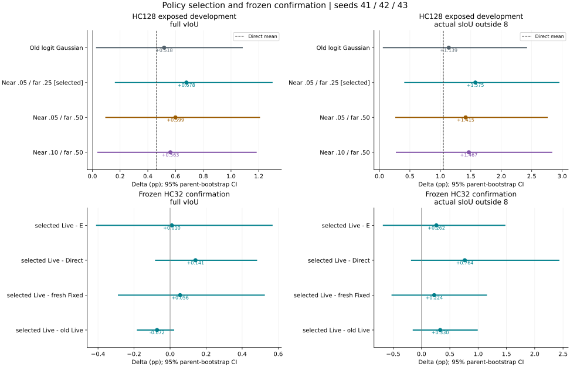

# Target-size-normalized dual-scale output OPD, HC128 development

Only policy coordinates/scales and the consistent TRUE mixture NLL changed. Frozen native ReferDINO selected8 labels, actual frozen spatial decoder, independent8×256 content states, E+finalMBR/physical frames/time/optimizer40steps remain. Seeds41/42/43, all reported. Candidates are output boxes, not decoded latent trajectory samples. Each actual update reruns complete decoder.

Three predeclared (near,far) pairs: (.05,.25),(.05,.5),(.1,.5). Equal mixture in corrected(cx,cy,logw,logh); centers normalized by box(w,h); scale noise multiplicative.8 antithetic pairs per component,32 total. D/actions/teacher feedback stopped; exact logsumexp mixture NLL. No old single-Gaussian KL/control-variate. Thus old/new comparison changes the policy AND its fitting objective; not an isolated proof of wider coverage causality.

Fresh Fixed retains initial mean/size covariance for all40 fresh paired batches. Live uses current actual mean/current detached size covariance. First round samples/feedback/update exact; no fixed-likelihood freezing. Boxes positive-sized but may cross image; no clipping/rejection or unreported truncated density.

All2304 fits and128×19 new outputs sealed before GT. OldE/Direct/Fixed/Live reuse exact pinned prior results, no new baseline fit costs. Three-seed metric means are formed WITHIN parent then bootstrap128 parents,10000 resamples; not384 independent parents or box ensemble. Existing exposure and severe tails retained.

## Final measured judgement

The predeclared development ranking selected **near0.05/far0.25**. This is kept frozen; confirmation was not used to switch to another scale or the old policy. The research structure selection is finished, without production promotion.

HC128 development: selectedLive−E full vIoU +0.678401pp [0.162201,1.300158], outside8 actual sIoU +1.574997pp [0.407723,2.954757]. Relative to oldLive: +0.160732pp [-0.027718,0.472484] / +0.436425pp [-0.016150,1.105983]. Relative to Direct: +0.215706pp [-0.016843,0.550397] / +0.525699pp [0.071236,1.172937]. Relative to new freshFixed: +0.459134pp [0.061434,0.974800] / +1.048222pp [0.132353,2.130550]. Development averages improve, but full-vIoU superiority over oldLive/Direct remains uncertain. RC074 contributes +16.833099pp of new−old; excluding it ONLY as a sensitivity diagnostic leaves the other127 mean +0.029454pp. No exclusion changes the reported128-parent result.

Frozen HC32 confirmation: selectedLive−E full vIoU +0.009622pp [-0.410969,0.569150], outside8 actual sIoU +0.261879pp [-0.683549,1.481530]. SelectedLive−oldLive: −0.072352pp [-0.184114,0.022729] / +0.329681pp [-0.155555,0.993483]. SelectedLive−Direct: +0.140981pp [-0.083535,0.483091] / +0.764104pp [-0.186017,2.435943]. SelectedLive−new freshFixed: +0.055512pp [-0.289710,0.525974] / +0.223830pp [-0.530150,1.155858]. ALL these confirmation intervals cross zero. New−old full-vIoU means are negative in all three confirmation seeds41/42/43 (−0.024254/−0.060890/−0.131913pp). The development policy increment was not confirmed; these results do not establish stable independent OPD benefit over Direct/freshFixed/oldLive.

Complete spatial contribution is measured separately at the SAME frozenMBR time. Development selectedLive−Source +2.425162pp [0.530687,4.328409] full vIoU includes E−Source +1.746761pp [-0.083132,3.585545]. Confirmation selectedLive−Source +3.379444pp [-2.930257,9.051985] includes E−Source +3.369822pp [-3.044336,9.056969]. Thus total-spatial point gains of2–3pp must not be attributed to the new OPD; the confirmation total itself is uncertain. Source_MBR is no spatial adaptation, not the original native-time Source.

All seeds/parents/tails remain. Development selectedLive−E improves80, degrades40, leaves8 unchanged;4 losses exceed3pp and2 exceed5pp (RC067−6.094566, RC036−5.084032). Confirmation improves11, degrades18, leaves3 unchanged; worst RH013−3.117879pp, best RH004+7.113821pp. No output/parent/seed/best-step gates, rescues or new parameter search. Three-seed means are within-parent METRICS, not box ensembles or384/96 independent parents. Confirmation was reserved from these rounds but has earlier project Source/old-method exposure.

The policy change is real: true normalized4D mixture log-density, detached per-round size covariance/actions/targets, geometry-constructed weights, current student means and new candidate batches; no old single-Gaussian analytic KL/control-variate reused. It changes coordinates/exploration and their consistent fitting objective together, so gains cannot be assigned to coverage alone. Fixed retains initial mean/D0 in both proposal and density; Live refreshes mean and detached size context. Their contrast does not separately isolate mean refresh versus covariance-context refresh, and no importance-corrected off-policy claim is made. This is an output-box policy with actual full decoder reruns, not independently decoded candidate trajectories.

New development GPU allocation3223.816253s; frozen confirmation655.595783s; total3879.412036s (64.656867min). New development Source/ReferDINO/DINO calls0; confirmation32 Sourcequeries/64offsetforwards and32 nativeReferDINOqueries/256 imageframes, shared by controls. Actual temporary state updates92160+12800=104960; no pretrained-weight/new-head training. Confirmation mean fit times Direct1.221692s, oldLive1.262329s, selectedFixed1.282313s, selectedLive1.287289s; these are fit timings with existing cached features, not full from-scratch deployment latency. E's prior DINO evidence and prior feature/teacher acquisition are not free.

Both independent saved-artifact audits passed sampling/density/gradient/optimizer/readout/evaluator/bootstrap checks; no claim of a second complete GPU replication. No main/confirmation model run failed or was repeated. The legacy Source-cache preflight used the wrong adjacent-receipt adapter once; it was corrected to verify the original frozen PLAN/global SHA before loading, without model/GT actions or output changes. The main audit's legacy native_chart counter is unused; actual corrected-chart comparison is asserted1e−12 and independently summarized at <=4.44e−16.

Decision: archive the selected(.05,.25) version and all controls as this finite structural comparison. It has NOT established the requested stable large OPD contribution and does not justify replacing the old research baseline or deploying a new default. Do not retune on HC32, switch configurations after its outcome, or automatically start another interface/policy experiment. Original CURRENT/MAIN/PAPER registries remain unchanged.

## Development primary comparisons (pp)

| Comparison | Full vIoU [95%CI] | Outside8 known actual sIoU [95%CI] |
|---|---:|---:|
| Direct_minus_E_MBR | +0.4627 [-0.0453,+1.0433] | +1.0493 [-0.0360,+2.3350] |
| Old_Live_seedmean_minus_E_MBR | +0.5177 [+0.0267,+1.0850] | +1.1386 [+0.0560,+2.4242] |
| N005F025_Live_seedmean_minus_E_MBR | +0.6784 [+0.1622,+1.3002] | +1.5750 [+0.4077,+2.9548] |
| N005F025_Live_seedmean_minus_Old_Live_seedmean | +0.1607 [-0.0277,+0.4725] | +0.4364 [-0.0161,+1.1060] |
| N005F025_Live_seedmean_minus_Direct | +0.2157 [-0.0168,+0.5504] | +0.5257 [+0.0712,+1.1729] |
| N005F025_Live_seedmean_minus_N005F025_Fixed_seedmean | +0.4591 [+0.0614,+0.9748] | +1.0482 [+0.1324,+2.1305] |
| N005F025_Fixed_seedmean_minus_E_MBR | +0.2193 [-0.0190,+0.5204] | +0.5268 [+0.0249,+1.2685] |
| N005F050_Live_seedmean_minus_E_MBR | +0.5994 [+0.0936,+1.2095] | +1.4154 [+0.2603,+2.7631] |
| N005F050_Live_seedmean_minus_Old_Live_seedmean | +0.0817 [-0.1732,+0.4050] | +0.2768 [-0.2378,+0.9326] |
| N005F050_Live_seedmean_minus_Direct | +0.1367 [-0.0813,+0.4473] | +0.3661 [-0.0889,+0.9932] |
| N005F050_Live_seedmean_minus_N005F050_Fixed_seedmean | +0.3779 [+0.0168,+0.8392] | +0.7843 [-0.0131,+1.7495] |
| N005F050_Fixed_seedmean_minus_E_MBR | +0.2215 [+0.0019,+0.5163] | +0.6311 [+0.0945,+1.4147] |
| N010F050_Live_seedmean_minus_E_MBR | +0.5628 [+0.0361,+1.1851] | +1.4675 [+0.2697,+2.8372] |
| N010F050_Live_seedmean_minus_Old_Live_seedmean | +0.0452 [-0.1860,+0.3639] | +0.3289 [-0.1517,+0.9831] |
| N010F050_Live_seedmean_minus_Direct | +0.1001 [-0.1226,+0.4076] | +0.4182 [-0.0262,+1.0504] |
| N010F050_Live_seedmean_minus_N010F050_Fixed_seedmean | +0.2922 [-0.0621,+0.7347] | +0.8831 [+0.0122,+1.8689] |
| N010F050_Fixed_seedmean_minus_E_MBR | +0.2706 [+0.0159,+0.5928] | +0.5843 [+0.0342,+1.4048] |

## Seed 41

| Comparison | Full vIoU [95%CI] | Outside8 known actual sIoU [95%CI] |
|---|---:|---:|
| Direct_minus_E_MBR | +0.4627 [-0.0453,+1.0433] | +1.0493 [-0.0360,+2.3350] |
| Old_Live_41_minus_E_MBR | +0.5581 [+0.0653,+1.1265] | +1.1756 [+0.1082,+2.4588] |
| N005F025_Live_41_minus_E_MBR | +0.6706 [+0.1632,+1.2879] | +1.4624 [+0.3260,+2.8113] |
| N005F025_Live_41_minus_Old_Live_41 | +0.1124 [-0.1038,+0.4050] | +0.2868 [-0.1147,+0.8585] |
| N005F025_Live_41_minus_Direct | +0.2079 [+0.0112,+0.5025] | +0.4131 [+0.0371,+0.9716] |
| N005F025_Live_41_minus_N005F025_Fixed_41 | +0.4472 [+0.0616,+0.9393] | +0.9656 [+0.0889,+2.0122] |
| N005F025_Fixed_41_minus_E_MBR | +0.2233 [-0.0245,+0.5393] | +0.4968 [-0.0136,+1.2330] |
| N005F050_Live_41_minus_E_MBR | +0.6087 [+0.0996,+1.2207] | +1.3274 [+0.1908,+2.6723] |
| N005F050_Live_41_minus_Old_Live_41 | +0.0506 [-0.2027,+0.3566] | +0.1518 [-0.3388,+0.7556] |
| N005F050_Live_41_minus_Direct | +0.1460 [-0.0537,+0.4387] | +0.2781 [-0.1522,+0.8549] |
| N005F050_Live_41_minus_N005F050_Fixed_41 | +0.4077 [+0.0281,+0.8873] | +0.8614 [+0.0037,+1.8909] |
| N005F050_Fixed_41_minus_E_MBR | +0.2011 [-0.0117,+0.4827] | +0.4660 [-0.0164,+1.1801] |
| N010F050_Live_41_minus_E_MBR | +0.6174 [+0.0818,+1.2528] | +1.5385 [+0.3065,+2.9302] |
| N010F050_Live_41_minus_Old_Live_41 | +0.0593 [-0.1880,+0.3966] | +0.3629 [-0.1852,+1.1182] |
| N010F050_Live_41_minus_Direct | +0.1547 [-0.0431,+0.4706] | +0.4892 [-0.0011,+1.1936] |
| N010F050_Live_41_minus_N010F050_Fixed_41 | +0.2851 [-0.0365,+0.6869] | +0.8732 [+0.0032,+1.8820] |
| N010F050_Fixed_41_minus_E_MBR | +0.3323 [+0.0246,+0.7073] | +0.6653 [+0.0504,+1.5195] |

## Seed 42

| Comparison | Full vIoU [95%CI] | Outside8 known actual sIoU [95%CI] |
|---|---:|---:|
| Direct_minus_E_MBR | +0.4627 [-0.0453,+1.0433] | +1.0493 [-0.0360,+2.3350] |
| Old_Live_42_minus_E_MBR | +0.5544 [+0.0190,+1.1604] | +1.1225 [+0.0271,+2.4300] |
| N005F025_Live_42_minus_E_MBR | +0.6339 [+0.1216,+1.2524] | +1.6570 [+0.4427,+3.0541] |
| N005F025_Live_42_minus_Old_Live_42 | +0.0795 [-0.2547,+0.4647] | +0.5345 [-0.0545,+1.3135] |
| N005F025_Live_42_minus_Direct | +0.1712 [-0.0911,+0.5245] | +0.6077 [+0.0720,+1.3444] |
| N005F025_Live_42_minus_N005F025_Fixed_42 | +0.4230 [+0.0206,+0.9411] | +1.1288 [+0.2027,+2.2318] |
| N005F025_Fixed_42_minus_E_MBR | +0.2110 [-0.0275,+0.5064] | +0.5282 [+0.0039,+1.2688] |
| N005F050_Live_42_minus_E_MBR | +0.6462 [+0.1330,+1.2660] | +1.4909 [+0.3282,+2.8556] |
| N005F050_Live_42_minus_Old_Live_42 | +0.0918 [-0.2536,+0.4642] | +0.3684 [-0.2198,+1.0869] |
| N005F050_Live_42_minus_Direct | +0.1835 [-0.0443,+0.5153] | +0.4416 [-0.0308,+1.1092] |
| N005F050_Live_42_minus_N005F050_Fixed_42 | +0.3319 [-0.0000,+0.7689] | +0.6219 [-0.0813,+1.4787] |
| N005F050_Fixed_42_minus_E_MBR | +0.3143 [+0.0299,+0.6883] | +0.8690 [+0.1693,+1.7816] |
| N010F050_Live_42_minus_E_MBR | +0.5766 [+0.0402,+1.1977] | +1.4787 [+0.2926,+2.8274] |
| N010F050_Live_42_minus_Old_Live_42 | +0.0222 [-0.2648,+0.3443] | +0.3562 [-0.1279,+0.9881] |
| N010F050_Live_42_minus_Direct | +0.1139 [-0.0636,+0.3914] | +0.4294 [+0.0113,+1.0134] |
| N010F050_Live_42_minus_N010F050_Fixed_42 | +0.2914 [-0.0803,+0.7624] | +0.8024 [-0.0044,+1.7453] |
| N010F050_Fixed_42_minus_E_MBR | +0.2852 [+0.0195,+0.6175] | +0.6763 [+0.0915,+1.5327] |

## Seed 43

| Comparison | Full vIoU [95%CI] | Outside8 known actual sIoU [95%CI] |
|---|---:|---:|
| Direct_minus_E_MBR | +0.4627 [-0.0453,+1.0433] | +1.0493 [-0.0360,+2.3350] |
| Old_Live_43_minus_E_MBR | +0.4405 [-0.0274,+0.9878] | +1.1176 [+0.0378,+2.4015] |
| N005F025_Live_43_minus_E_MBR | +0.7307 [+0.1652,+1.4113] | +1.6056 [+0.3977,+3.0197] |
| N005F025_Live_43_minus_Old_Live_43 | +0.2903 [+0.0007,+0.7076] | +0.4880 [-0.0379,+1.2146] |
| N005F025_Live_43_minus_Direct | +0.2680 [-0.0328,+0.6897] | +0.5563 [+0.0405,+1.2728] |
| N005F025_Live_43_minus_N005F025_Fixed_43 | +0.5072 [+0.0687,+1.0679] | +1.0503 [+0.1051,+2.1725] |
| N005F025_Fixed_43_minus_E_MBR | +0.2235 [-0.0132,+0.5245] | +0.5553 [+0.0597,+1.3015] |
| N005F050_Live_43_minus_E_MBR | +0.5432 [+0.0317,+1.1547] | +1.4279 [+0.2332,+2.7995] |
| N005F050_Live_43_minus_Old_Live_43 | +0.1027 [-0.0960,+0.4076] | +0.3103 [-0.2525,+1.0361] |
| N005F050_Live_43_minus_Direct | +0.0805 [-0.1947,+0.4139] | +0.3786 [-0.1638,+1.0705] |
| N005F050_Live_43_minus_N005F050_Fixed_43 | +0.3941 [-0.0004,+0.8902] | +0.8696 [-0.0329,+1.9385] |
| N005F050_Fixed_43_minus_E_MBR | +0.1491 [-0.0582,+0.4333] | +0.5583 [+0.0009,+1.3533] |
| N010F050_Live_43_minus_E_MBR | +0.4946 [-0.0441,+1.1192] | +1.3852 [+0.1932,+2.7666] |
| N010F050_Live_43_minus_Old_Live_43 | +0.0541 [-0.1690,+0.3595] | +0.2676 [-0.2039,+0.9079] |
| N010F050_Live_43_minus_Direct | +0.0319 [-0.2909,+0.3771] | +0.3359 [-0.1110,+0.9415] |
| N010F050_Live_43_minus_N010F050_Fixed_43 | +0.3002 [-0.0995,+0.7997] | +0.9738 [+0.0232,+2.0686] |
| N010F050_Fixed_43_minus_E_MBR | +0.1944 [-0.0368,+0.4963] | +0.4114 [-0.1287,+1.2190] |

## Selection, tails and cost

Frozen selected policy: **N005F025**, scales[0.05, 0.25]. Ranking uses full vIoU then outside8 sIoU then measured fit time, as predeclared. Selection is exposed-development tuning, not proof of significance. All configurations and every seed retained. Confirm only this frozen selection, no confirmation-driven switches.

New GPU allocation3223.816s; updates92160; full trajectory decoder94592; offset189184; sampled geometric feedback23592960. New development Source/ReferDINO/DINO calls0. Original caching cost not free. Actual per-fit cost and positive/negative tails below.

{
  "ranking": [
    {
      "policy": "N005F025",
      "full_vIoU": 0.27888703456819275,
      "outside8_sIoU": 0.5181891493259618,
      "mean_fit_seconds": 1.2990947593552846
    },
    {
      "policy": "N005F050",
      "full_vIoU": 0.27809655695153734,
      "outside8_sIoU": 0.5165932973045526,
      "mean_fit_seconds": 1.3235488434511353
    },
    {
      "policy": "N010F050",
      "full_vIoU": 0.2777314568244894,
      "outside8_sIoU": 0.517113861054834,
      "mean_fit_seconds": 1.3419018160778553
    },
    {
      "policy": "Old",
      "full_vIoU": 0.27727971437490717,
      "outside8_sIoU": 0.5138249021529849,
      "mean_fit_seconds": 1.6239456480676988
    }
  ],
  "tails": {
    "Old": {
      "positive": 77,
      "negative": 43,
      "unchanged": 8,
      "below_minus3pp": 4,
      "below_minus5pp": 3,
      "worst5": [
        [
          -8.579918186259539,
          "RC036"
        ],
        [
          -6.645705224450935,
          "RC126"
        ],
        [
          -6.131660061196376,
          "RC067"
        ],
        [
          -3.572573167027465,
          "RC080"
        ],
        [
          -2.482387249893328,
          "RC070"
        ]
      ],
      "best5": [
        [
          7.877887148958584,
          "RC014"
        ],
        [
          8.503499171618303,
          "RC093"
        ],
        [
          10.920318896414777,
          "RC045"
        ],
        [
          15.537130844714348,
          "RC097"
        ],
        [
          22.556713995209872,
          "RC091"
        ]
      ]
    },
    "N005F025": {
      "positive": 80,
      "negative": 40,
      "unchanged": 8,
      "below_minus3pp": 4,
      "below_minus5pp": 2,
      "worst5": [
        [
          -6.094566084672021,
          "RC067"
        ],
        [
          -5.084032436018515,
          "RC036"
        ],
        [
          -4.736438442098706,
          "RC126"
        ],
        [
          -3.326629858097019,
          "RC080"
        ],
        [
          -2.220416332283273,
          "RC070"
        ]
      ],
      "best5": [
        [
          7.469572272450339,
          "RC093"
        ],
        [
          11.173509466267722,
          "RC045"
        ],
        [
          15.545972002124042,
          "RC097"
        ],
        [
          18.074275251030155,
          "RC074"
        ],
        [
          22.38344755435972,
          "RC091"
        ]
      ]
    },
    "N005F050": {
      "positive": 78,
      "negative": 42,
      "unchanged": 8,
      "below_minus3pp": 4,
      "below_minus5pp": 3,
      "worst5": [
        [
          -6.0538795543829345,
          "RC067"
        ],
        [
          -5.907407672447753,
          "RC126"
        ],
        [
          -5.666023200198033,
          "RC036"
        ],
        [
          -3.0994665987880032,
          "RC080"
        ],
        [
          -1.4160563311143681,
          "RC063"
        ]
      ],
      "best5": [
        [
          5.983479279698201,
          "RC084"
        ],
        [
          10.86094714729417,
          "RC045"
        ],
        [
          15.56010196358703,
          "RC097"
        ],
        [
          17.165834849665064,
          "RC074"
        ],
        [
          22.461348571332078,
          "RC091"
        ]
      ]
    },
    "N010F050": {
      "positive": 74,
      "negative": 46,
      "unchanged": 8,
      "below_minus3pp": 4,
      "below_minus5pp": 3,
      "worst5": [
        [
          -9.576211588285787,
          "RC036"
        ],
        [
          -6.739897045594572,
          "RC126"
        ],
        [
          -5.721675682793975,
          "RC067"
        ],
        [
          -3.3394454575791266,
          "RC080"
        ],
        [
          -2.2555215489279967,
          "RC070"
        ]
      ],
      "best5": [
        [
          5.999657478118,
          "RC084"
        ],
        [
          10.978177626966264,
          "RC045"
        ],
        [
          15.555281892152928,
          "RC097"
        ],
        [
          17.29408977627023,
          "RC074"
        ],
        [
          22.517769192371162,
          "RC091"
        ]
      ]
    }
  }
}

Independent saved-artifact audit reconstructs RNG/antithetic actions/current-or-initial covariance, TRUE mixture density via independent torch distributions, geometric weights/mean gradient/Adam, actual full/outside8 metrics and parent bootstrap. It is not a second full GPU rerun. No trained head or pretrained weight updates. No automatic production promotion or further structure search.

## Frozen confirmation completed

Selected policy remainsN005F025. See [reserved32 confirmation](confirmation/REPORT.md). No confirmation-driven parameter switch or structure iteration.

[Complete spatial Source comparison](SOURCE_BASELINE_REPORT.md) · [Frozen confirmation](confirmation/REPORT.md)

