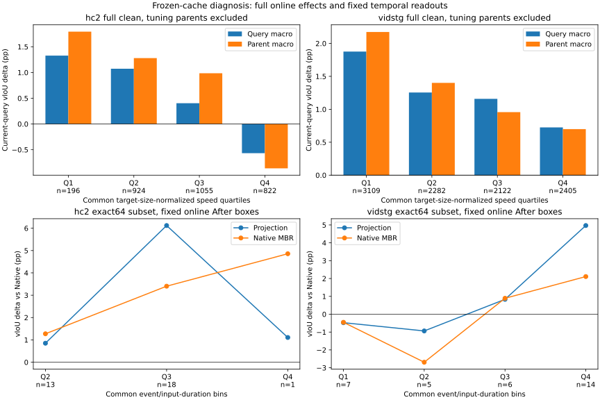

# Full cached evidence stratification and fixed readout controls

Original clean official cohort: HC3482/237 parents and Vid10303/732, three original online orders. Historically exposed, not a fresh confirmation. Full P1 uses Native timing; restored P7-A additionally uses projection. Saved original predictions and metrics are unchanged. No new model/Teacher/parameter fitting in this audit.

## Full online decomposition

Values in percentage points; query macro averages the three locked orders. Parent macro gives each video parent equal weight. Current=After−Before; inherited=Before−Frozen. This arithmetic does not identify a causal transfer mechanism.

| Cohort | Domain | Queries / parents | Total query | Current query | Inherited query | Total parent | Current parent | Inherited parent |
|---|---|---:|---:|---:|---:|---:|---:|---:|
| all | hc2 | 3482 / 237 | +2.566352 | +0.467487 | +2.098865 | +2.438612 | +0.384572 | +2.054040 |
| all | vidstg | 10303 / 732 | +2.967833 | +1.281306 | +1.686527 | +3.311592 | +1.595373 | +1.716220 |
| excluding_tuning_parents | hc2 | 2997 / 205 | +2.532219 | +0.404059 | +2.128160 | +2.408901 | +0.355155 | +2.053747 |
| excluding_tuning_parents | vidstg | 9918 / 700 | +2.984024 | +1.300528 | +1.683495 | +3.328741 | +1.629432 | +1.699308 |

The previously quoted +2.409/+3.329 pp values are parent macro, not official query macro. Query weighting changes these figures; neither is substituted for the other.

## Corrected feature definitions

Event length and start are measured against the actual physical model-input frame-grid span [first,last+1). This may differ from the original full parent-video duration. Annotation coverage is annotated frame count / physical event frame count; input annotation fraction is a separate statistic. HC physical feature support uses metadata start plus bbox count; the legacy evaluator endpoint remains unchanged. Current binding gives complete within-event annotation for every query in both domains: missing-box risk is not observed in this official binding.

Motion uses actual fid gaps / fps. Report image diagonals/sec and center displacement per geometric-mean target box size/sec, using adjacent pair mean target size. This is apparent 2D motion including camera motion, not recovered object velocity. Same pooled query quartile boundaries apply to both datasets; Vid contributes more queries to these boundaries. Constant annotation coverage has coincident boundaries, so its Q4 label means the sole constant group, not a high-versus-low contrast. Lexical relation/sequence markers and parser target category are diagnostic proxies, not verified identities or semantic annotations.

First/repeated is assigned separately within each original order and actual parent; a query may be first in one order and repeated in another, so unique-query counts across these strata need not add to N. Exposure is descriptive, not a randomized intervention.

Public query files contain only bin labels, anonymous identifiers and sealed metrics. Exact per-query GT duration/start/coordinates and raw query text stay private. All strata, sample counts, gross harm thresholds, parent/query means and overall parent-cluster CIs are in the public FULL_hc2.json and FULL_vidstg.json. Per-order signed values remain in CSV; no stratum is used for online selection.

## Fixed temporal decisions on the exact64 cache

Only this cache retains complete logits/actions. Full13785 Source inputs lack them; this is NOT a full-cohort MBR experiment. The same sealed decisions are crossed with Source, inherited Before and actual original online OPD After geometry. Observations, spatial states and parameters do not change. Final outputs preserve the original physical envelope of two offsets; per-offset outputs are also reported. No new history is simulated.

| Domain | Fixed geometry | Readout | vIoU % | tIoU % | Δv Native pp | added annotated frames/query | IoU on added known frames |
|---|---|---|---:|---:|---:|---:|---:|
| hc2 | Frozen | Native | 22.662572 | 43.574672 | +0.000000 | 0.000 | unknown |
| hc2 | Frozen | projection | 26.417434 | 52.823955 | +3.754861 | 34.188 | 52.723 |
| hc2 | Frozen | native_MBR | 26.144050 | 51.378361 | +3.481478 | 28.875 | 53.392 |
| hc2 | Before | Native | 24.194652 | 43.574672 | +0.000000 | 0.000 | unknown |
| hc2 | Before | projection | 28.320968 | 52.823955 | +4.126316 | 34.188 | 56.470 |
| hc2 | Before | native_MBR | 28.074704 | 51.378361 | +3.880052 | 28.875 | 57.789 |
| hc2 | After | Native | 22.500215 | 43.574672 | +0.000000 | 0.000 | unknown |
| hc2 | After | projection | 26.323341 | 52.823955 | +3.823126 | 34.188 | 54.305 |
| hc2 | After | native_MBR | 25.084289 | 51.378361 | +2.584074 | 28.875 | 51.627 |
| vidstg | Frozen | Native | 12.742288 | 34.547397 | -0.000000 | 0.000 | unknown |
| vidstg | Frozen | projection | 14.376637 | 38.454197 | +1.634349 | 39.844 | 37.481 |
| vidstg | Frozen | native_MBR | 13.501398 | 36.390281 | +0.759110 | 27.281 | 46.556 |
| vidstg | Before | Native | 14.513934 | 34.547397 | +0.000000 | 0.000 | unknown |
| vidstg | Before | projection | 16.403621 | 38.454197 | +1.889687 | 39.844 | 41.267 |
| vidstg | Before | native_MBR | 15.379624 | 36.390281 | +0.865690 | 27.281 | 50.493 |
| vidstg | After | Native | 16.861480 | 34.547397 | +0.000000 | 0.000 | unknown |
| vidstg | After | projection | 18.940866 | 38.454197 | +2.079386 | 39.844 | 49.755 |
| vidstg | After | native_MBR | 17.432508 | 36.390281 | +0.571028 | 27.281 | 53.798 |

The public TEMPORAL_hc2.json and TEMPORAL_vidstg.json contain every signed query result, event-length/start common-bin strata, lost/gained annotated support and added support without GT. Added-frame IoU is a macro over queries with known added frames, not zero-filled; coverage counts and unknowns are separate. Fixed geometry means sIoU is invariant to the temporal readout. MBR maximizes expected physical tIoU under the model distribution, not true GT overlap. Projection-length controls from the previous report are diagnostics still using Actionness length; equal per-offset length does not guarantee equal fused-envelope length.

## Exploration-scale audit and prelocked conditional gate

Actual original ONLINE32 rollout upper/lower RMS quartile ratio: 4.833152. Full-cohort exploration scale is a Source-box delta-method PROXY; full original raw step traces were legally retired, not newly lost. Actual32 traces retain real inherited state and steps.

hc2: conditions `{"actual_RMS_contrast_at_least2": true, "full_groups_at_least20parents": false, "high_current_mean_negative": false, "high_unobserved_mean_negative": false, "high_minus_low_negative_all_orders": false}`.

vidstg: conditions `{"actual_RMS_contrast_at_least2": true, "full_groups_at_least20parents": true, "high_current_mean_negative": false, "high_unobserved_mean_negative": false, "high_minus_low_negative_all_orders": false}`.
Primary high/low proxy quartile current-query Δv: +1.259704 / +0.405986 pp; high unobserved GT-frame Δs: +1.962114 pp. Parent/query means and CIs are retained; these means do not condition on successful updates.

**Gate not passed: no target-relative-coordinate OPD was fitted.** Scale imbalance alone is insufficient to establish damage. The prelocked required conjunction did not hold. This stops this conditional branch, not all coordinate-normalized policies. Do not interpret domain/small-object correlations as causal evidence or replace the positive original full online result.

Flat reward, ESS, actual perturbation IoU/log-size, per-round reward-up/unobserved-actual-decoder-down and current-query effects are retained in the public SPATIAL_hc2.json and SPATIAL_vidstg.json. Per-round conflicts are intermediate path diagnostics, not final failures. Full strata do not recover retired raw samples; Source proxies are not mislabeled as actual inherited trajectories.

No production registry promotion, new Actionness-free official claim, critic, diffusion, Qwen, semantic identity label, parameter sweep or official full restart. GT is used only offline. Existing negative/positive results remain unchanged.

CPU reader recovery retained three interface fixes: the existing receipt filename suffix, accepting the sealed NumPy array type, and converting cxcywh to the stored float64 xyxy chart for exact comparison. Original failures and pre-fix implementations remain in private recovery. No predictions, Student steps, scientific parameters or sealed metrics were changed; no model calls were added.

