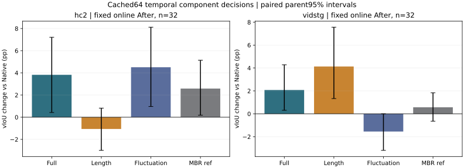

# Exact cached64 projection length and fluctuation decomposition

Same exposed32 parent queries/domain. Original Native time, same cached two offsets and original physical envelope. Fixed geometry is crossed with each temporal readout: **After is primary**, Source and inherited Before are conditional attribution controls. CPU-only, no new model/expert/Student fitting, training or new online stream.

## Observed domain pattern

At fixed original online After geometry, HC fluctuation-only gains +4.508774pp vIoU versus Native, while length-only is −1.062619pp with a CI crossing zero. Vid length-only gains +4.130964pp, while fluctuation-only is −1.549118pp. Full projection gains +3.823126/+2.079386pp in HC/Vid. These are different conditional mechanisms across two exposed32-parent panels, not support for one universal length-only or fluctuation-only story. Full−length is positive in HC and negative in Vid; full−fluctuation is uncertain in HC and positive in Vid. No GT-dependent domain-specific readout is registered.

The weighted mean bar_u is negative at35/64 HC offsets and25/64 Vid offsets; its offset mean is −.100250/+.611195. Thus the constant-actionness length term can favor contraction as well as expansion. HC predicted/physical-GT duration ratios are .768713 Native,1.142432 Full,.633216 Length and1.221253 Fluctuation; Vid ratios are1.909904,2.177557,2.298963,2.091747. Ratio-of-length means do not alone determine temporal IoU. Full extension adds34.188/39.844 known frames/query, with After IoU54.305%/49.755% on known added support and31.625/20.250 added unknown frames/query. Unknown temporal support is not a measured background label.

DECOMPOSITION_DIAGNOSTICS.json retains every pair of exact interval-agreement counts, weighted means and the measured difference between weighted cell mass and endpoint duration fractions. Across all arms/offsets the maximum absolute mass-versus-endpoint fraction difference is .030928 HC and .100917 Vid. This is a unit/readout distinction, not a numerical approximation error.

## Algebra and decision rules

For the original standardized actionness u and normalized physical-cell weights omega, bar_u=sum omega*u. Every legal sampled-index interval I has L=bar_u*sum_I omega and F=sum_I omega*(u-bar_u). Original score is C + lambda*lp0 + L + F, where C=sum omega*logsigmoid(-u) is candidate-independent and lambda=.1. Each direct sliced-sum enumeration agrees with the original score and prefix decomposition (maximum error 3.552713678800501e-15). Original full projection uses the original implementation and target exactly; Native preserves its original float32 MAP/ties. Component decisions use original float64 legal indices s<e and first argmax. MBR is copied from old sealed decisions, with no algorithm rerun.

Omega interval mass uses Voronoi midpoint cells; physical output duration uses [fid_s,fid_e+1). They differ, including at endpoint cells. Removing the zero-mean fluctuation removes location-varying actionness but retains the Native prior; removing L preserves that prior and centered fluctuations. bar_u may be negative: length pressure is not assumed always expansive.

## Complete fused readout metrics

All metric columns are percentages. R03/R05 use strict vIoU>.3/>.5. sIoU is measured on all known GT frames and is invariant to temporal-only decisions.

| Domain | Fixed geometry | Readout | vIoU | tIoU | sIoU | R03 | R05 |
|---|---|---|---:|---:|---:|---:|---:|
| hc2 | Source | Native | 22.662572 | 43.574672 | 47.542166 | 31.250000 | 12.500000 |
| hc2 | Source | full_projection | 26.417434 | 52.823955 | 47.542166 | 40.625000 | 15.625000 |
| hc2 | Source | length_only | 20.334822 | 37.353289 | 47.542166 | 21.875000 | 9.375000 |
| hc2 | Source | fluctuation_only | 27.268974 | 53.942779 | 47.542166 | 43.750000 | 15.625000 |
| hc2 | Source | native_MBR | 26.144050 | 51.378361 | 47.542166 | 34.375000 | 12.500000 |
| hc2 | Before | Native | 24.194652 | 43.574672 | 51.003017 | 31.250000 | 15.625000 |
| hc2 | Before | full_projection | 28.320968 | 52.823955 | 51.003017 | 46.875000 | 15.625000 |
| hc2 | Before | length_only | 21.725628 | 37.353289 | 51.003017 | 31.250000 | 9.375000 |
| hc2 | Before | fluctuation_only | 29.233207 | 53.942779 | 51.003017 | 50.000000 | 18.750000 |
| hc2 | Before | native_MBR | 28.074704 | 51.378361 | 51.003017 | 43.750000 | 12.500000 |
| hc2 | After | Native | 22.500215 | 43.574672 | 47.426518 | 31.250000 | 9.375000 |
| hc2 | After | full_projection | 26.323341 | 52.823955 | 47.426518 | 43.750000 | 9.375000 |
| hc2 | After | length_only | 21.437597 | 37.353289 | 47.426518 | 31.250000 | 9.375000 |
| hc2 | After | fluctuation_only | 27.008989 | 53.942779 | 47.426518 | 43.750000 | 12.500000 |
| hc2 | After | native_MBR | 25.084289 | 51.378361 | 47.426518 | 40.625000 | 12.500000 |
| vidstg | Source | Native | 12.742288 | 34.547397 | 35.515403 | 15.625000 | 3.125000 |
| vidstg | Source | full_projection | 14.376637 | 38.454197 | 35.515403 | 15.625000 | 3.125000 |
| vidstg | Source | length_only | 15.644074 | 41.182874 | 35.515403 | 18.750000 | 6.250000 |
| vidstg | Source | fluctuation_only | 11.283002 | 32.274396 | 35.515403 | 6.250000 | 0.000000 |
| vidstg | Source | native_MBR | 13.501398 | 36.390281 | 35.515403 | 15.625000 | 3.125000 |
| vidstg | Before | Native | 14.513934 | 34.547397 | 40.289765 | 21.875000 | 3.125000 |
| vidstg | Before | full_projection | 16.403621 | 38.454197 | 40.289765 | 28.125000 | 6.250000 |
| vidstg | Before | length_only | 17.691100 | 41.182874 | 40.289765 | 25.000000 | 6.250000 |
| vidstg | Before | fluctuation_only | 13.124841 | 32.274396 | 40.289765 | 15.625000 | 0.000000 |
| vidstg | Before | native_MBR | 15.379624 | 36.390281 | 40.289765 | 21.875000 | 9.375000 |
| vidstg | After | Native | 16.861480 | 34.547397 | 48.513145 | 21.875000 | 9.375000 |
| vidstg | After | full_projection | 18.940866 | 38.454197 | 48.513145 | 25.000000 | 9.375000 |
| vidstg | After | length_only | 20.992443 | 41.182874 | 48.513145 | 25.000000 | 15.625000 |
| vidstg | After | fluctuation_only | 15.312362 | 32.274396 | 48.513145 | 18.750000 | 0.000000 |
| vidstg | After | native_MBR | 17.432508 | 36.390281 | 48.513145 | 21.875000 | 9.375000 |

## Primary After paired parent intervals

Differences in percentage points. Parent bootstrap10000 fixed draws; every parent/query remains, positive/negative/neutral are counted before aggregation. Intervals are descriptive on historically exposed sources and multiple contrasts, not a new independent confirmation.

| Domain | Contrast | Δv pp [CI95] | Δt pp [CI95] | Positive / negative / neutral parents (v) |
|---|---|---:|---:|---:|
| hc2 | full_projection__minus__Native | +3.823126 [+0.425929, +7.208339] | +9.249282 [+3.470188, +14.893453] | 20/8/4 |
| hc2 | length_only__minus__Native | -1.062619 [-2.992751, +0.817542] | -6.221384 [-11.594563, -1.522537] | 8/12/12 |
| hc2 | fluctuation_only__minus__Native | +4.508774 [+0.964481, +8.115625] | +10.368107 [+4.124499, +16.437743] | 18/10/4 |
| hc2 | native_MBR__minus__Native | +2.584074 [+0.183839, +5.142660] | +7.803688 [+3.209490, +12.587788] | 17/10/5 |
| hc2 | full_projection__minus__length_only | +4.885745 [+1.236731, +8.493422] | +15.470666 [+8.751719, +22.048887] | 19/9/4 |
| hc2 | full_projection__minus__fluctuation_only | -0.685648 [-2.035909, +0.341123] | -1.118825 [-4.097933, +1.541223] | 7/7/18 |
| hc2 | length_only__minus__fluctuation_only | -5.571393 [-9.124773, -1.998235] | -16.589491 [-23.068451, -10.142904] | 8/19/5 |
| vidstg | full_projection__minus__Native | +2.079386 [+0.310142, +4.284069] | +3.906801 [+0.821737, +7.375168] | 13/5/14 |
| vidstg | length_only__minus__Native | +4.130964 [+1.330746, +7.560284] | +6.635477 [+2.142566, +11.539473] | 16/5/11 |
| vidstg | fluctuation_only__minus__Native | -1.549118 [-3.193486, -0.001165] | -2.273001 [-5.474589, +1.265873] | 8/14/10 |
| vidstg | native_MBR__minus__Native | +0.571028 [-0.649267, +1.838636] | +1.842884 [-0.293533, +4.431303] | 13/8/11 |
| vidstg | full_projection__minus__length_only | -2.051578 [-4.171317, -0.108466] | -2.728677 [-6.254696, +0.613741] | 8/14/10 |
| vidstg | full_projection__minus__fluctuation_only | +3.628504 [+1.383072, +6.419834] | +6.179801 [+2.658376, +10.379577] | 15/4/13 |
| vidstg | length_only__minus__fluctuation_only | +5.680082 [+2.080277, +9.779126] | +8.908478 [+3.040521, +15.265297] | 16/8/8 |

These changes are separate argmax decisions. Full−Native is not the sum of (length-only−Native) and (fluctuation-only−Native); the discrete argmax and fused-envelope operation are nonlinear. Full−one-component is conditional evidence at the same prior, not a causal percentage or a decomposition of task gain. No component winner is selected for deployment.

## Event strata and expansion support

Event-length/start bins reuse the full13785 pooled boundaries after all readouts are sealed; they are GT-derived offline descriptions, not online routing. Ratios below use corrected physical GT event duration; legacy metric endpoints remain unchanged. Exact per-query GT durations and ratios are private; public rows retain only ratio bins, signed metrics and known/unknown support counts.

| Domain | Readout (After fused) | Pred / physical-GT duration | Pred / metric-span duration | Added known frames/query | IoU on added-known support | Queries with known additions | Added unknown frames/query |
|---|---|---:|---:|---:|---:|---:|---:|
| hc2 | Native | 0.768713 | 0.773873 | 0.000 | unknown | 0 | 0.000 |
| hc2 | full_projection | 1.142432 | 1.150418 | 34.188 | 54.305% | 24 | 31.625 |
| hc2 | length_only | 0.633216 | 0.637854 | 3.031 | 74.301% | 7 | 3.438 |
| hc2 | fluctuation_only | 1.221253 | 1.229648 | 42.344 | 52.130% | 25 | 40.094 |
| hc2 | native_MBR | 1.053298 | 1.060450 | 28.875 | 51.627% | 22 | 23.812 |
| vidstg | Native | 1.909904 | 1.909904 | 0.000 | unknown | 0 | 0.000 |
| vidstg | full_projection | 2.177557 | 2.177557 | 39.844 | 49.755% | 14 | 20.250 |
| vidstg | length_only | 2.298963 | 2.298963 | 50.094 | 54.416% | 15 | 40.500 |
| vidstg | fluctuation_only | 2.091747 | 2.091747 | 27.312 | 43.060% | 8 | 21.000 |
| vidstg | native_MBR | 1.986556 | 1.986556 | 27.281 | 53.798% | 12 | 9.375 |

Added-frame IoU averages queries that actually have known added frames; missing additions are unknown, not zero-filled. Counts and lost-frame IoU/unknowns remain in every domain result. Temporal expansion may include missing/unannotated support; no GT geometry is invented there.

| Domain | Offline stratum | Bin | Queries / parents | Native v | Full v | Length v | Fluctuation v |
|---|---|---|---:|---:|---:|---:|---:|
| hc2 | event_length_bin | Q2 | 13/13 | 31.810705 | 32.661864 | 32.637936 | 33.872473 |
| hc2 | event_length_bin | Q3 | 18/18 | 17.025984 | 23.146386 | 14.539440 | 23.408472 |
| hc2 | event_length_bin | Q4 | 1/1 | 0.000000 | 1.107738 | 0.000000 | 2.593005 |
| hc2 | event_start_bin | Q2 | 7/7 | 25.503367 | 32.888040 | 27.323182 | 36.126992 |
| hc2 | event_start_bin | Q3 | 16/16 | 18.929974 | 21.748695 | 16.660326 | 22.248114 |
| hc2 | event_start_bin | Q4 | 9/9 | 26.511526 | 29.350169 | 25.352845 | 28.380988 |
| vidstg | event_length_bin | Q1 | 7/7 | 7.313434 | 6.838358 | 7.814196 | 6.519053 |
| vidstg | event_length_bin | Q2 | 5/5 | 8.495234 | 7.558541 | 9.278042 | 7.296763 |
| vidstg | event_length_bin | Q3 | 6/6 | 20.511093 | 21.344935 | 20.622639 | 17.855573 |
| vidstg | event_length_bin | Q4 | 14/14 | 23.059328 | 28.026920 | 31.923770 | 21.481782 |
| vidstg | event_start_bin | Q1 | 14/14 | 19.574157 | 23.131507 | 26.381090 | 19.086779 |
| vidstg | event_start_bin | Q2 | 7/7 | 18.667902 | 21.272903 | 24.446584 | 13.413758 |
| vidstg | event_start_bin | Q3 | 5/5 | 20.602229 | 20.880609 | 19.392860 | 20.216547 |
| vidstg | event_start_bin | Q4 | 6/6 | 5.307117 | 4.825540 | 5.722090 | 4.633606 |

Full per-offset and fused metrics, Source/Before/After, every signed per-query effect, parent means and bootstrap intervals, R03/R05, bins, unknowns and legacy MBR are in RESULTS_hc2.json and RESULTS_vidstg.json. The original official span semantics and clipping are reused, independently checked against DenseTube. Original Native/projection/MBR metrics match the prior temporal64 audit exactly.

## Scope and limitations

This is a four-readout zero-parameter diagnostic on64 exposed cached queries, not full13785 MBR or new temporal learning. The actionness source, standardization, Native prior and spatial states are unchanged; any common calibration issue remains. Fixed geometry has not been recomputed after changing time. Length-only still uses actionness-derived bar_u and is not Actionness-free. Fluctuations are not certified semantic event evidence. No training, parameter sweep, GT-based choice, new images/semantic labels, production change or automatic follow-up is authorized. All existing positive, negative and unknown findings remain.

