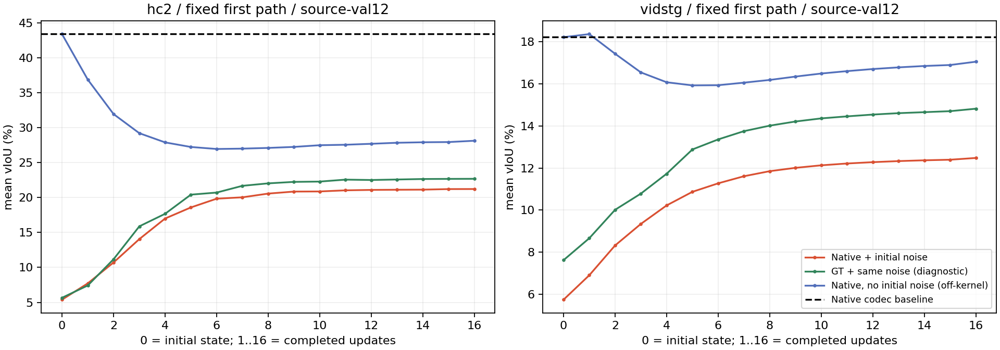

# Why Native-start inference loses despite passing local denoising checks

Frozen HC epoch30 / Vid epoch20, source-val12 each, same cached conditions and original four CUDA seeds. No training, observation guidance, target inference, Teacher/Student calls or method selection. Source GT controls are diagnostics; this source subset is not proven unseen to pretrained Student.

## Ordered first-path accounting

vIoU percent. Native codec accounts for representation readout separately from raw Source. Changes telescope but are not unique causal percentages.

| State | HC | VidSTG |
|---|---:|---:|
| Native_codec | 43.367793 | 18.224082 |
| Native_noisy_initial | 5.387928 | 5.738585 |
| first_clean | 13.842588 | 11.448650 |
| first_proposal | 7.724535 | 6.902728 |
| final | 21.212924 | 12.479204 |
| no_initial_first_clean | 16.311831 | 11.709772 |
| no_initial_final | 28.117194 | 17.056832 |
| GT_codec | 95.994028 | 88.828049 |
| GT_noisy_initial | 5.663483 | 7.619159 |
| GT_first_clean | 13.709876 | 14.208156 |
| GT_final | 22.675527 | 14.821899 |

## Ordered contributions, percentage points

| Diagnostic change | HC | VidSTG |
|---|---:|---:|
| initial_noise | -37.979865 | -12.485497 |
| one_step_denoiser | +8.454660 | +5.710065 |
| multistep_minus_first_clean | +7.370336 | +1.030554 |
| final_minus_Native | -22.154869 | -5.744878 |
| final_minus_noisy_initial | +15.824996 | +6.740619 |
| remove_initial_noise | +6.904270 | +4.577628 |

## Matched one-step probes

The epsilon is matched between GT and Native at each raw sigma; it is the original CUDA warm-start epsilon, not the separate old CPU low-noise probe. These do not replace the prior qualification results.

| Domain | sigma | GT input/output vIoU | Native input/output vIoU |
|---|---:|---:|---:|
| hc2 | 0.030000 | 89.386741 / 88.808320 | 42.727036 / 43.205104 |
| hc2 | 0.212950 | 55.136584 / 58.571456 | 34.660580 / 39.710401 |
| hc2 | 2.000000 | 5.663483 / 13.709876 | 5.387928 / 13.842588 |
| vidstg | 0.030000 | 78.742427 / 79.707935 | 18.180589 / 18.260233 |
| vidstg | 0.212950 | 48.420199 / 48.493011 | 16.895454 / 17.822606 |
| vidstg | 2.000000 | 7.619159 / 14.208156 | 5.738585 / 11.448650 |

## Measured findings

The biggest loss is introduced before the denoiser: sigma2 destroys much of the existing Native prediction. The learned denoiser then recovers only part of it. Full16-step vIoU is above the one-clean readout in both first-path and all-path means, so this is not evidence that recursive updates universally decrease vIoU. Time and raw-state MSE can still worsen; all metrics remain in RESULTS.

The large-noise recovery problem is not specific to Native bias: even paired GT-centered initialization ends far below its original clean GT codec readout. The prior low/medium qualification did not establish accurate sigma2 reconstruction. Removing initialization noise helps, but same-schedule inference still degrades Native; dropping noise alone does not establish a valid solution.

At the last level, actual-path raw GT state loss divided by sigma squared is reported as a descriptive residual/noise comparison, NOT a calibrated OOD probability. A small declared sigma does not mean the current state is near GT. Low-noise identity preconditioning can preserve an already wrong state.

These ordered changes do not identify independent causal shares. The counterfactual uses the same fixed network and sigma schedule and is off the training perturbation law. Neither a new checkpoint nor a new sampler is selected.

## Interpretation boundaries

GT+Gaussian denoising and Native+Gaussian restoration are different input populations: Native includes structured temporal/object/geometry error before random noise is added. Same sigma is not the same distance from clean GT. Local near-GT preservation cannot certify recovery from that bias. Low-noise skip preconditioning preserves incorrect states too; report actual late-path error alongside sigma.

Removing initial noise while retaining the sigma2 schedule is an intentionally off-kernel counterfactual, not calibrated sampling and not a newly selected method. The idealized GT-centered rollout is source-GT-assisted and cannot be deployed. Full-path versus first-clean compares two fixed readouts from the same initial state, not equal-compute methods. No GT-best intermediate step is selected online.

The implemented update is algebraically a VE Euler step; no update-sign bug was found. This diagnosis does not isolate higher-order integration error from learned vector-field error, nor establish a new sampler or authorize new training. [Official EDM Euler/Heun sampler](https://github.com/NVlabs/edm/blob/main/generate.py).

## Evidence and cost

See RESULTS.json for both first-path and all-path means, time/spatial/state errors, all per-source stage/probe scalars and first/mean curves. All four detailed state paths are sealed privately. Old terminal states reproduced; official and DenseTube scorers agree. Frozen replay GPU lease: 2.667372 seconds; cumulative with prior repair 36.608555 seconds under original14400s cap. Cached-feature diagnostic cost, not online end-to-end latency.

