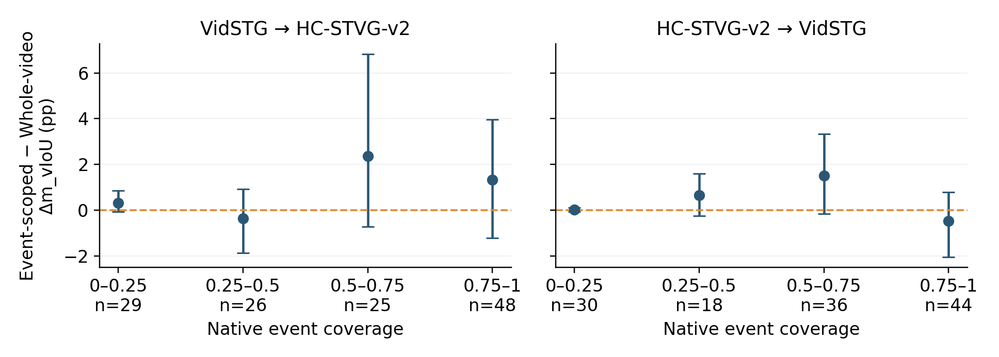
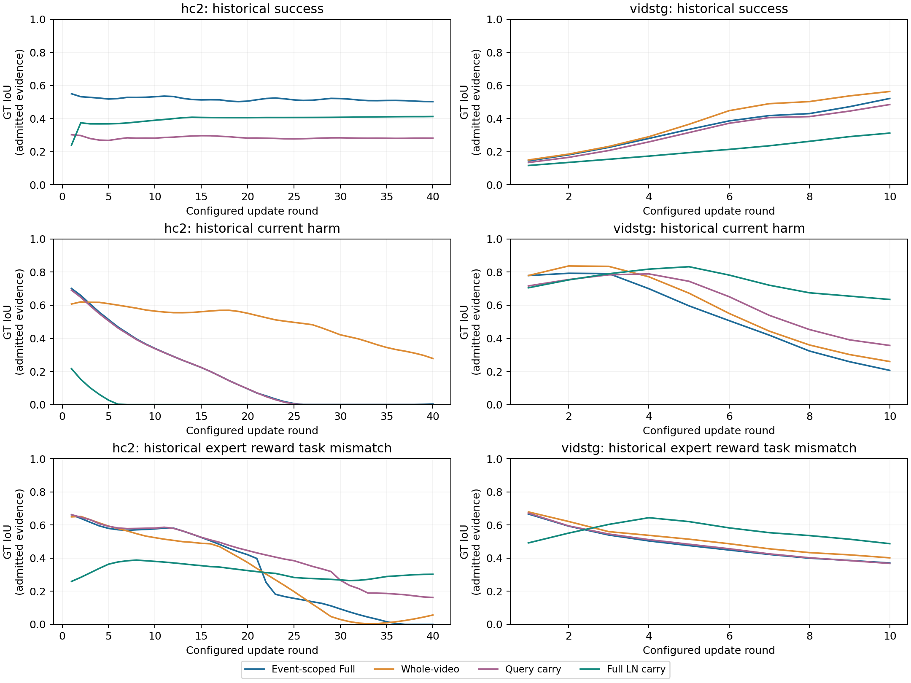

# Fixed component ablations and event-coverage Figure 3

All three requested interventions, both directions, all conditions and both fixed cross-domain orders are complete. The table combines seven preserved P2/P3 rows and three new matched rows. Uncertain and reversed differences remain in the table and companions; no parameter or checkpoint was selected from these results.

The target populations are the original 128 historically exposed parents per dataset, one fixed query per parent. Cross-domain clean averages the two original stream orders within each parent. Same-domain corruption averages frame drop, frame freeze, motion blur, occlusion and exposure at 5% before parent aggregation. There are 5,376 new complete formal fits, distinct from 72 qualification arrivals / 144 complete qualification fits. All formal arms/conditions/orders/targets sealed before new annotations. The original completed P1–P6 suite remains unchanged. TubeDETR adaptation is outside this run.

Source checkpoints and main settings are fixed: HC2 lr/sigma/tau/rounds/writeback .01/.025/.05/40/1/16; VidSTG .03/.1/.25/10/1/8, 32 antithetic actions and joint 1,792 parameters. Whole-video samples four positions from the same original observed RGB grid; it adds no decoded frames and changes only expert observation scope. Query carry inherits only the 256-coordinate residual while Adam resets and the original LN attenuation remains. Full LN carry uses alpha=1 with query/Adam reset. Native WHEN and final-round readout remain identical.

## Evidence supported by these new controls

Slow-state attenuation has 4 of four paired intervals above zero. This is the most consistent new component evidence on these saved cohorts, with unadjusted intervals; the Corrupt HC2 lower endpoint is only +0.003471 pp. It is not a claim of generalization to a new population.

Fast-state reset has 1 of four paired intervals above zero (Cross VidSTG); the other three include zero. Event-scoped sampling has 0 of four paired intervals above zero: three average differences favor Full and Corrupt VidSTG favors whole-video, but all four intervals include zero. The event-scope comparison therefore does not establish a stable overall advantage.

All 8 of 8 nonempty coverage-bin paired intervals include zero. The fixed figure preserves these uncertain and reversed differences; it does not establish a monotonic coverage trend or a coverage-driven causal benefit.

## Complete component table

Absolute parent-macro m_vIoU (%). Query-macro is identical for these balanced one-query-per-parent cohorts.

| Configuration | Cross → HC2 | Cross → VidSTG | Corrupt HC2 | Corrupt VidSTG |
|---|---:|---:|---:|---:|
| Full method | 23.502 | 18.337 | 33.024 | 25.769 |
| w/o Event-Scoped Sampling | 22.549 | 17.984 | 32.056 | 25.930 |
| w/o Action-Reward Correspondence | 19.665 | 9.516 | 26.704 | 15.547 |
| w/o On-Policy Refresh | 22.378 | 14.477 | 29.667 | 23.190 |
| w/o Query Residual | 23.672 | 17.873 | 33.015 | 25.349 |
| w/o LayerNorm Adaptation | 22.320 | 15.015 | 29.082 | 24.331 |
| w/o Slow-State Consolidation | 23.264 | 18.079 | 32.807 | 25.289 |
| w/o Fast-State Reset | 23.457 | 17.883 | 32.594 | 25.668 |
| w/o Slow-State Attenuation | 22.853 | 17.325 | 32.411 | 23.716 |
| Frozen source | 22.156 | 14.466 | 29.094 | 23.594 |

## Paired component effects

Differences are Full minus the control in percentage points, with 10,000 paired-parent bootstrap draws (fixed seed 20261011). Intervals are conditional on the saved, historically exposed cohorts and are not multiplicity adjusted. An interval including zero does not establish either equivalence or a stable advantage.

| Control | Setting | Full − control (pp), paired 95% CI | Reading |
|---|---|---:|---|
| w/o Event-Scoped Sampling | Cross → HC2 | +0.953 [-0.228, +2.257] | paired interval includes zero |
| w/o Event-Scoped Sampling | Cross → VidSTG | +0.352 [-0.389, +1.058] | paired interval includes zero |
| w/o Event-Scoped Sampling | Corrupt HC2 | +0.968 [-0.295, +2.360] | paired interval includes zero |
| w/o Event-Scoped Sampling | Corrupt VidSTG | -0.161 [-1.394, +1.058] | paired interval includes zero |
| w/o Fast-State Reset | Cross → HC2 | +0.045 [-0.345, +0.400] | paired interval includes zero |
| w/o Fast-State Reset | Cross → VidSTG | +0.453 [+0.067, +0.902] | Full higher; paired interval above zero |
| w/o Fast-State Reset | Corrupt HC2 | +0.430 [-0.183, +1.114] | paired interval includes zero |
| w/o Fast-State Reset | Corrupt VidSTG | +0.101 [-0.245, +0.451] | paired interval includes zero |
| w/o Slow-State Attenuation | Cross → HC2 | +0.649 [+0.064, +1.283] | Full higher; paired interval above zero |
| w/o Slow-State Attenuation | Cross → VidSTG | +1.011 [+0.237, +1.821] | Full higher; paired interval above zero |
| w/o Slow-State Attenuation | Corrupt HC2 | +0.613 [+0.003, +1.238] | Full higher; paired interval above zero |
| w/o Slow-State Attenuation | Corrupt VidSTG | +2.052 [+1.038, +3.233] | Full higher; paired interval above zero |

## Fixed-bin event-coverage analysis

Coverage is intersection(native interval, half-open GT annotation support) divided by GT annotation duration. The annotation support ends one physical frame after the last annotated frame. This descriptive covariate differs from tIoU; the original official task scorer is unchanged. Four bins were fixed before new predictions and both orders are averaged within each parent. GT participates only in postseal grouping and evaluation. A conditional difference does not establish that coverage causes that difference.

Each control and Full retain their own declared online LayerNorm trajectory. Their paired final difference therefore includes the consequences of earlier arrivals; the coverage grouping does not hold inherited state equal at each query. The two saved cross-domain orders are averaged as fixed orders, not a sample of all possible stream orders.

The official joint vIoU numerator uses spatial overlap only inside the native/GT temporal intersection. When that intersection is absent, both paired vIoU values are zero regardless of spatial changes. A coverage-dependent vIoU difference can therefore partly reflect the joint metric’s attainable range. It cannot by itself establish better expert evidence or explain the complete mechanism.

| Direction | Coverage bin | Parents | Event-scoped − whole-video (pp), paired 95% CI |
|---|---|---:|---:|
| Cross → HC2 | [0, 0.25) | 29 | +0.306 [-0.082, +0.862] |
| Cross → HC2 | [0.25, 0.5) | 26 | -0.370 [-1.867, +0.923] |
| Cross → HC2 | [0.5, 0.75) | 25 | +2.369 [-0.733, +6.820] |
| Cross → HC2 | [0.75, 1] | 48 | +1.325 [-1.219, +3.963] |
| Cross → VidSTG | [0, 0.25) | 30 | +0.016 [-0.079, +0.100] |
| Cross → VidSTG | [0.25, 0.5) | 18 | +0.656 [-0.253, +1.590] |
| Cross → VidSTG | [0.5, 0.75) | 36 | +1.500 [-0.151, +3.342] |
| Cross → VidSTG | [0.75, 1] | 44 | -0.482 [-2.056, +0.785] |

## State trajectories and negative tails

Total control effect is After−Frozen, current effect is After−Before, and inherited effect is Before−Frozen. These are decompositions of each control trajectory, not substitutes for its paired contrast with Full. Every individual condition, order and parent is retained in ALL_STATISTICS, including severe harmful tails.

| Setting / control | Total vs Frozen (pp), 95% CI | Current vs Before | Inherited vs Frozen | >5 / >20 pp harmful parents |
|---|---:|---:|---:|---:|
| A_hc2_cross_clean / whole_video | +0.393 [-0.925, +1.563] | -1.504 [-2.831, -0.344] | +1.897 [+1.487, +2.334] | 15 / 2 |
| A_hc2_cross_clean / carry_query | +1.301 [-0.037, +2.424] | -0.280 [-1.596, +0.755] | +1.581 [+1.010, +2.165] | 10 / 1 |
| A_hc2_cross_clean / full_LN_carry | +0.697 [-0.631, +1.823] | +2.431 [+1.162, +3.678] | -1.733 [-2.674, -0.844] | 16 / 1 |
| A_vidstg_cross_clean / whole_video | +3.518 [+1.955, +5.104] | +1.576 [+0.152, +3.020] | +1.943 [+1.412, +2.510] | 8 / 1 |
| A_vidstg_cross_clean / carry_query | +3.417 [+2.017, +4.821] | +1.782 [+0.525, +3.059] | +1.635 [+1.027, +2.239] | 8 / 1 |
| A_vidstg_cross_clean / full_LN_carry | +2.859 [+1.696, +4.064] | +3.278 [+2.162, +4.486] | -0.419 [-1.097, +0.209] | 11 / 0 |
| A_hc2_same_5percent / whole_video | +2.963 [+1.422, +4.533] | -0.979 [-2.584, +0.593] | +3.942 [+3.230, +4.631] | 13 / 2 |
| A_hc2_same_5percent / carry_query | +3.501 [+2.160, +4.783] | +0.311 [-1.020, +1.533] | +3.190 [+2.343, +4.004] | 9 / 2 |
| A_hc2_same_5percent / full_LN_carry | +3.318 [+1.968, +4.608] | +2.427 [+0.858, +3.905] | +0.891 [-0.087, +1.834] | 8 / 3 |
| A_vidstg_same_5percent / whole_video | +2.336 [+0.361, +4.246] | -0.024 [-1.806, +1.656] | +2.360 [+1.633, +3.119] | 13 / 4 |
| A_vidstg_same_5percent / carry_query | +2.074 [-0.088, +4.173] | +0.291 [-1.703, +2.233] | +1.783 [+1.041, +2.555] | 13 / 6 |
| A_vidstg_same_5percent / full_LN_carry | +0.122 [-1.956, +2.116] | +3.312 [+1.534, +5.216] | -3.189 [-4.564, -1.950] | 21 / 5 |

## Actual expert calls and observed quality

Nominal selected observations, attempted calls, admitted references and GT-evaluable references use different denominators. Expert quality below is an unweighted mean over arrivals with at least one GT-evaluable admitted reference; unannotated frames are missing, not zero-IoU failures. State arms reuse the sealed expert references. Shared capture is counted once. Stored fit wall time includes synchronous audits and is not full cold-start deployment latency.

| Setting / control | Nominal / attempted / admitted / GT-evaluable | Expert GT IoU on valid arrivals | Fit wall seconds per arrival |
|---|---:|---:|---:|
| A_hc2_cross_clean / whole_video | 1024 / 1016 / 874 / 322 | 0.561398 | 1.821828 |
| A_hc2_cross_clean / carry_query | 1024 / 1016 / 902 / 580 | 0.557093 | 1.809553 |
| A_hc2_cross_clean / full_LN_carry | 1024 / 1016 / 902 / 580 | 0.557093 | 1.804874 |
| A_vidstg_cross_clean / whole_video | 1024 / 856 / 710 / 354 | 0.665046 | 0.365071 |
| A_vidstg_cross_clean / carry_query | 1024 / 856 / 722 / 424 | 0.640010 | 0.360015 |
| A_vidstg_cross_clean / full_LN_carry | 1024 / 856 / 722 / 424 | 0.640010 | 0.359338 |
| A_hc2_same_5percent / whole_video | 2560 / 2540 / 2150 / 798 | 0.558229 | 2.027828 |
| A_hc2_same_5percent / carry_query | 2560 / 2540 / 2196 / 1418 | 0.555261 | 2.022090 |
| A_hc2_same_5percent / full_LN_carry | 2560 / 2540 / 2196 / 1418 | 0.555261 | 2.020085 |
| A_vidstg_same_5percent / whole_video | 2560 / 2140 / 1755 / 869 | 0.669037 | 0.364568 |
| A_vidstg_same_5percent / carry_query | 2560 / 2140 / 1847 / 1131 | 0.618869 | 0.363278 |
| A_vidstg_same_5percent / full_LN_carry | 2560 / 2140 / 1847 / 1131 | 0.618869 | 0.363197 |

Actual new DINO calls: 96 during qualification and 5520 during formal capture (5616 total). Qualification outputs never enter the formal streams. Reuse counts and measured observed/unobserved effects remain in complete anonymous rows.

## Fixed historical cases and verification

The six completed P3 cases and their display frames were fixed before any new GT read. Their historical success/current-harm/expert-mismatch labels do not label the new controls as successful or harmful. All four saved fits per case are read back; sample/GT IoU is checked independently on each arm’s GT-evaluable admitted frames. Signal curves consequently have different observation denominators. Empty/no-GT evidence is explicitly missing. Offline best samples are diagnostic and never choose a deployment output. Six private RGB sheets use identical previously fixed physical frames across Frozen, Full and the three new controls; the decoded pixels and corruption specs match the original saved inputs. RGB/query/GT geometry remain private.

The final fixed-case signal PNG/PDF uses visual003, which shortens clipped axis labels without changing any of the 24 saved curves or case/frame selection. Original provisional images and their hashes remain preserved.

The actual root reread 5376 complete fits, 134400 rounds, 9633792 state coordinates, 5376 matched inputs and 72 qualified/formal complete pairs. The postseal official scorer is compared with independent dense arithmetic; source, complete query/LN/Adam lifetimes, input/native bindings, saved-math dictionaries and second byte checks pass. Actual figure and RGB views are bound by ROOT_VISUAL_REVIEW. The public audit independently recomputes anonymous scalars, parent bootstrap, coverage bins, tail counts, costs and all old/new table cells. This does not independently reimplement the complete decoder Jacobian or guarantee future GPU precision/OOM safety.

Two copied historical table display values are corrected from the complete sealed row means: shuffled-feedback Cross VidSTG 9.517→9.516 and Frozen Corrupt HC2 29.093→29.094. Original predictions, rows and scores are untouched. The failed unsealed table projection and CPU002 status writer remain preserved; the separate CPU003 projection annotates each immutable result on its initial write.

Scope: these three interventions and fixed coverage analysis only. No retuning, production promotion, extra backbone, EATA restoration or historical queue restart. Final closure additionally binds actual exact remote content and archive verification.
