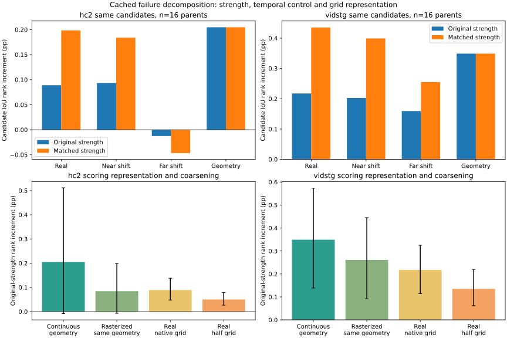

# Why frozen correspondence resembles shuffle and trails interpolation

Retrospective CPU-only diagnosis of the same exposed HC16/Vid16 cached qualification32. No new model, encoder/DINO call, training, Student update or GPU work. Native time, actual Gaussian candidates and original evidence remain immutable. All original b7e84a17 query values replay exactly. These are ranking diagnostics, not new vIoU or online-TTA results.

## Findings and scope

1. The original shuffle is a one-step cyclic shift among non-planned frames, mostly a NEIGHBORING-frame mismatch. Median physical gaps are about0.32s HC and0.20s Vid. Same-location normalized feature cosine remains0.873/0.868. A prespecified half-cycle shift reduces this to0.441/0.529. The old near-shuffle was a weak temporal negative control, not evidence-free input.

2. Original reward scales differ. Real weights have ESS about31.8/32, interpolation about30.5–30.6. Matching sorted weight strength removes most of the raw gap: real HC+.198465pp vs interpolation+.204741, Vid+.434930 vs+.348922; paired intervals cross zero. This does not establish superiority, but the original gap cannot be attributed entirely to worse ordering. Equal-strength weights are a diagnostic rank reweighting, not a deployed calibration or a proposed temperature.

3. Coarse-grid rectangle scoring itself loses geometric detail: identical interpolation boxes scored continuously give+.204741/+.348922pp, rasterized on the original grid+.084146/+.261110. At the same raster scoring interface, real-minus-raster interpolation is HC+.004789/Vid−.043701pp, both intervals cross zero. Downsampling the cached feature grid further decreases raw rank by.038845/.082400pp. A true finer feature map is unavailable; upsampling existing maps cannot show the benefit of a higher-resolution encoder.

4. There is no observed global attention-collapse bug. Normalized entropy .425/.365, mean top1 mass .497/.554 and same-frame diagonal mass .896/.914 are inconsistent with uniformly diffuse affinity. Same-frame self matching is not proof of cross-frame identity correctness. Hard argmax or removing the per-video common feature component gives small raw changes; after equalizing strength hard matching is worse and centering has no established benefit. No temperature/normalization search follows.

5. Old visually reviewed wrong-identity anchors affect feedback, but do not explain all of the real-versus-interpolation gap. Dropping one WI anchor improves raw real rank by about.012081/.012612pp on WI-containing parent subsets; interpolation also improves. Mixed-query matched WI-versus-CI/CP contrasts are based on only4 HC and1 Vid parents. Leave-one-out cannot remove a consistently wrong identity from an all-WI set. CI/CP are old model-assisted identity labels, not proof of superior geometry or independent human annotation.

## Every prespecified feedback on unobserved actual decoder frames

Rank delta units: pp of weighted true candidate IoU minus uniform candidate mean IoU. All16 parent queries/domain retained; missing GT support excluded only from evaluable frames, never zero-filled. Matched strength assigns the exact sorted interpolation weights according to each feedback reward rank; tied rewards share their assigned weights, flat feedback is uniform. This uses no GT for weight calibration.

| Feedback | HC raw Δrank | HC matched strength | Vid raw Δrank | Vid matched strength |
|---|---:|---:|---:|---:|
| real | +0.088934 | +0.198465 | +0.217409 | +0.434929 |
| near_shift | +0.093314 | +0.183958 | +0.202547 | +0.399068 |
| interpolation | +0.204741 | +0.204741 | +0.348922 | +0.348922 |
| far_shift | -0.012579 | -0.046536 | +0.159273 | +0.255013 |
| uniform_affinity | +0.004854 | +0.036046 | +0.023287 | +0.151903 |
| static_box_masks | +0.062077 | +0.136315 | +0.166682 | +0.294171 |
| self_match_static | +0.061875 | +0.144563 | +0.160966 | +0.288169 |
| interpolation_raster | +0.084146 | +0.152067 | +0.261109 | +0.340745 |
| hard_correspondence | +0.095822 | +0.185786 | +0.250269 | +0.417111 |
| centered_correspondence | +0.094181 | +0.201755 | +0.233137 | +0.428310 |
| half_grid_correspondence | +0.050090 | +0.144928 | +0.135008 | +0.307344 |

Intervals below are descriptive, unadjusted parent-bootstrap intervals over a retrospectively exposed panel and multiple prespecified controls. No best control is selected for deployment.

## Paired parent uncertainty for major contrasts

| Domain | Contrast | Raw pp [CI95] | Matched strength pp [CI95] |
|---|---|---:|---:|
| hc2 | real__minus__near_shift | -0.004380 [-0.026282, +0.015800] | +0.014506 [-0.050718, +0.095682] |
| hc2 | real__minus__far_shift | +0.101513 [+0.031843, +0.196787] | +0.245000 [-0.010271, +0.634952] |
| hc2 | real__minus__uniform_affinity | +0.084080 [+0.041291, +0.133870] | +0.162418 [+0.027448, +0.345996] |
| hc2 | real__minus__interpolation | -0.115806 [-0.382852, +0.071746] | -0.006276 [-0.125302, +0.094041] |
| hc2 | interpolation_raster__minus__interpolation | -0.120595 [-0.323215, +0.005797] | -0.052673 [-0.119954, -0.002807] |
| hc2 | real__minus__interpolation_raster | +0.004789 [-0.071255, +0.074862] | +0.046397 [-0.059188, +0.164725] |
| hc2 | hard_correspondence__minus__real | +0.006888 [-0.006071, +0.022549] | -0.012679 [-0.032068, +0.003464] |
| hc2 | centered_correspondence__minus__real | +0.005247 [+0.001551, +0.008998] | +0.003291 [-0.013241, +0.021019] |
| hc2 | half_grid_correspondence__minus__real | -0.038845 [-0.085151, -0.003315] | -0.053536 [-0.248686, +0.102541] |
| hc2 | real__minus__static_box_masks | +0.026858 [-0.011928, +0.071493] | +0.062150 [-0.066757, +0.202839] |
| hc2 | real__minus__self_match_static | +0.027059 [-0.008176, +0.067469] | +0.053902 [-0.068836, +0.183540] |
| vidstg | real__minus__near_shift | +0.014862 [-0.016600, +0.050637] | +0.035861 [+0.002437, +0.077310] |
| vidstg | real__minus__far_shift | +0.058135 [-0.067011, +0.187348] | +0.179917 [-0.021827, +0.424915] |
| vidstg | real__minus__uniform_affinity | +0.194122 [+0.095680, +0.295666] | +0.283026 [+0.058987, +0.527624] |
| vidstg | real__minus__interpolation | -0.131513 [-0.269007, -0.005816] | +0.086007 [-0.020282, +0.198327] |
| vidstg | interpolation_raster__minus__interpolation | -0.087812 [-0.185611, -0.005012] | -0.008176 [-0.071662, +0.053580] |
| vidstg | real__minus__interpolation_raster | -0.043701 [-0.140061, +0.046558] | +0.094184 [+0.004573, +0.185600] |
| vidstg | hard_correspondence__minus__real | +0.032861 [+0.006387, +0.066980] | -0.017818 [-0.039192, -0.001452] |
| vidstg | centered_correspondence__minus__real | +0.015729 [-0.001613, +0.035969] | -0.006619 [-0.025655, +0.008801] |
| vidstg | half_grid_correspondence__minus__real | -0.082400 [-0.153645, -0.024423] | -0.127586 [-0.262803, -0.021764] |
| vidstg | real__minus__static_box_masks | +0.050727 [-0.047026, +0.148962] | +0.140758 [+0.022727, +0.275300] |
| vidstg | real__minus__self_match_static | +0.056442 [-0.040144, +0.153914] | +0.146760 [+0.026914, +0.285383] |

Real-minus-far-shift raw: HC+.101513pp CI[+.031843,+.196787]; Vid+.058135 CI[−.067011,+.187348]. Real-minus-uniform-affinity is positive with intervals above zero in both domains. Thus real features carry information beyond a constant box-area prior, but a reliable two-domain advantage over a genuinely distant temporal mismatch is not established on16 parents/domain. Same-video distant images can still contain the same person, so far mismatch is not guaranteed semantically negative either. No counterfactual is declared a true wrong target.

## Resolution and partial-cell scoring

| Domain | Known unobserved frames | GT width <1 cell | Mean GT width/height cells | GT same-box raster self-IoU | DINO same-box raster self-IoU |
|---|---:|---:|---:|---:|---:|
| hc2 | 301 | 11.628% | 2.987/4.510 | 0.649776 | 0.649475 |
| vidstg | 515 | 13.981% | 2.764/4.306 | 0.672249 | 0.744869 |

On a fractional grid mask, an identical rectangle need not score1. If a rectangle occupies fraction a of one cell, its intersection under cell-average scoring is a² and soft-IoU is a/(2−a). This is a coarse fractional-occupancy approximation, not an arithmetic mistake in continuous IoU. It both weakens score contrast and can change candidate ordering. Nearest-neighbor replication of a map at2× resolution leaves the score unchanged (independently checked): it adds no evidence. Finer-feature extraction was NOT run; lower-grid degradation cannot prove that increasing original resolution will fix identity correspondence.

## Wrong-reference influence, with the same query/frame support

| Domain | Dropped old label | Parents | Real reward Δrank change pp | Interpolation Δrank change pp |
|---|---|---:|---:|---:|
| hc2 | WI | 8 | +0.012081 | +0.047632 |
| hc2 | CI | 11 | -0.009742 | -0.059470 |
| hc2 | CP | 3 | -0.007057 | -0.103402 |
| hc2 | MX | 2 | +0.001237 | +0.021734 |
| hc2 | UN | 0 | unknown | unknown |
| vidstg | WI | 3 | +0.012612 | +0.030857 |
| vidstg | CI | 10 | -0.008886 | -0.069210 |
| vidstg | CP | 1 | +0.003498 | -0.011081 |
| vidstg | MX | 1 | -0.000776 | -0.539281 |
| vidstg | UN | 1 | +0.000077 | -0.036264 |

Each leave-one-out removes one admitted reference; remaining evidence stays equally weighted, empty means uniform. Labels WI=wrong identity, CI=identity-consistent/extent reasonable, CP=identity-consistent/partial extent, MX=mixed instances, UN=unknown. These are prior model-assisted actual-pixel labels; no new visual labels were created. Removing labels is offline diagnosis and cannot be used as an online filter. Source composition differs across label groups, so their means are not matched treatment effects. The within-query mixed-label comparisons are separately preserved in RESULTS. Single-parent bootstrap intervals collapse and do not estimate population uncertainty. All-WI and all-unknown configurations remain; small leave-one-out effect does not certify safe references.

## What has and has not been isolated

- Identified: near-temporal shuffle weakness, reward-strength mismatch, and a rasterized scoring penalty on identical geometric references. These are distinct computational effects supported by matched cached controls.
- Supported within this cache: real affinity carries some information; additional coarsening harms feedback. Incorrect old labels can adversely influence rank, with limited mixed-query support.
- Not identified: a percentage of end-to-end failure caused by each factor, whether genuine higher-resolution features solve the problem, or whether any diagnostic reweighting improves actual Student adaptation and later queries. Factors interact and are not additive causal shares.
- No authorization is inferred for training, new captures, TTA, new normalization/temperature selection or promotion. Original failed qualification remains failed; production and paused queues remain unchanged.

## Reproducibility and cost

All32 derived controls were sealed before new GT rank summaries. 32413 independent original-result/weight/tie/aggregation and partial-cell contracts passed. Max CPU-vs-original-CUDA FP32 soft-map probe difference is 3.33786011e-06; old scientific maps/rewards/weights use the original exact saved bits. The initial inappropriate cross-device bit-equality check and a too-tight2e-6 probe were corrected; original failures and CPU reader revisions are preserved. Existing sealed controls were reused without mutation. This is a diagnostic numerical comparison, not rerun model inference.

Final successful CPU control pass wall time 2.170033s includes a reused first control and excludes earlier numerical probes, annotation loading, scoring, audit and publication; it is not total analysis time or deployment latency. GPU time0, new model calls0, training0. Exact per-frame GT geometry and individual reference coordinates stay private; public domain aggregates, anonymous per-query diagnostics and all controls/uncertainty remain. Old maps and b7 results are immutable.

