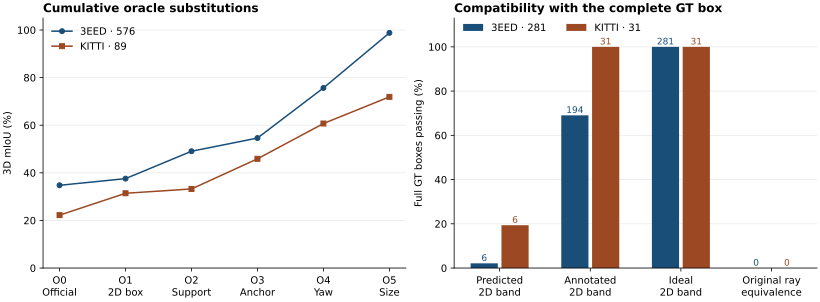

# 3EED 与 KITTI 的级联 Oracle 误差分解

在当前正式方法上，**物理锚是两域平均收益最大的单项替换**。换成 GT 几何锚，3EED 和 KITTI 分别提高 **15.98、19.44 pp mIoU**。3EED 在原始 2D 已确认指向目标的 367 条里，替换物理支持仍提高 **8.25 pp**。单独给真 yaw 收益较小，先给正确锚再给真 yaw 则明显提升。接下来的机制重点是 **实例支持如何产生度量锚，以及什么观测可以验证锚和姿态**。正式方法继续用 `ray_equivalent_height_only`。

完整 GT 框在上一轮有锚子集上只通过了 **6/281** 条 3EED 和 **6/31** 条 KITTI 的 Qwen 像素带。换成标注 2D 带后提高至 **194/281、31/31**。两域均有 **0 条**真框通过相对于原预测的微米级首交等价。真框与实测返回的额外诊断显示，换成正确窗口可以大幅恢复射线目标关联，物体实测表面与长方体投影首交之间仍有差距。 [冻结协议](PROTOCOL_ZH.md)

## 协议与覆盖

复用有研发曝光的 576 条 3EED 普通验证描述和 KITTI Tracking 上按既有规则可评分的 89 条。无标签阶段对两个预测面板的 702 条全部复放，正式框最大参数差为 0。封存后用独立离线进程读取 GT，沿用冻结的 Qwen 类别和 3D 回复。3EED 的 O1 使用原记录的标注投影框，KITTI 使用 Tracking 2D 标注框。保持正式分区、物理几何和路由逻辑。O2 仅在当前窗口和对应 fit 数据源中取框内 LiDAR 返回构成支持代理。O3 将 GT 三维框在当前 yaw 轴上的近面与底面作为物理锚，O4 切换 yaw 时在新轴上表达同一 GT 几何锚，O5 再替换尺寸。每条仍以完整预测流程和回退规则计分。

报告的 95% 区间按平台内录制成簇重抽样 2,000 次。3EED 有 98 段录制，其中 Drone 2 段、Quad 3 段。KITTI 评分样本覆盖 19 段。小录制数量限制了平台区间的泛化意义。无新模型调用，无 checkpoint 训练，所有 GT 使用均限于离线诊断。

## O0–O5 级联

括号内为相对前一步的 mIoU 增量，单位为百分点。

| 步骤 | 3EED mIoU | 3EED Acc@50 | KITTI mIoU | KITTI Acc@50 |
|---|---:|---:|---:|---:|
| O0 正式方法 | 34.77% | 33.85% | 22.22% | 22.47% |
| O1 正确 2D 区域 | 37.57%（+2.80） | 36.11% | 31.41%（+9.19） | 34.83% |
| O2 GT 框内支持代理 | 49.07%（+11.50） | 57.12% | 33.23%（+1.82） | 38.20% |
| O3 GT 物理锚 | 54.61%（+5.54） | 61.28% | 45.89%（+12.66） | 51.69% |
| O4 GT yaw | 75.66%（+21.05） | 96.18% | 60.71%（+14.83） | 70.79% |
| O5 GT 长宽高 | 98.78%（+23.12） | 98.78% | 71.91%（+11.20） | 71.91% |

| mIoU 配对增量，pp [95% 区间] | 3EED | KITTI |
|---|---:|---:|
| O1 − O0 | +2.80 [1.12, 4.63] | +9.19 [4.53, 15.00] |
| O2 − O1 | +11.50 [8.96, 14.30] | +1.82 [−3.69, 6.48] |
| O3 − O2 | +5.54 [3.04, 7.41] | +12.66 [5.60, 20.52] |
| O4 − O3 | +21.05 [18.16, 24.19] | +14.83 [8.82, 20.87] |
| O5 − O4 | +23.12 [20.18, 25.83] | +11.20 [7.45, 15.19] |

O5 在有有效框时按构造等于 GT。3EED 有 7 条、KITTI 有 25 条缺失冻结 3D 回复，后端保持缺失并按 IoU 0 计分。因此 O5 代表该级联在固定前端下的可达端点。O4 已让 3EED **554/576**、KITTI **63/89** 达到 IoU 0.5。O5 主要改善已过阈值框的重叠质量，只新增 **15 / 1** 条 Acc@50 成功。

## 单项替换与相互作用

| 对 O0 的单项替换 | 3EED ΔmIoU pp [95% 区间] | KITTI ΔmIoU pp [95% 区间] |
|---|---:|---:|
| 正确 2D | +2.80 [1.12, 4.63] | +9.19 [4.53, 15.00] |
| GT 框内支持代理，保持预测窗口 | +5.89 [4.15, 7.74] | +1.42 [−1.91, 4.58] |
| GT 物理锚，保留预测 yaw 和尺寸 | **+15.98 [10.99, 21.08]** | **+19.44 [11.79, 27.66]** |
| GT yaw，固定原框中心和尺寸 | +0.55 [0.33, 0.78] | +0.01 [−1.99, 2.21] |
| GT 尺寸，保原近面和底面 | +2.39 [1.20, 3.33] | +0.43 [−0.16, 1.12] |
| GT 尺寸，固定原中心 | +2.40 [1.51, 3.50] | +0.13 [−0.14, 0.43] |

O2 后的三因素全组合中，anchor、yaw、size 的平均主效应在 3EED 为 **+22.51、+13.59、+10.60 pp**，KITTI 为 **+23.25、+8.66、+5.25 pp**。anchor×yaw 的平均差上差为 **+26.79 [23.64, 30.28] pp** 与 **+17.97 [10.68, 25.52] pp**。这些有限差分对应不同基准条件。以 Waymo 为例，O3 单步在预测 yaw 下反而下降 **3.98 pp**，随后 O4 增加 **15.46 pp**。相同单项 anchor 对 Drone 和 Quad 分别增加 **26.36、19.45 pp**，在 Waymo 为 **+2.12 pp** 且区间跨零。跨平台同时保留这些差异。

## 物理支持归因

- 3EED 原 2D 已确认正确的 367 条中，O1 只增加 **0.51 pp**，O2 增加 **8.25 pp**。原 2D 明确错指的 57 条中，O1 增加 **17.55 pp**。前一组表明即便指向了正确实例，当前支持提取仍有可改善空间。
- 正式路由有支持点可查的 553 条 3EED 样本中，**140 条**的支持点有不到一半落在 GT 框内。低纯度集中于 Drone 和 Quad，分别是 **70/178** 与 **60/187**，Waymo 为 **10/188**。KITTI 是 **25/62**。这个统计涵盖 C_ray、H 与 A 的实际证据，A 仅有中心窗口内的深度代理点。3EED 的总体支持纯度中位数仍是 100%，低纯度主要来自尾部。
- O2 在 3EED 实际采用 **521/576**，在 KITTI 为 **40/89**。KITTI 的 49 条回退包括 25 条缺失冻结 3D 和 24 条未形成有效代理区域。3EED 上 O2 救回 130 条，同时有 9 条跌破阈值。KITTI 救回 11 条、跌破阈值 8 条，整体增益区间跨零，不能把 3EED 的支持收益直接外推。
- 框内点是空间成员代理，可能包含地面、背景或另一个实例的返回。O2 复用原路由逻辑，匹配更改会影响进入 C、H 或 A 的条件。O1 固定旧 Qwen 3D 回复，因此只度量二维窗口通道，未覆盖前端发生错指后对 3D 回复的连带影响。

## O6 完整真框的兼容性

同一批有正式物理锚的样本，用真实尺寸与锚、yaw 的 2×2 替换检查图像带。每格是 3EED 通过数 / KITTI 通过数，分母为 **281 / 31**。

| 真实尺寸放置方式 | Qwen 窗口 | 标注窗口 | 理想 GT 投影 |
|---|---:|---:|---:|
| 预测锚 + 预测 yaw | 5 / 2 | 98 / 8 | 112 / 8 |
| GT 锚 + 预测 yaw | 7 / 3 | 127 / 17 | 177 / 17 |
| 预测锚 + GT yaw | 4 / 3 | 112 / 9 | 131 / 8 |
| GT 锚 + GT yaw（完整 GT 框） | **6 / 6** | **194 / 31** | **281 / 31** |

姿态误差确实能排除真实尺寸，尤其使用准确图像边界时。完整真框在 3EED 仍有 87 条过不了标注带，这指出了标注投影和直立框表示在当前容差下的差异。理想边界是同一几何的回路正对照。两套八角点投影实现对可投影真框的裁剪矩形差异均在 **0.0005 px** 内。这个检查覆盖共同的标定输入，原始标定误差仍需另有独立证据才能辨识。

上一轮的 LiDAR 硬条件要求覆盖原见证点、保持原 Selection 命中与首交。真实尺寸放在预测锚和 yaw 上时 **224 / 24** 条通过，两域与图像联合通过数是 **3 / 1**。完整 GT 框仍覆盖原见证点的只有 **64 / 3** 条，对原预测保持精确首交的为 **0 / 0**，所以联合通过也为 **0 / 0**。此处等价基准是原预测。首交被改变时，即使新的框更准确也会被拒绝。

下表单独以真实 LiDAR 返回作深度参照。比例按射线汇总。绝对深差比较相机起点视线上的长方体首交和真实返回光学深度。5 cm/20 cm 比例以所有返回为分母，未命中的视线计为未通过。

| GT 对照使用的返回 | 3EED 条数 | 3EED 命中 / 20 cm 内 | KITTI 条数 | KITTI 命中 / 20 cm 内 |
|---|---:|---:|---:|---:|
| O0 的关联 Audit | 40,921 | 89.8% / 16.6% | 1,405 | 49.0% / 30.2% |
| O1 的关联 Audit | 40,312 | 99.3% / 17.6% | 859 | 98.8% / 57.6% |
| 标注窗口内分区 Audit | 131,044 | 93.2% / 8.0% | 3,435 | 94.6% / 35.5% |
| 上行里落入 GT 的代理返回 | 59,982 | 100% / 15.6% | 1,787 | 100% / 48.9% |

原关联 Audit 上，O0 框在 20 cm 内的比例是 **31.9% / 59.6%**，高于同一批返回下真框的 **16.6% / 30.2%**。该批返回原本就按预测区域关联。把窗口改正确后，GT 命中率在 KITTI 从 **49.0%** 提升到 **98.8%**。对 GT 框内的代理返回，包含和命中由选点定义，首交残差仍可测。超过 20 cm 的主要残差来自返回在 GT 长方体首交之后，比例 **84.4% / 51.1%**。框内点背景、物体表面与标注箱体的间距、经相机光心的视线和原生 LiDAR 发射视点差异均可能贡献残差。这些读出不支持把差距单独归因给标定、传感器或形状模型。

## 研究判断与复算

当前最清楚的结构是两域共同存在的度量锚问题、3EED 中的实例支持问题，以及锚与 yaw 的强耦合。KITTI 的二维定位通道也有明确余量。尺寸在姿态正确后能提升框的精细重叠，对当前 Acc@50 的新增收益有限。完整真框对照支持把原预测等价性与真实观测拟合分开分析。这是讨论几何一致性和三维框准确性关系的实验依据。后续研究优先级是支持、锚和姿态的机制及观测模型，正式方法仍为原顶面收缩。

复算使用带有本轮脚本、既有冻结预测和数据缓存的原实验工作区。运行目录为 `studies/3eed_cascaded_oracle_20261128`，依次运行 `replay.py`、`diagnose.py`、`summarize.py`、`validate.py`。本地输出位于工作区的 `runs/cascaded-oracle-20261128`，保留逐例诊断、汇总、封存和复核。独立复核重算 665 条，O0 的 IoU 与上一轮逐条相同，旋转 IoU 两后端的最大绝对差为 **4.10×10⁻⁹**。兼容性回顾重现了上一轮真尺寸与真框的旧物理检查。
