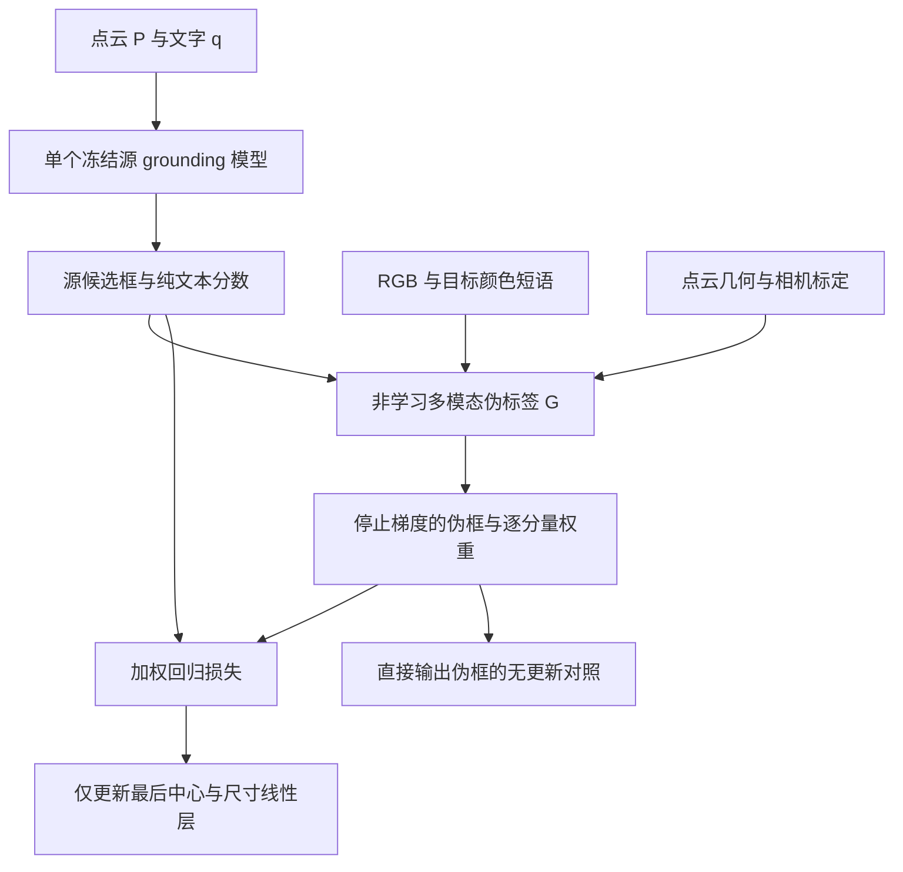

# 第一版：单模型多模态伪标签回归适应

采用用户指定的第一版结构：一个3EED grounding模型负责点云—文字预测；非学习模块G利用RGB、文字、点云和标定生成停止梯度的伪框；仅最后中心与尺寸线性输出层允许更新。没有教师、EMA或教师—学生训练。

当前状态是**实现与合成契约通过**。真实目标域的伪标签接受率、伪标签质量和TTA收益尚未测量。尺寸监督在保守首版中明确关闭，不能将实现的六维接口称作已经实现有效尺寸适应。

## 模型与两条路径

源模型是新训练的Waymo-only epoch100，100轮、15,300次更新；checkpoint SHA256为`0d8766abaf06c9f3e2500fcb187337982d391f9e4d46ca854f3b3bb70fd33bbd`。它使用XYZ点云与文字，RGB只进入G。权重来源、源域结果、成本及独立审计见[Round6报告](../round6/REPORT.md)。源域读出与目标TTA读出须区分：本版推理只用文字确定token span，不允许GT类别/positive_map选目标。

Reg-TTA3D在这里仅提供“聚焦回归参数”的启发。原文还含噪声一致性、回归精炼和class-balance EMA，本版不移植其完整流水线。原始来源：[ECCV 2024论文](https://www.ecva.net/papers/eccv_2024/papers_ECCV/papers/05971.pdf)。

## 非学习G的具体首版

G接收原模型同一份点云P、RGB、完整输入文字、原始候选6D框及纯文本分数、固定源Top1 query、逐点投影与深度。其函数没有GT框、类别标注、positive_map或教师预测入口。

1. 保留原模型选中的query身份。首版检验该候选的RGB证据，不进行候选重排，也不声称能够纠正选错实例。
2. 只解析目标开头短语中的有限颜色词与名词，例如“the white car”。关系宾语的颜色不会作为目标颜色。否定、多色、未知表达或无明确颜色证据均跳过。当前支持red、green、blue、yellow、white、black；这不是通用2D语言定位器。
3. 在传入的完整P上按像素做近侧z-buffer，再用HSV颜色支持、源框邻域、连通分量及竞争候选歧义检查建立RGB—点云关联。该可见性只相对于实际观测点云成立；稀疏采样可能漏掉遮挡物，不能将其当作真实完整遮挡图。
4. 某个中心轴只有在源框相反两侧都具有足够颜色点、横向覆盖、低离散度且平移残差一致时，才接受两侧残差的中位修正。伪标签中心修正上限固定为`min(0.1×该轴尺寸, 0.2米)`，超限拒绝，不通过截断把不可信修正伪造成可信修正。
5. 首版保留全部源尺寸，尺寸权重固定为零。局部可见表面不提供完整尺寸监督；不以点云局部均值替代完整目标中心。无可信中心轴时返回原框及全零权重。

全部几何、HSV和可靠性阈值已写入[G契约](../../crossplatform/round7/G_CONTRACT.md)与`G_IMPLEMENTATION_LOCK.json`。这些是尚待真实数据验证的启发式条件，不是经验证的正确性概率。接受率低或全部跳过都是应保留的结果，不按非零率或GT分数放宽门限。

## 回归更新与参数边界

允许更新的四个参数为`prediction_heads.5.{center_residual_head,size_pred_head}.net.8.{weight,bias}`，合计1,734个参数。每个中心/尺寸分支为288→3的最后线性Conv。首个G的尺寸权重为零，因此实际能够产生非零更新的只有中心分支867个参数；尺寸分支仍保留在接口中，等待有证据的尺寸伪监督。

对固定query，记原输出为b、停止梯度伪框为t、逐坐标可靠性为w，更新损失为：

`L = sum_j w_j SmoothL1(b_j, stopgrad(t_j); beta) / sum_j w_j`。

归一化避免可监督坐标数量改变总损失尺度；全零权重直接跳过。使用显式plain SGD，无momentum、weight decay或隐含梯度裁剪。步数、学习率与beta必须由真实实验计划给出，合成fixture中的数值不作为实验选参。G的限幅只约束伪标签，不自动限制SGD真实位移；真实计划必须按冻结特征Gram登记有效步长，或另设无GT拒绝条件。完整模型保持eval，BN与dropout不更新；缓存两个最后Conv的输入，冻结前段。每个样本结束后恢复源参数、梯度引用、requires-grad、buffers、模式及随机状态，首版采用episodic协议。

原生框为中心与尺寸六维，yaw固定为0。本版没有朝向估计/PCA，不把朝向补全收益归给中心/尺寸TTA。无效源尺寸明确跳过更新；评估阶段如需官方clamp，应对所有臂一致执行，并保留raw尺寸。

## 必须保留的同信息对照

| 对照 | 作用 |
|---|---|
| Source | 同一份Waymo-only权重的冻结预测 |
| Direct G | 直接输出多模态伪框，不更新参数 |
| Parameter SGD | 用相同伪框和权重更新最后回归层 |
| Exact output-space SGD | 不更新参数，在框空间精确重放线性层SGD产生的修正 |
| PC-only G | 同一几何与相机信息，不使用颜色匹配 |
| Shuffled-color G | 固定颜色置换，检查文字—RGB对应是否实际必要 |

后三种G模式各自接入同样四个输出臂。它们可能具有不同拒绝率，正式比较必须同时报告全样本结果和预先规定的共同可适应集合，不能只选择成功样本。

固定query和冻结特征时，最后线性层SGD在该query上满足：

`b_next,j = b_j - lr × (||h_group(q)||² + 1) × dL/db_j`。

这意味着当前输入上拟合伪框可以等价为框空间更新；共享Conv还会改变其他query，需记录spillover。Parameter SGD超过Source并不足以证明独有TTA贡献。必须比较Direct G与同信息框空间控制；若研究参数适应的跨输入价值，需另外固定独立重采样/视图测试及query身份对应协议，当前尚未执行。

## 相机约定与尚未消除的限制

全20,367帧的RGB、点云、K/E与pose均存在，JPEG header和结尾检查通过；不等于全部图像像素已经解码验收。Waymo模型点须撤销suffix旋转，再使用`A @ inverse(E)`转换相机坐标；Drone先撤销模型z+=1.8，再用E；Quad用E。Waymo K是第四列为零的3×4矩阵，本版明确验证后取前三列。没有添加官方代码中定义但未使用的translation_vectors。

全部metadata均缺失畸变参数。投影默认拒绝缺失D；只有运行计划显式登记`assume_zero_declared`时才可使用零畸变假设。零畸变、rolling shutter及图像裁剪/内参对应仍须真实投影检查。合成逆变换通过只能证明实现代数，不能证明真实照片对齐正确。

## 已完成验收与运行边界

- 四参数接口、停止梯度、共享层spillover、SGD与框空间重放及正常/异常后的源状态恢复均通过合成CPU检查。三步SGD全候选与框空间重放最大差约`4.77e-7`，在预声明容差内。
- G通过双侧平移、部分可见、遮挡、背景同色、竞争候选、错误颜色/关系宾语/否定/多色、点排列不变、修正超限及GT字段拒收等合成检查。
- 相机模块通过五种Waymo视角逆变换、Drone高度撤销、Quad约定、负深度拒绝和camera字段白名单检查。
- 端到端连接通过证据不足零更新、缺失D拒绝、无效源尺寸跳过和多对照恢复检查。

入口为[run_episode](../../crossplatform/round7/v1_pipeline.py)。当前没有真实目标样本接受率、任务指标或TTA收益；第一版作为可执行研究实现保留，尚不采纳为有效方法。正式实验须先固定目标划分、投影验收、G配置与更新配置，再封存所有臂预测并离线评分，保留被拒绝样本和负向变化。

独立审查发现并修复FOV取整边界漏洞：先检查原始浮点投影范围，再按半开像素格floor取像素。修前源码、配置和夹具保存于history/before_FOV_fix；修前错误纳入负投影点、修后拒绝的反例已保留。独立审查见[实现审核](INDEPENDENT_IMPLEMENTATION_REVIEW.json)。当前端到端夹具验证的是证据不足/异常跳过链路，非零伪框与正参数更新分别由G和adapter合成夹具验证，尚无真实模型正更新证据。metadata探索读取边界见[澄清记录](RGB_METADATA_READ_BOUNDARY_CLARIFICATION.json)。
