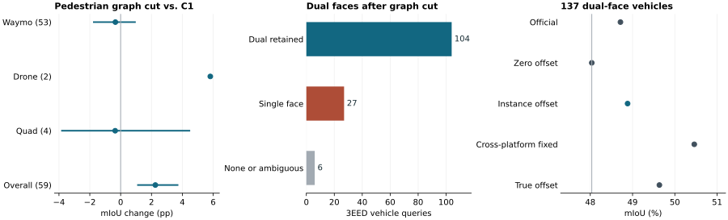

# 实例支持的几何效用与车辆边界证据

**车辆图割改变了可恢复的几何结构，主要损失落在中心估计。** 137 条原本可拟合双面的 3EED 车辆中，图割后 33 条失去可靠双面。逐项换回原框参数时，中心恢复的 mIoU 幅度远大于换回 yaw 或尺寸。可信外围点能小幅改善同一双面求解器，但相比正式框和跨平台控制，证据尚不足以采用。行人 C1 在直接机制面板录制不重合的子集上仍有收益，C4 的额外提升集中于 Drone。 [冻结协议](PROTOCOL_ZH.md)

## P0 · 行人录制审计与配对

重新从官方发布读取资产 OID，对本地归档重新计算 SHA-256，并与历史曝光审计复核。可用录制为 Waymo 187 段、Drone 5 段、Quad 7 段，均有项目历史曝光。Waymo split 还列出 10 段，现有发布包缺少这些录制。三平台符合全历史独立条件的录制均为 **0**，因此独立测试指标为空。 [官方数据发布](https://huggingface.co/datasets/RRRong/3EED/tree/main) · [此前的全历史曝光审计](../3eed_pedestrian_independent_20261128/REPORT_ZH.md)

另从封存的 288 条配对中，按原始录制排除直接机制面板及其 3EED 恢复与级联输入，剩 185 条查询。它们的录制仍有较早项目曝光。三臂为正式方法、原支持加几何中位数 C1、局部图割加同一几何中位数 C4。中心误差按三臂都有框的 177 条计算，mIoU 与 Acc@50 计入全部查询。各平台未重采样为等权。

| 平台 | 查询 / 录制 | 3D 中心中位数 m，正式 / C1 / C4 | mIoU，正式 / C1 / C4 | Acc@50，正式 / C1 / C4 |
|---|---:|---:|---:|---:|
| Waymo | 53 / 53 | 0.188 / 0.132 / 0.136 | 37.52% / 42.43% / 42.09% | 33.96% / 52.83% / 49.06% |
| Drone | 78 / 2 | 1.284 / 1.430 / 0.885 | 12.04% / 18.36% / 24.17% | 2.56% / 23.08% / 32.05% |
| Quad | 54 / 4 | 0.335 / 0.272 / 0.242 | 26.49% / 33.67% / 33.31% | 14.81% / 42.59% / 40.74% |
| 合计 | 185 / 59 | 0.441 / 0.273 / 0.226 | 23.56% / 29.72% / 31.97% | 15.14% / 37.30% / 39.46% |

C1 相对正式方法提高 **6.17 pp mIoU、22.16 pp Acc@50**。C4 相对 C1 额外增加 **2.25 pp mIoU [1.12, 3.69]** 和 **2.16 pp Acc@50 [0.00, 4.35]**，挽回 9 条、退化 5 条。Drone 提高 **5.81 pp mIoU / 8.97 pp Acc@50**，来自两段录制。Waymo 和 Quad 的 Acc@50 分别下降 **3.77** 和 **1.85 pp**。其余 103 条有直接录制重合的配对保留于聚合数据。

## P0 · 图割保留了哪些车辆几何

评分面板含 368 条 3EED 车辆与 89 条 KITTI 车辆。原支持或图割实例框的逐点审计，以有正式框的 366、64 条为主，点的归属由 GT 框内实测点代理。近边统计只看朝向相机的近面内 0–0.15 m 区域，每个轴单独计数，角点可同时进入两轴。正交面覆盖格数在固定原主体面附近统计。

| 逐点读出 | 3EED | KITTI |
|---|---:|---:|
| 原支持有可靠双面 | 137 | 6 |
| 图割后维持双面 / 单面 / 无解或有歧义 | 104 / 27 / 6 | 3 / 2 / 1 |
| 原先无可靠双面，图割后新增双面 | 14 | 2 |
| 丢失至少一个原近边代理点的查询 | 56 | 7 |
| 近边计数净下降的查询 | 42 | 5 |
| 近边点轴向计数，图割前 → 后 | 7,242 → 7,595 | 203 → 228 |
| 原主体表面覆盖格数，图割前 → 后 | 9,238 → 9,347 | 89 → 79 |

在 3EED 的 **271 条支持发生改变**的车辆中，GT 框内点的纵向跨度中位数缩短 **1.9 cm**，横向增加 **0.7 cm**。在 IoU 下降至少 0.05 的 88 条中，56 条原可拟合双面，16 条随后失去双面。与此同时，这些退化查询的近边点计数仍从 2,886 增至 3,133；在有原近边点的车辆中，近边点计数变化与 IoU 变化的 Spearman 相关仅 **−0.10**。图割让 23 条车辆从支持不达标变为达标，该子组 mIoU 平均增加 **5.94 pp**。达标门槛沿用纯度 ≥85%、窗内代理覆盖 ≥70%。局部双面证据确实会丢失，净近边点数和覆盖格数无法解释全部退化。

在 271 条上做 2³ 框参数替换，其他参数组合均等平均。将图割框的**中心**换回原值，主效应 **+4.95 pp [2.95, 7.67]**；换回 **yaw +1.00 pp [0.22, 2.04]**；换回**尺寸 −0.11 pp [−0.28, 0.00]**。这是框输出归因，中心改变仍可包含区域选择与姿态读出的交互。在 54 条两类丢点都存在的 3EED 查询上，离线等量补回真近边回波，比补回其他丢失的真点多 **1.87 pp [−0.46, 4.72]**，两组均从 32 条可拟合双面增至 35 条。这个对照尚未确认应优先补哪一类点。

## P0 · 表面偏移归因

对每个面法向，零偏移方案的中心残差等于**主体面到 GT 近边的偏移**加**预测与真实投影半尺寸之差**。在 137 条双面车的 274 个轴里，两项有 **183 个轴符号相反**。固定尺寸时，真实偏移可以消除第一项，也会消除原有的抵消。保持成框尺寸、yaw 和竖直坐标冻结后，真实偏移单独使 3EED 水平中心误差中位数从 **0.325 降至 0.260 m**，而 Waymo 从 **0.218 增至 0.240 m**。只给真实半尺寸用于中心推算，3EED 反而为 **0.392 m**；两项同给时，未被位移门控拒绝的中心在数值精度内等于 GT。这组 2×2 干预只用于解释误差抵消。

在四种读出均恢复同一双面的 86 条 3EED 查询中，给定真实 yaw 使主体到框边的绝对偏移中位数从侧面 **0.233 降至 0.181 m**、端面 **0.191 降至 0.154 m**。再换入 GT 支持代理为 **0.169 / 0.151 m**。在全部可用的 119 个真支持、真 yaw 车侧面和 119 个端面上，朝外的真回波 5% 分位仍距 GT 边 **0.150 / 0.139 m**；主体面距该回波分位为 **0.018 / 0.014 m**。两项是各自的边际中位数。残差主要位于可见回波与标注框近边之间，当前数据不足以分开未采到的外沿和标注规范。Waymo 采用原始 Waymo 标注，Drone 和 Quad 经伪标注与人工复核；KITTI 只有两条 GT 支持加真 yaw 的双面车，且缺乏同物体的双套标注。 [3EED 标注协议 §A.2.2](https://openreview.net/pdf/ceb56b7b04a26c75dc4e4e95065b7b7d34f1327d.pdf) · [KITTI 3D 评估说明](https://www.cvlibs.net/datasets/kitti/eval_object.php?obj_benchmark=3d)

## P1 · 固定主体 yaw，外围点估计边界

各臂沿用相同的双面方向、长宽高和竖直中心，只改水平中心。实例偏移使用主体面外侧、接近主体、具有空间连贯性的回波。零偏移沿主体面补半个预测尺寸。固定偏移是其它 3EED 平台车辆轴向中位数的**离线迁移对照**，目标平台无标签进入其统计。真实偏移是逐例离线 Oracle。所有中心移动共用位移门槛。

| 对照 | 3EED 双面 137 条 mIoU / Acc@50 | 水平误差中位数 | KITTI 双面 6 条 mIoU / Acc@50 |
|---|---:|---:|---:|
| 正式方法 | 48.71% / 62.04% | 0.306 m | 35.34% / 33.33% |
| 主体 yaw，原中心 | 47.76% / 61.31% | 0.306 m | 34.94% / 33.33% |
| 上轮主体面区间约束 | 48.51% / 62.04% | 0.320 m | 34.94% / 33.33% |
| 零偏移 | 48.04% / 64.23% | 0.325 m | 34.55% / 50.00% |
| 实例外围，原支持或原支持∪图割 | 48.88% / 64.96% | 0.306 m | 34.55% / 50.00% |
| 固定偏移，跨平台离线对照 | 50.46% / 64.23% | 0.260 m | 33.60% / 50.00% |
| 逐例真偏移，Oracle | 49.63% / 61.31% | 0.260 m | 36.10% / 50.00% |

外围点在 70 条 3EED 双面车上触发至少一个轴，轴向偏移绝对误差中位数由 **0.254 降至 0.228 m**。相对零偏移提高 **0.85 pp mIoU [0.61, 1.13]**。相对正式方法只提高 **0.17 pp [−1.79, 2.06]**，Acc@50 **+2.92 pp [−2.00, 8.08]**。在 101 条语义实例已核实的双面车上，实例偏移比零偏移提高 **1.11 pp mIoU**，相比正式方法为 **−0.06 pp**。KITTI 仅两条触发，两条均为错指，没有可用的正确实例触发证据。固定偏移在 3EED 胜过实例偏移，却使 KITTI 相对零偏移下降 **0.95 pp mIoU**。

加入图割点后，137 条 3EED 双面车有 136 条得到相同的框。另 1 条的中心相差 4.75 cm，两臂 IoU 均为零。在探索性补充中，候选池扩为同一预测窗内原拟合组的可见回波，参数仍冻结。137 条中有 51 条的偏移估计改变，比原实例偏移再增 **0.21 pp mIoU [0.06, 0.47]**，Acc@50 无净变化。KITTI 相对增量 **0.18 pp**，区间跨零。 [补充协议](EXPLORATORY_ROI_ZH.md)

## P2 · 类别组合与当前入口

3EED 开发面板 576 条查询，正式方法 **34.77% mIoU / 33.85% Acc@50**，仅启用行人 C1 **37.28% / 42.88%**，仅启用行人 C4 **38.24% / 45.14%**。再给双面车辆启用实例偏移为 **38.28% / 45.83%**，比行人 C4 增 **0.04 pp mIoU [−0.40, 0.48]** 和 **0.69 pp Acc@50 [−0.52, 1.76]**。KITTI 的同一组合为 **22.17% / 23.60%**，原法 **22.22% / 22.47%**，阈值上挽回一条。类别组合为开发期回放，正式入口仍使用 `ray_equivalent_height_only`。行人 C1/C4 保留为实验候选，车辆外围估计保留为机制对照。

## 复算

全部几何对照复用缓存 Qwen 回复，盲读出先封存，目标三维标签随后由离线评分读取。未调用新模型或训练 checkpoint。按顺序运行本地研究目录中的 `evidence.py`、`diagnose_utility.py`、`summarize_utility.py`、`center_factorial.py`、`peripheral_roi.py predict`、`peripheral_roi.py score`，最后用 `plot_and_release.py` 输出图和聚合数据。成对区间使用 2,000 次平台内录制级重采样，单段录制的退化区间只作描述，Acc@50 按严格 IoU > 0.50。逐例证据留在本地 `runs/geometric-utility-20261128`。 [聚合结果](results.json)
