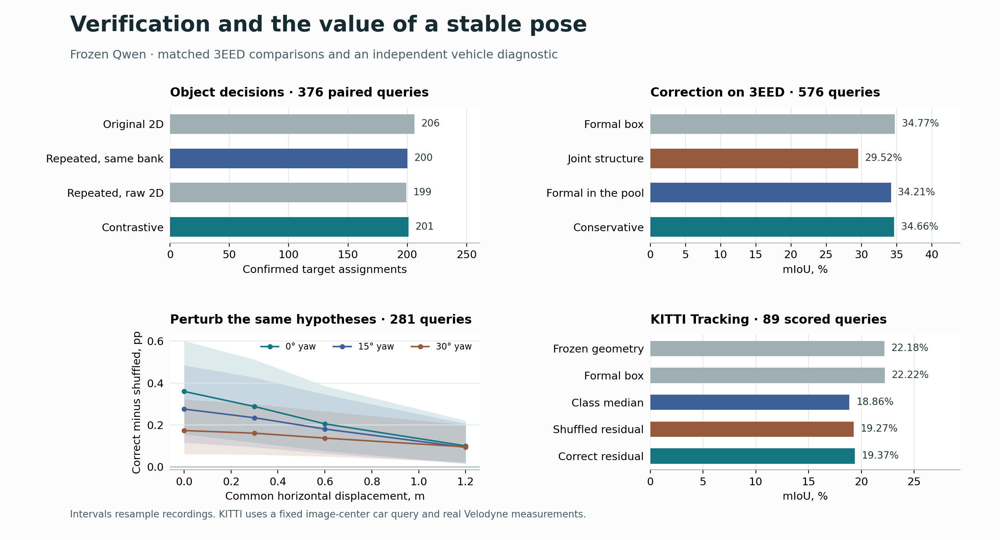

# 候选验证、保守修正与尺寸残差复测

前四项实验沿用 576 条已曝光 3EED Ordinary Validation 查询。Waymo、Drone、Quad 各 192 条，分别覆盖 93、2、3 段录制。所有推理均使用冻结 Qwen3-VL-4B-Instruct，候选与替换规则在本轮标签评分前封存。[主实验协议](PROTOCOL_ZH.md) · [配对结果图](verification.png)

## Correction 的错误替换

| 576 条查询 | mIoU | Acc@50 |
| --- | ---: | ---: |
| 正式框 | 34.77% | 33.85% |
| 上轮的联合结构评分 | 29.52% | 25.69% |
| 上轮结构评分，正式框参与候选 | 34.21% | 32.99% |
| 本轮保守替换 | 34.66% | 33.51% |
| 正式框＋实例残差 | 35.39% | 34.72% |
| 保守替换＋实例残差 | 35.28% | 34.38% |

- 联合结构评分实际修改了 444 条，84 条 IoU 上升、289 条下降、71 条持平。只看下降的 289 条时，161 条的中心误差至少增加 0.15 m，31 条的 yaw 误差至少增加 10°，30 条的平均尺寸相对误差至少增加 5 pp。因素可重叠。
- 在下降的 289 条里，只把新中心移植到正式框、保留正式尺寸和 yaw，mIoU 损失 **−15.56 pp**。仅交换 yaw 为 −1.06 pp，仅交换尺寸为 +1.60 pp。单项移植解释了中心变化的重要性，单项差值不相加。
- 将正式框放回旧候选池后，106 条实际修改，40 条 IoU 下降。下降的 40 条里，36 条 Selection 射线损失变小，28 条的独立 Audit 冲突率下降，17 条在两个 Audit 子集上都下降。中心误差中位数由 0.28 m 增至 0.58 m。对这 40 条，只移植中心损失 −20.95 pp mIoU。
- 本轮保守规则提名 33 条，21 条因保留回波的证据不足被拒绝，12 条通过三个回波分区，全部来自 Quad。12 条中 6 条 IoU 上升、6 条下降，平均 **−5.41 pp mIoU**。全 576 条效果 **−0.11 pp**，录制级 95% 区间 **[−0.32, 0.00]**。两次 Acc@50 退化，零次救回。12 个接受样本的强冲突计数分别在三组回波上由 917 降到 586、465 降到 300、453 降到 276。高置信的重复射线证据减少了改框次数，仍未可靠识别 amodal 框的改善。
- 三个回波分区互不重叠，仍共享视角、关联和同一个光线观测模型。此结果与“同一视角下能解释可见观测的框可以有不同 amodal 准确度”一致。

## 同一样本的锚定扰动

281 条查询的固定正式锚能同时应用正确残差和同类打乱残差。先用已封存的物理约束获得完整预测，再给两臂加完全相同的刚体变换。横向和纵向正负方向平均，yaw 正负号平均。表中为正确残差减打乱残差的 mIoU。扰动只是因果敏感度诊断。

| 位姿条件 | 正确残差 − 打乱残差 | 录制级 95% 区间 |
| --- | ---: | ---: |
| 原正式姿态 | +0.360 pp | [+0.156, +0.601] |
| 平移 0.6 m，yaw 15° | +0.181 pp | [+0.063, +0.346] |
| 平移 1.2 m，yaw 30° | +0.095 pp | [+0.023, +0.201] |

预先指定的“原姿态增益减去 0.6 m／15° 增益”为 **+0.180 pp**，配对 95% 区间 **[+0.049, +0.311]**。同一批尺寸信号在更差的位姿下带来的 IoU 收益减少约一半。扰动后的框不重新运行物理选框，结果度量相同尺寸读出的 IoU 对位姿变化的敏感度。

| 原姿态离线分层 | 查询 | 原姿态的正确残差 − 打乱残差 |
| --- | ---: | ---: |
| 中心 ≤0.30 m 且轴误差 ≤15° | 116 | +0.60 pp |
| 中间 | 42 | +0.51 pp |
| 中心 ≥0.60 m 或轴误差 ≥30° | 123 | +0.08 pp |

分层同时受平台和物体类型影响。固定样本的共同扰动为“可靠锚定放大实例尺寸收益”提供了更直接的证据。

## Object 对比核验与等预算重复定位

376 条查询已有至少两个候选。对比组和重复组各调用同一冻结 Qwen 一次，所有逐例视觉网格完全一致，两组均分配 1,508,704 个原始视觉 patch，输出上限均为 112 token。实际生成均值分别为 2.0 和 50.44 token。对比组用一张同大小画布保留场景和各候选裁剪，给出实测回波摘要。重复组在原图中独立再求框。重复框和固定候选的匹配使用至少 0.50 IoU 和 0.10 候选间隔。

| 376 条有多个候选的查询 | 确认命中 | 救回 | 误改 | 实际改框 |
| --- | ---: | ---: | ---: | ---: |
| 原正式目标 | **206** | 0 | 0 | 0 |
| 对比式核验 | 201 | 11 | 16 | 63 |
| 重复定位后映射同一候选池 | 200 | 3 | 9 | 32 |
| 直接用重复定位框 | 199 | 5 | 12 | 268 |

- 对比式相对同候选池重复定位为 **+0.27 pp 确认命中率**，录制级 95% 区间 **[−1.20, +1.67]**。相对原目标为 −1.33 pp，区间 [−3.01, +0.30]。
- 可比较查询里，原方法明确错指 51 条。对比式救回 4 条，重复定位映射救回 1 条，直接重复定位救回 2 条。在其中候选池已包含正确目标的 19 条里，对比式与同池重复仍分别救回 4、1 条。
- 全 576 条上，原目标／对比式／同池重复的确认命中分别为 367、362、361。对比式把候选机会转化成部分真实救回，但额外误改抵消了收益。计算额度的配平依赖调用数、视觉网格和上限，提示长度及实际解码步数有差异。

## 独立录制复测

从 KITTI Tracking 公共发布包固定抽取 21 段录制各 6 帧。126 帧图像、点云、标定都下载并校验，所有标定的独立投影复核达到浮点精度。模型对每帧收到相同的模板指代，选择二维框水平中心最接近图像水平中心的乘用车。标签包在预测封存后才完整下载并解析。89 帧来自 19 段录制且可唯一评分，35 帧缺少合格车辆，2 帧中心排序歧义。 [KITTI Tracking 数据说明](https://www.cvlibs.net/datasets/kitti/eval_tracking.php) · [固定外域协议](KITTI_PROTOCOL_ZH.md)

| 89 条可评分查询 | mIoU | Acc@50 |
| --- | ---: | ---: |
| `C_ray_simple` | 22.18% | 23.60% |
| 正式框 | **22.22%** | 22.47% |
| 正式锚＋Waymo 类别尺度 | 18.86% | 15.73% |
| 正式锚＋同类打乱残差 | 19.27% | 20.22% |
| 正式锚＋正确实例残差 | 19.37% | 20.22% |

- 正确残差比正式框低 **−2.85 pp mIoU**，录制级 95% 区间 **[−5.86, −0.75]**。比类别尺度提高 **+0.51 pp**，区间 **[+0.21, +0.88]**。比打乱残差多 **+0.09 pp**，区间 **[−0.06, +0.27]**。
- 89 条中正式 2D 确认命中 56 条。31 条可应用正式锚 Fitting，其中 19 条 2D 确认命中。31 条正式锚统一对比中，正式框与正确残差分别为 35.55%、27.36% mIoU。19 条同时满足 2D 命中和正式锚条件时，正式框与正确残差分别为 58.00%、44.63% mIoU。因此总体损失仍出现在对准正确实例的子集中。
- 31 条正式锚中，长宽高中位相对误差由正式框的 5.23%、2.39%、3.19% 增至 15.29%、25.82%、12.92%。源域尺度及约束后的尺寸对该外域车体校准失准。
- 独立检验面向一个道路车辆数据集和一个固定模板指代。当前实验对自然指代或 Drone、Quad 的外部泛化缺少独立数据。KITTI 的结果使用本项目几何评分，未作为 KITTI Tracking 排行榜的原任务成绩提交。

## 方法结论

在已曝光的 3EED 面板，正式物理锚加实例残差仍是较强的候选读出。在同一批样本上共同扰动中心和方向，会显著压低正确相对打乱残差的增益。外域复测进一步显示，尺度先验的域适配也是实际收益的条件。对比核验产生了真实救回，净结果受误改抵消。通过三个回波分区的保守 Correction 也未得到正收益。正式默认入口继续使用 `ray_equivalent_height_only`。

