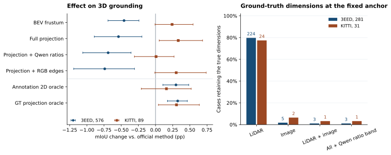

# 单帧 RGB 与 LiDAR 的尺度恢复实验

固定正式框的姿态、相机侧近面与底面后，RGB 投影能显著缩小被采样到的尺寸可行集。但 3EED 的 281 条有锚样本中，只有 **3 条**能同时保留真实尺寸。完整投影使 3EED 的 mIoU 下降 **0.54 pp**，在 KITTI 提高 **0.33 pp**，两边的 Acc@50 都没有提升。理想投影边界在 3EED 提高 **0.32 pp mIoU**，Acc@50 持平。按预定停止条件，正式方法继续使用 `ray_equivalent_height_only`。

本轮复用了 576 条 3EED 普通验证描述，以及 KITTI Tracking 外部面板的 126 个预测条目。后者有 89 条符合以图像中心车辆为目标的评分规则。两个面板此前均用于研发。全部盲预测使用冻结 Qwen 缓存、单帧 RGB、LiDAR 和相机标定。新增模型调用与 checkpoint 训练均为零。预测文件封存后才读取目标标签，单独生成 Oracle 和逐例评分。每项配对区间按各平台录制重采样 2,000 次。 [固定实验协议](PROTOCOL_ZH.md)



## 1. KITTI 宽度退化归因

在原来出现退化的 31 条样本上，正式框、Waymo 类别尺度和 Waymo 尺度加 Qwen 残差的宽度绝对相对误差中位数分别是 **2.39%、27.40%、25.82%**。两个 Waymo 方案都在 **31/31** 条上高估宽度。GT 宽度中位数为 **1.651 m**，Waymo 类别目标宽度为 **2.103 m**，加残差后的宽度中位数为 **2.077 m**。重锚后两组仍存在宽度偏差，3D IoU 也低于正式框。两种旧方案在物理约束下的框逐参数复放一致。

| 尺寸来源 | 宽度 MdAPE，31 条 | 中心固定 mIoU | 保近面与底面重锚 mIoU | 重锚后加原物理约束 mIoU |
|---|---:|---:|---:|---:|
| A 正式框 | 2.39% | 35.55% | 35.55% | 35.55% |
| B Waymo 类别尺寸 | 27.40% | 27.32% | 25.58% | 25.89% |
| C Waymo 尺度加 Qwen 残差 | 25.82% | 28.48% | 27.05% | 27.36% |
| D 原始 Qwen 裁剪尺寸 | 3.41% | 32.87% | 33.38% | 33.63% |
| F 真值尺寸 | 0.00% | 35.83% | 36.56% | 36.68% |

E 在 SHA 顺序锁定的 7 段 KITTI 参考录制中，每条车轨迹先取一次时间中位数，再用 265 条轨迹取类别中位数。剩余 14 段录制包含下表的 22 条同条件样本。E 和 F 仅用于离线归因。

| 尺寸来源 | 宽度 MdAPE，22 条 | 中心固定 mIoU | 保近面与底面重锚 mIoU | 重锚后加原物理约束 mIoU |
|---|---:|---:|---:|---:|
| A 正式框 | 2.35% | 36.58% | 36.58% | 36.58% |
| B Waymo 类别尺寸 | 26.30% | 26.61% | 24.97% | 25.41% |
| C Waymo 尺度加 Qwen 残差 | 24.74% | 27.88% | 26.50% | 26.92% |
| D 原始 Qwen 裁剪尺寸 | 3.00% | 33.33% | 33.89% | 33.96% |
| E KITTI 参考录制类别尺寸 | 2.67% | 33.33% | 34.55% | 34.90% |
| F 真值尺寸 | 0.00% | 36.80% | 37.88% | 38.05% |

KITTI 标注按 `(h,w,l)` 读取，转成 LiDAR 直立框后按 `(l,w,h)` 逐例核对，轴尺寸误差为 0。标注二维框与 GT 框投影的 IoU 中位数是 **0.991**。31 条的截断标记均为零，遮挡级别 0、1、2 分别为 22、7、2 条。31 条目标均为 KITTI `Car`，冻结 Qwen 窗口全部走通用 `fine_vehicle` 的 Waymo 统计分组。该通用组的宽度偏大足以解释这批样本的直接宽度退化。KITTI 分组缺少车型标签，跨车辆亚型差异与数据集标注的细微差异仍未单独辨识。KITTI 参考中位数消除了宽度过估，但在 22 条上仍低于正式框的 mIoU。

## 2. 给定一个真尺寸后，Qwen 比例能否补全另两轴

配对分析有 630 条（3EED 566、KITTI 64）。主表取与 Fitting 适用条件对齐的 281 条 3EED 和 31 条 KITTI。每格为未给定两轴的平均绝对相对误差 / 固定原中心与 yaw 的 mIoU，单位均为百分比。类别比例来自 Waymo TRAIN 每实例比例的组内中位数，分组用冻结的预测类别。打乱控制取同域、同预测类别的另一个实例。

| 数据 | 已知轴 | Qwen 比例 | 类别比例 | 同类打乱比例 | 原始 Qwen |
|---|---|---:|---:|---:|---:|
| 3EED | 长 | 9.81 / 44.42 | 5.76 / 46.96 | 10.27 / 44.18 | 12.61 / 42.66 |
| 3EED | 宽 | 10.97 / 44.26 | 5.74 / 46.68 | 11.25 / 44.38 | 7.82 / 42.66 |
| 3EED | 高 | 8.74 / 45.51 | 8.16 / 46.21 | 9.49 / 45.00 | 9.91 / 42.66 |
| KITTI | 长 | 10.44 / 31.64 | 11.71 / 32.12 | 11.84 / 31.14 | 5.28 / 32.87 |
| KITTI | 宽 | 9.18 / 32.38 | 10.11 / 32.31 | 9.65 / 32.81 | 8.34 / 32.87 |
| KITTI | 高 | 10.08 / 32.32 | 12.02 / 31.67 | 12.82 / 31.26 | 7.37 / 32.87 |

3EED 给定真宽时，Qwen 相对类别比例的配对误差差为 **+5.22 pp**，95% 区间 **[+4.41, +6.39]**。相对于打乱比例为 **−0.28 pp [−0.75, +0.31]**。给定真高时，Qwen 优于打乱比例，差值在 3EED 和 KITTI 分别为 **−0.76 pp [−1.20, −0.33]** 和 **−2.75 pp [−3.88, −1.61]**。KITTI 真高分支也优于类别比例 **1.94 pp**，原始 Qwen 在这两轴的误差仍较低。3EED 的类内组内秩相关 `L/W` 与 `H/W` 分别为 **0.410、0.128**（273 条），KITTI 为 **0.264、0.141**（31 条）。比例保留了一部分随实例变化的形状信号，给定一个真尺寸仍缺乏跨轴、跨数据的一致恢复优势。

## 3. 视锥与完整透视求解

FGR-style 在固定正式 yaw、近面和底面的条件下，用锚定 BEV 边与标定视锥左右边界求交，保留原框高度。这是原论文视锥几何的适配实现。完整透视求解枚举哪些三维角点产生二维极值，求三轴尺寸，再用全八角点和实际相机畸变验证。选择以像素带、点包含和首交的可行性为前提。RGB 对照从 Qwen 窗口的局部灰度梯度提取边缘，形状对照在可行集内读出 Qwen 的无量纲比例。四个盲分支均使用同一正式对象与姿态。 [FGR §III-B](https://arxiv.org/html/2105.07647) · [Deep3DBox §3.2](https://arxiv.org/html/1612.00496)

| 方法 | 3EED mIoU | 3EED Acc@50 | KITTI mIoU | KITTI Acc@50 | 实际更新条数 3EED / KITTI |
|---|---:|---:|---:|---:|---:|
| 正式方法 | 34.77% | 33.85% | 22.22% | 22.47% | — |
| FGR-style | 34.31% | 33.16% | 22.46% | 22.47% | 57 / 9 |
| 完整透视 | 34.23% | 32.81% | 22.55% | 22.47% | 48 / 8 |
| 完整透视 + Qwen 比例 | 34.08% | 32.81% | 22.23% | 22.47% | 48 / 8 |
| 完整透视 + RGB 边缘 | 34.03% | 32.12% | 22.53% | 22.47% | 37 / 9 |
| 2D 标注 Oracle | 35.07% | 33.51% | 22.38% | 22.47% | 55 / 5 |
| 理想 GT 投影 Oracle | 35.09% | 33.85% | 22.53% | 22.47% | 51 / 4 |

完整透视相对正式框 3EED 变化 **−0.54 pp [−0.89, −0.20]**，救回 1 条、跌破阈值 7 条。KITTI 变化 **+0.33 pp [+0.05, +0.69]**，实际更新 8 条，Acc@50 的结局逐例保持。分平台 mIoU 变化为 Waymo **−0.14 pp**、Drone **−1.01 pp**、Quad **−0.47 pp**。在有锚且原 2D 已确认是目标的 201 条 3EED 上仍下降 **1.11 pp**。加入 Qwen 比例相对单独完整透视在 3EED 降 **0.15 pp**、KITTI 降 **0.32 pp**。RGB 边缘对照在两域均未超过原完整透视的 mIoU 点估计。

2D 标注 Oracle 使用数据提供的裁剪框，理想 Oracle 使用 GT 三维框的未裁剪八角点投影。3EED 使用标注记录里的 `bbox_2d_proj`，与后者的裁剪版中位 IoU 为 **0.980**，两臂的边界差异本来就小。Qwen 窗口与理想裁剪版在有锚 3EED / KITTI 上的中位 IoU 分别为 **0.639 / 0.772**。即使提供理想边界，固定姿态和物理首交的 3EED Oracle 也只增加 **0.32 pp mIoU [+0.17, +0.46]**，救回和跌破阈值各 1 条。这两个 Oracle 都沿用原盲预测的对象、支持点、姿态、锚和搜索范围。

702 条预测中有 316 条走到固定锚分支，其中 312 条可评分。两域共有 339 次带改动的已评分分支，包括两个 Oracle。同口径重算显示，改动全部保留原 Selection 射线命中和见证点覆盖，最大首交变化 **2.84×10⁻¹⁴ m**。这些约束针对 Selection 子集，独立 Audit 射线变化也随逐例数据记录。

## 4. 联合约束可辨识性

以同一有限尺寸范围和同一批 2,048 个 Sobol 设计点比较四种约束。范围由像素尺度、实测深度和正式尺寸构造。下表每格分别是 **至少留下一个设计点的样本数 / 用准确尺寸、固定正式锚后通过约束的样本数**。真尺寸检查独立于采样。

| 面板 | 有锚 n | 仅 LiDAR | 仅图像 | 联合 | 联合 + Qwen 比例带 |
|---|---:|---:|---:|---:|---:|
| Waymo | 134 | 117 / 91 | 58 / 5 | 7 / 3 | 1 / 3 |
| Drone | 108 | 106 / 95 | 32 / 0 | 6 / 0 | 1 / 0 |
| Quad | 39 | 39 / 38 | 11 / 0 | 4 / 0 | 1 / 0 |
| 3EED | 281 | 262 / 224 | 101 / 5 | 17 / 3 | 3 / 3 |
| KITTI | 31 | 31 / 24 | 11 / 2 | 4 / 1 | 1 / 1 |

在联合 Sobol 集非空的样本中，联合通过点数占 LiDAR 通过点数的中位比例，在 3EED 为 **0.17%**（17 条），KITTI 为 **0.21%**（4 条）。3EED 上这 17 条的 LiDAR-only 三轴中位跨度为 **4.96、5.95、5.66 m**。联合三轴的采样跨度中位数均为 0，表示至少半数联合样本仅留下单个设计点。三个轴的连续可行集宽度未知。另有 48 条 3EED 和 8 条 KITTI 实际通过了直接求根与物理验证后更新，说明粗采样非空数与可解个数采用不同判据。3EED 中有 Sobol 交集的 17 条完整投影平均仍下降 **3.19 pp mIoU**。把真框的原始姿态、中心一起代回，两个数据集均有 0 条满足对正式首交深度的微米级等价。这个约束是原预测的观测等价测试，数值结果刻画了严格等价族相对 GT 的兼容性。

局部 Jacobian 用对数尺寸和边界容差标准化。3EED 侧视 177 条在长、宽、高轴的图像导数列范数中位数为 **12.37、2.04、11.86**，端视 104 条为 **4.17、9.33、10.49**。KITTI 侧视和端视也呈相同的长宽敏感性反转。3EED 和 KITTI 的图像最小奇异值中位数分别为 **1.76、0.64**，叠加保留命中状态的 LiDAR 首交局部导数后是 **1.83、0.64**。原首交在固定近面时经常局部不变，遮挡和射线命中转变在有限集合另行检查。正式锚样本的最大仰俯角是 Drone 的 **18.68°**，预定 **20°** 俯视层没有样本。该层在当前数据上无法验证。

结果支持**图像边界对不同尺寸轴提供不同方向的约束**，也发现它在当前固定锚、冻结对象窗口和严格射线等价条件下常排斥真实尺寸。盲分支的跨域收益和 Qwen 比例的补维能力均未通过继续开发的判据。保留这轮实验作为 Fitting 的机制和边界条件证据。

## 复算与产物

从包含本轮分析脚本的原实验工作区仓库根目录运行下列命令。沿用现有 `.venv`、3EED 与 KITTI 缓存以及上一轮本地封存预测。脚本在标签访问前校验对应的预测封存，采用单 CPU BLAS/OMP 线程。绘图额外使用 Matplotlib。

```bash
cd studies/3eed_image_metric_geometry_20261128
export OPENBLAS_NUM_THREADS=1 OMP_NUM_THREADS=1 MKL_NUM_THREADS=1
../../../.venv/bin/python p0_diagnostics.py
../../../.venv/bin/python geometry_predict.py
../../../.venv/bin/python geometry_score.py
../../../.venv/bin/python validate_study.py
```

本地输出位于工作区的 `runs/image-metric-geometry-20261128`。汇总分别位于 `p0-summary.json` 与 `geometry-summary.json`。逐例结果包括 `width-scored.json`、`ratio-scored.json`、`geometry-scored.json`。独立复核记录在 `independent-validation.json`，重算了宽度误差、比例锚、性能分母、可行集通过条数，逐条核对封存盲框与评分输入相同。正式框与历史实验入口维持原版本。3EED 的 Drone 和 Quad 录制重复度较高，KITTI 面板也曾用于研发，跨录制泛化结论须等待新封存面板。
