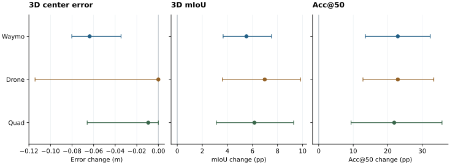

# 3EED 行人稳健中心配对复测

288 条行人查询上，稳健中心分支的 3D 中心误差中位数 **0.420 m → 0.273 m**，mIoU **24.66% → 30.88%**，Acc@50 **14.24% → 36.81%**。Acc@50 救回 **68** 条，退化 **3** 条。结果来自已有项目曝光的录制。 [冻结协议](PROTOCOL_ZH.md)

## 按平台的配对结果

表中从左到右是原正式方法和稳健中心。中心误差仅包括两臂都有框的配对。缺框的查询在全样本 mIoU 和 Acc@50 中计为失败。

| 平台 | 查询 / 录制 | 有效配对 / 实际更新 | 3D 中心误差中位数 | 水平中心误差中位数 | mIoU | Acc@50 |
|---|---:|---:|---:|---:|---:|---:|
| Waymo | 96 / 96 | 88 / 86 | 0.204 m → 0.134 m | 0.184 m → 0.115 m | 37.19% → 42.71% | 29.17% → 52.08% |
| Drone | 96 / 3 | 95 / 51 | 1.135 m → 1.135 m | 1.029 m → 0.895 m | 14.41% → 21.38% | 3.13% → 26.04% |
| Quad | 96 / 7 | 93 / 69 | 0.495 m → 0.526 m | 0.427 m → 0.456 m | 22.38% → 28.54% | 10.42% → 32.29% |
| 合计 | 288 / 106 | 276 / 206 | 0.420 m → 0.273 m | 0.371 m → 0.163 m | 24.66% → 30.88% | 14.24% → 36.81% |

| 平台 | mIoU 增量 pp [95% 区间] | Acc@50 增量 pp [95% 区间] | 配对 3D 中心误差中位差 m [95% 区间] | 救回 / 退化 |
|---|---:|---:|---:|---:|
| Waymo | +5.52 [+3.66, +7.52] | +22.92 [+13.52, +32.32] | -0.064 [-0.080, -0.035] | 25 / 3 |
| Drone | +6.98 [+3.60, +9.83] | +22.92 [+12.82, +33.33] | 0.000 [-0.114, 0.000] | 22 / 0 |
| Quad | +6.16 [+3.12, +9.28] | +21.88 [+9.38, +35.71] | -0.009 [-0.066, 0.000] | 21 / 0 |

配对中心差先计算每条的误差差再取中位数，因此可与两臂边际中位数之差不同。区间为按录制重采样的 95% 区间。Drone 和 Quad 分别只有 3 和 7 段，区间反映这批录制内的变动。三平台查询数相同，平台等权 mIoU 和 Acc@50 与合计值一致。

Waymo 的两类中心误差均下降。Drone 的水平误差中位数下降，3D 中心误差中位数持平。Quad 的整体水平和 3D 中心误差中位数上升，但逐例 3D 中位差为 −0.009 m、区间上界为零，mIoU 与 Acc@50 同时上升。在实际更新的 69 条 Quad 上，3D 中心误差中位数为 0.316 m → 0.243 m。这一更新子集受分支准入影响，完整平台结果仍以 96 条为准。

## 采用覆盖与协议核对

| 平台 | 稳健中心实际采用 | 预测非行人 | 缺正式支持区域或冻结框 |
|---|---:|---:|---:|
| Waymo | 86 / 96 | 0 | 10 |
| Drone | 51 / 96 | 0 | 45 |
| Quad | 69 / 96 | 0 | 27 |
| 合计 | 206 / 288 | 0 | 82 |

本轮按平台各取 96 条，使用原有行人表达。TRAIN / Validation 的查询数分别是 Waymo 53/43、Drone 78/18、Quad 54/42。
录制可与历史研究重合。对上一轮 576 条直接开发面板，物理采集时刻、RGB 文件和 LiDAR 文件均无重合。
使用同一批冻结 Qwen 2D/3D 回答。两臂共享原 Object、车辆分支和顶缩，按冻结预测类别决定是否启用行人读出。封存配对预测后才读取标注框。零训练。
对 12 条样本直接复放原正式入口，正式框逐参数相同。两套旋转 IoU 实现的最大绝对差为 6.66e-16。
逐平台汇总和实际更新子集的指标保存在 [聚合分数](results.json)。原正式方法入口保持原样。

## 复算

从包含项目依赖与 3EED 公开包的实验工作区依次运行注册器 register.py、预测入口 run_recheck.py predict、评分入口 score_recheck.py 和独立复核 validate_recheck.py。评分入口补齐了初次离线评分缺失的路径导入，预测封存和推理代码保持原版本。私有运行文件位于工作区的 `runs/pedestrian-paired-recheck-20261128`。主评分按正式协议使用 IoU 严格大于 0.50。
