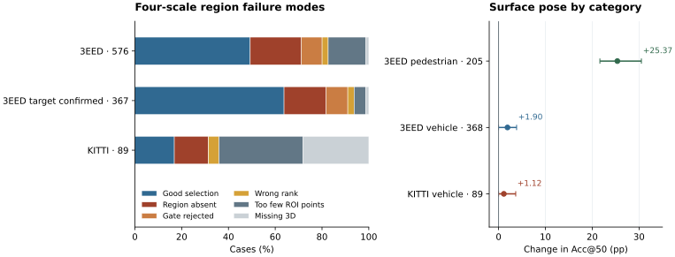

# 物理实例绑定与可见表面姿态

**四尺度支持的主要损失发生在候选生成和准入。姿态改动的主要收益来自行人水平中心。** 3EED 中，126 条样本的原四尺度没有生成同时满足纯度和覆盖要求的区域，51 条有好区域但过不了门槛，15 条有合法好区域却未被选中。行人稳健中心把 3EED 行人的 Acc@50 从 **13.17% 提高到 38.54%**。车辆的表面方向更准，联合框 mIoU 接近原基线。保留 `ray_equivalent_height_only` 的正式入口和 Fitting，行人读出作为待独立验证的候选。

复用 576 条 3EED 普通验证描述与 89 条可评分 KITTI Tracking 样本。无标签预测阶段为两套输入面板的 702 个条目生成封存结果，GT 仅用于离线审计、分组和评分。Qwen 二维框、类别、3D 回复和推理权重均冻结，新增模型调用与训练为零。两个面板曾用于研发。区间按平台内录制成簇重采样 2,000 次。Drone 和 Quad 分别只有 2、3 段录制。 [主协议](PROTOCOL_ZH.md) · [上一轮级联 Oracle](../3eed_cascaded_oracle_20261128/REPORT_ZH.md)

## Object 的瓶颈在何处

逐例复建原四尺度、原中心支持规则、原 Selection 门槛和区域排序。对 C_ray 和 H 分别使用原路由的采样池，比对重建的获胜区域与正式输出的点。好区域的诊断定义为纯度 ≥85%、覆盖 ≥70%，目标支持以同一池、投影在当前窗口内的 GT 框内 LiDAR 点为代理，至少 5 个代理点才能归因。纯度分母是区域的所有点，覆盖分母是 ROI 内的代理点池。真实逐点归属不在数据中。

| 窗口及面板 | 正式选区达标 | 候选未生成 | 候选卡门槛 | 合法候选未选中 | ROI 或采样点不足 | 缺冻结 3D |
|---|---:|---:|---:|---:|---:|---:|
| 3EED，原预测窗口，576 | 284 | 126 | 51 | 15 | 93 | 7 |
| 3EED，原窗口已确认指向目标，367 | 234 | 66 | 34 | 10 | 18 | 5 |
| 3EED，改用标注窗口，576 | 298 | 157 | 47 | 42 | 25 | 7 |
| KITTI，原预测窗口，89 | 15 | 13 | 0 | 4 | 32 | 25 |
| KITTI，改用标注窗口，89 | 18 | 20 | 0 | 4 | 22 | 25 |

3EED 原窗口的 126 条生成失败，按同一暴露面板上的顺序检查归为 **71 条前景高度筛除、10 条未进入足够大的连通区域、5 条支持拆散、40 条目标与背景混入同一个大区域**。71 条中 52 条为行人。Quad 贡献了 75 条生成失败中的 53 条前景筛除。哪怕允许离线合并所有纯度达标的现有区域，也只有 126 条中的 **11 条**能够覆盖至少 70% 的目标代理点。主结论在 80/60 和 90/80 匹配门槛下保持。KITTI 的主要可见限制来自 ROI/采样不足和缺冻结 3D，在能形成支持的样本中生成失败仍多于排序失败。

### 近地前景补回探针

用同一个连通图算子、四尺度和同一选区规则，允许在预测 ROI 中与原前景点水平邻近的 5–20 cm 近地点重新入图。这组工程对照由上述发现引出。3EED 403 条实际新增了场景前景点，275 条 3D 框因此改变。最后达标支持从 **284 增至 292 条**，对应 10 条修复、2 条退化。mIoU **−0.05 pp [−0.68, +0.50]**，Acc@50 **+0.52 pp [−0.52, +1.56]**。KITTI 达标从 **15 到 16**，只新增 1 条 Acc@50 成功。局部准入规则在当前面板上可补回部分支持，3D 总体收益不稳定。Object 继续沿用原四尺度候选。 [探针协议](OBJECT_PROBE_ZH.md)

## Correction 的类别特定效果

车辆对真实 LiDAR 的可见轮廓做局部 BEV 直线拟合。利用面朝相机、点位于内侧和局部跨度验证主面，只有观测到可靠正交面时才约束另一横轴。用原尺寸从测得近面换算中心。单面缺失的方向保留原中心投影，轴消歧不足时回退。此处借鉴 L-shape 的正交可见边和 FGR 的关键边思想，完整框维持原尺寸，不把图像边界作为尺寸求解条件。 [Zhang 等，L-shape](https://publications.ri.cmu.edu/storage/publications/2017/07/Xiao-2017-Efficient-L-Shape-Fitting.pdf) · [Wei 等，FGR §III-B](https://arxiv.org/html/2105.07647)

行人利用原支持点的水平几何中位数估中心，只有原地面模型与所见下沿一致时才调整落地位置。保持原 yaw。车辆与行人的路由均用冻结 Qwen 的预测类别。C_ray 继续走原顶缩。**789 次**有框更新的 C_ray 顶缩对照均通过 Selection 命中和首交复核，最大首交变化为 0。对照针对每个新姿态自身缩顶前后，姿态改变本身可以改变首交。

| 读出 | 3EED mIoU | 3EED Acc@50 | KITTI mIoU | KITTI Acc@50 |
|---|---:|---:|---:|---:|
| 原正式框 | 34.77% | 33.85% | 22.22% | 22.47% |
| Object 近地探针 | 34.72% | 34.38% | 22.24% | 23.60% |
| 表面中心，原 yaw | 36.79% | 43.58% | 22.18% | 23.60% |
| 表面 yaw，原中心 | 35.11% | 34.55% | 22.02% | 22.47% |
| 车辆联合与行人稳健中心 | 37.21% | 44.10% | 22.13% | 23.60% |
| 只启用行人稳健中心 | 37.28% | 42.88% | 22.22% | 22.47% |

- **行人**（3EED 205 条）。水平中心误差中位数从 **0.275 m 降到 0.120 m**，mIoU 增加 **7.06 pp [6.11, 8.13]**，Acc@50 增加 **25.37 pp [21.63, 30.50]**，救回 54 条、跌破阈值 2 条。171 条实际更新中，114 条只改水平中心，57 条同时动地面位置。两组有不同的准入条件，组间收益差不能归因给地面调整。
- **车辆**（3EED 368 条）。轴角误差中位数从 **7.29° 降到 4.38°**。单独替换 yaw 增加 **0.53 pp mIoU [0.32, 0.77]**，联合版本为 **−0.11 pp [−0.85, +0.62]**。联合的 89 条双面更新增加 **10.11 pp Acc@50 [4.35, 17.05]**，173 条单面更新的 mIoU 下降 **1.16 pp [−2.31, −0.04]**。双面分组的结果支持按表面证据强度进一步验证。KITTI 仅 15 条实际采用，联合 mIoU 变化 **−0.10 pp [−0.56, +0.49]**。
- **行人专用候选**根据开发面板已观察到的类别效应，从封存的盲预测按冻结类别组合，3EED 总体 mIoU **+2.51 pp [1.14, 3.73]**，Acc@50 **+9.03 pp [4.19, 13.40]**。KITTI 当前面板只有车辆，无法提供对行人读出的外部复测。

## 复算

在含本轮脚本、冻结 Qwen 回复和已封存数据缓存的实验工作区内，从 `studies/3eed_physical_binding_surface_pose_20261128` 依次运行 `binding_audit.py`、`generation_detail.py`、`predict_pose.py`、`score_pose.py`、`object_probe.py`、`score_object_probe.py`。工作区 `runs/physical-binding-surface-pose-20261128` 保留两份盲预测回执、逐例离线评分和候选审计汇总。665 条评分的键、分母和两条盲预测文件的 SHA 已复核，正式框的 IoU 与级联 Oracle 的 O0 逐例一致。
