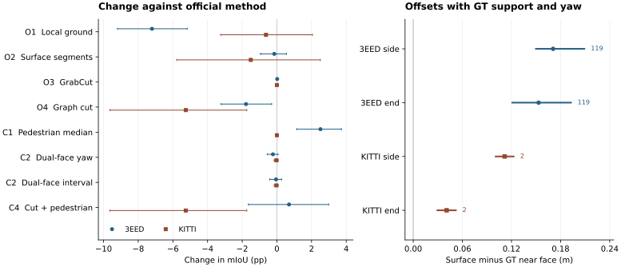

# 局部表面实例绑定与可观测姿态

**新支持最有价值的用法是接到行人稳健中心。** 在另一个已封存的 288 条行人查询面板上，加入局部图割支持后，相比原支持的稳健中心，mIoU 从 **30.88% 增至 33.46%**，Acc@50 从 **36.81% 增至 39.93%**，3D 中心误差中位数从 **0.273 m 降到 0.206 m**。同一个图割用于所有物体时，3EED 和 KITTI 的全量 mIoU 均退化。车辆双面方差拟合改善了 yaw 的点估计，完整框仍接近原基线。正式默认方法保持 `ray_equivalent_height_only`。 [实验协议](PROTOCOL_ZH.md)

## 数据与对照

机制面板复用 702 条冻结 Qwen 预测条目，共 665 条可评分，其中 3EED 576 条、KITTI 89 条。四个 Object 对照使用同一冻结二维窗口，四尺度对照及新图支持共用正式的后端姿态生成和顶缩逻辑。H 路由继承原来按支持跨度补全尺寸的规则，新支持可改变读出的尺寸。位姿对照冻结输入框的预拟合尺寸，C_ray 在新姿态上调用原顶缩，并复核其缩顶前后的选择射线。共核验 **508** 次 C_ray 读出的顶缩等价性。预测进程封存后才由离线进程读取 GT。无新增 Qwen 调用，无训练。

3EED 通过公开 pose 的旋转读出原始点系中的世界竖直，KITTI 采用 Velodyne 原始 z 轴作为局部竖直代理。相机投影使用原标定。三类公开点文件均未找到可认证的原生扫描环和发射邻接，O2/O4 使用密度归一化 kNN、局部法向与通过实测回波的相机光心射线夹角作为连续性代理。该代理与使用扫描器原生 range image 的分割不同。 [3EED 位姿处理](https://github.com/worldbench/3EED/blob/main/utils/align_3eed.py) · [Range Image Segmentation §4](https://www.ipb.uni-bonn.de/pdfs/bogoslavskyi16pfg.pdf) · [MWSIS §3.3](https://arxiv.org/html/2312.06988)

## O1–O4 · 局部地面、表面段、RGB 和图割

| 对照 | 3EED 达标支持 | 3EED mIoU / Acc@50 | KITTI 达标支持 | KITTI mIoU / Acc@50 |
|---|---:|---:|---:|---:|
| 原四尺度 | 284 / 576 | 34.77% / 33.85% | 15 / 89 | 22.22% / 22.47% |
| O1 重力对齐局部地面 | 226 / 576 | 27.56% / 23.96% | 10 / 89 | 21.60% / 23.60% |
| O2 三状态局部段 | 297 / 576 | 34.62% / 34.90% | 17 / 89 | 20.72% / 21.35% |
| O3 GrabCut 软证据 | 284 / 576 | 34.79% / 33.85% | 15 / 89 | 22.22% / 22.47% |
| O4 联合图割 | 338 / 576 | 32.99% / 31.08% | 4 / 89 | 16.97% / 14.61% |
| O4 去 RGB | 330 / 576 | 31.75% / 28.65% | 3 / 89 | 17.57% / 15.73% |
| O4 只换回原地面 | 314 / 576 | 35.13% / 34.90% | 13 / 89 | 18.52% / 16.85% |

达标指纯度 ≥85%、覆盖 ≥70%。覆盖相对于同一拟合池和当前窗口内的 GT 框内代理点，缺少逐点实例 GT。O4 在 472 条 3EED 上产生过区域提议，324 条至少有一个达标提议。最终 338 条达标包含回退到原支持的样本。

- **O1 局部地面。** 用局部高度、可信法向和平面性标出地面。待判断点可进入四尺度连通图。这在原 71 条前景筛除失败中恢复 6 条达标，但 3EED 整体支持纯度中位数从 100.0% 降到 88.1%，mIoU 下降 **7.21 pp [−9.20, −5.17]**。原地面与新地面的图割配对也表明，全量采用新的准入规则会损伤车辆。 [Patchwork++ §III-C、III-D](https://arxiv.org/html/2207.11919)
- **O2 局部段。** 对连续块按核心、扩展区和窗外比例赋予前景/背景/不确定状态，核心深度有多个势均力敌的模式时回退。40 条原目标与背景混合失败中恢复 **7 条**。全量 3EED mIoU 变化 **−0.15 pp [−0.95, +0.55]**。
- **O3 软外观。** 在原窗与略扩窗上运行 GrabCut，利用意见一致性和近层投影为同一候选四尺度提供有界外观证据。在有合格掩码且 ROI 前、背景样本均足够的 **351 条 3EED** 上，对 GT 框内点的逐帧 ROC AUC 中位数 **0.734**，KITTI 的 15 条为 **0.554**。独立替换只改变 8 条 3EED 框，Acc@50 持平。RGB 在全量 3EED 图割中相对无 RGB 提高 **1.24 pp mIoU [+0.68, +1.80]**，在行人子集的同一对照为 **−0.41 pp [−0.69, −0.02]**。它在当前协议下提供可测信号，效果随类别和读出而变。 [GrabCut §3](https://pages.cs.wisc.edu/~dyer/cs534/papers/grabcut-rother.pdf)
- **O4 图割。** 将可信核心回波、局部段、地面和软外观合入稀疏图，正种子取主深度模式，不按最近距离硬选。修复原 **71 条**前景筛除失败中的 **27 条**、**40 条**混合失败中的 **25 条**，以及原 **126 条**生成失败中的 **58 条**。在对应 126 条上 mIoU 增加 **5.50 pp [+0.62, +8.81]**，全量却下降 **1.78 pp [−3.22, −0.30]**，KITTI 下降 **5.26 pp [−9.63, −1.74]**。支持达到纯度与覆盖门槛，仍可能缺少对姿态足够有用的表面。 [Golovinskiy 与 Funkhouser，Min-Cut](https://pixl.cs.princeton.edu/gfx/pubs/Golovinskiy_2009_MBS/index.php)

## C2–C3 · 双面姿态与表面偏移

方差读出只在可信的两面上估计正交朝向。单面仅记录拟合面和偏移，保持正式姿态。双面中心用实测面与原尺寸给出的区间约束，采用最小改动，不把实测面直接当框近边。3EED 的 **137 条**双面更新中，yaw 误差中位数从 **6.17° 降到 2.43°**，联合区间版本 mIoU 改变 **−0.20 pp [−1.88, +1.16]**，Acc@50 持平。旧双面版本在 3EED 全量 Acc@50 提高 **1.56 pp [+0.53, +2.74]**，KITTI 持平。 [L-shape 方差准则](https://publications.ri.cmu.edu/storage/publications/2017/07/Xiao-2017-Efficient-L-Shape-Fitting.pdf) · [FGR §III-B](https://arxiv.org/html/2105.07647)

用 GT 框内真实回波和真 yaw 拟合时，3EED 的 **119 个车侧面**到 GT 近边的有符号偏移中位数为 **0.171 m**，四分位区间 **[0.149, 0.210] m**。**119 个端面**为 **0.153 m [0.120, 0.194]**。这里正值表示实测表面在框边界以内。按相机方位分组，侧向观察 40 个面中位数为 **0.172 m**，端向观察 130 个面为 **0.159 m**，其余为斜视。该读出在预定俯视层没有可用观测。KITTI 的真支持加真 yaw 只有 **2 个双面案例**；用预测支持时偏移含有明显的错指和较大偏差，跨域统一偏移尚无充分依据。

| 匹配的 98 条 3EED 双面车 | mIoU | 水平中心误差中位数 |
|---|---:|---:|
| 正式框 | 61.33% | 0.226 m |
| 预测支持、预测表面，直接作为框边 | 60.39% | 0.242 m |
| GT 支持、预测表面 | 65.69% | 0.231 m |
| GT 支持、真 yaw 下拟合表面 | 68.05% | 0.229 m |
| 再给真表面到框边偏移 | 75.26% | 0.167 m |

C3 仅为离线 Oracle，固定正式框尺寸和高度，逐级替换支持、朝向和偏移。真支持取同一拟合点池里相机可见的 GT 框内点，可绕过原预测窗的漏支持。四个 Oracle 分支均能拟合双面的 98 条作为可配对样本，样本条件会影响本表的绝对分数。结果说明即使支持和 yaw 较准确，表面偏移仍有独立影响。

## C1、C4 · 固定行人中心与换支持复测

原支持的稳健中心 C1 沿用无权重几何中位数，保持既有地面准入。机制面板 205 条行人的 C1 为 **37.19% mIoU / 38.54% Acc@50**，图割加同一行人中心 C4 为 **39.88% / 44.88%**。两者 mIoU 的差 **+2.70 pp [−0.24, +4.87]**。把图割应用给车辆后损失抵消了行人收益。根据这一类别差异，用冻结预测类别选择行人专用图割加稳健中心，机制面板总体相对 C1 提高 **0.96 pp mIoU**、**2.26 pp Acc@50**。该组合作为开发读出进入下列复测。 [上一轮 C1 复测](../3eed_pedestrian_paired_recheck_20261128/REPORT_ZH.md)

另一个 288 条查询的封存面板，和上述 576 条没有同一物理采集时刻或相同 RGB／LiDAR 文件。它保留历史已曝光的录制。这里重新锁定 C4 并只复放缓存 Qwen 回复，独立复算确认 288 条正式框、C1 框及其 IoU 与上轮一致。

| 平台 | 录制 | mIoU，正式 / C1 / C4 | Acc@50，正式 / C1 / C4 | 3D 中心误差中位数，C1 → C4 |
|---|---:|---:|---:|---:|
| Waymo | 96 | 37.19% / 42.71% / 42.88% | 29.17% / 52.08% / 50.00% | 0.134 → 0.136 m |
| Drone | 3 | 14.41% / 21.38% / 26.38% | 3.13% / 26.04% / 33.33% | 1.135 → 0.781 m |
| Quad | 7 | 22.38% / 28.54% / 31.11% | 10.42% / 32.29% / 36.46% | 0.526 → 0.335 m |
| 合计 | 106 | 24.66% / 30.88% / 33.46% | 14.24% / 36.81% / 39.93% | 0.273 → 0.206 m |

C4 相对 C1 的全体 mIoU 增量 **+2.58 pp [+0.92, +3.98]**，Acc@50 **+3.13 pp [0.00, +5.83]**，救回 16 条、退化 7 条。Drone mIoU **+5.00 pp [+1.45, +5.92]**，Quad **+2.57 pp [−1.13, +6.28]**，Waymo Acc@50 **−2.08 pp [−6.25, +2.08]**。三个平台各 96 条，中心统计基于三臂都有框的 276 条。录制数限制了 Drone 与 Quad 的估计。C4 行人专用分支保留为实验候选，正式推理仍沿用现有 Object、车辆读出和顶缩。

## 复算与产物

在本地已配置的实验工作区内，从本研究目录依次运行 structure_paths.py、blind.py、evaluate_structure.py、verify_study.py。额外行人复测由 recheck_pedestrian.py 依次执行 prepare、predict、score。各阶段复用已封存数据和原标定，工作区下的 runs/structure-conditioned-20261128 保留逐例私有分数与封存回执。报告的区间按录制成簇重采样 2,000 次，Acc@50 采用正式的 IoU 严格大于 0.50。 [公开聚合数据](results.json)
