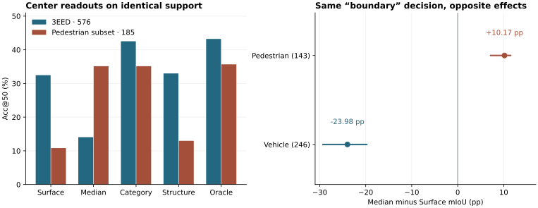

# 类别无关的结构路由能否替代类别对照？

**这条固定结构规则未达到替代条件。** 在相同 Qwen 几何输出、支持点、姿态和尺寸下，3EED 的 Structure 比 Category 低 **2.89 个百分点 mIoU**、**9.55 个百分点 Acc@50**。差距主要来自行人。对包含可拟合边界的行人，几何中位数往往仍更好。同一边界判据在车辆和行人上对应相反的读出偏好。统一图割轻微改变了输入支持和框分数，结构路由的差距仍在。 [冻结协议](PROTOCOL_ZH.md)

## 控制变量

主面板 702 条冻结预测有 665 条可评分，其中 3EED 576 条，KITTI 89 条。行人面板另有 288 条配对，185 条与直接机制面板录制不重合，仍有项目历史曝光。两面板合计封存 990 条预测，所有评分均在封存后进行。不存在新模型调用、训练或参数搜索。

原正式入口用 Qwen 预测类别决定 C_ray 的车辆准入。主对照只向上游传入冻结的二维框数值和三维框数值，对全部输入开放同一 C_ray，再走原 H/A 回退。**所有候选逐例复用上游固定的支持点、长宽高、yaw、竖直中心和已经计算的顶缩高度，只改变水平中心。** Category 由 Qwen 的预测类别选择行人 Median，其余为 Surface。Structure 从点云的横向覆盖、重力对齐后的展布、视点和可见边缘中读出聚集、边界或不确定，只在聚集条件成立且中位数可用时选择 Median，其余保留原 Surface。Oracle 离线从同一对候选选 IoU 较高的一项。另用原正式支持和正式框做逐例回放，隔离上游准入的影响。 [原支持对照协议](ARCHIVED_SUPPORT_ZH.md)

## 固定四尺度支持的主结果

| 中心读出 | 3EED 576 条 mIoU / Acc@50 | 行人录制子集 185 条 mIoU / Acc@50 | 行人 3D 中心误差中位数 | KITTI 89 条 mIoU / Acc@50 |
|---|---:|---:|---:|---:|
| 全部 Surface | 34.11% / 32.47% | 21.95% / 10.81% | 0.461 m | 22.22% / 22.47% |
| 全部 Median | 25.69% / 14.06% | 29.31% / 35.14% | 0.299 m | 14.48% / 7.87% |
| Category | **37.12% / 42.53%** | **29.31% / 35.14%** | **0.299 m** | **22.22% / 22.47%** |
| Structure | 34.23% / 32.99% | 22.73% / 12.97% | 0.457 m | 20.56% / 19.10% |
| Oracle | 37.55% / 43.23% | 30.12% / 35.68% | 0.286 m | 22.22% / 22.47% |

3EED 的 Structure 相对 Category 的配对 95% CI 为 **[−4.34, −1.26] pp mIoU**、**[−14.75, −3.79] pp Acc@50**。185 条行人录制子集相应为 **−6.58 pp [−9.23, −4.07]** 和 **−22.16 pp [−29.04, −15.30]**。完整 288 条行人面板的差分别为 **−6.43** 和 **−22.22 pp**。185 条中的中心误差在共有有效框的 177 条计量。

| 3EED 平台 | 查询 / 录制 | Category mIoU / Acc@50 | Structure mIoU / Acc@50 |
|---|---:|---:|---:|
| Waymo | 192 / 93 | 55.59% / 68.75% | 54.10% / 65.62% |
| Drone | 192 / 2 | 24.73% / 29.17% | 23.56% / 23.96% |
| Quad | 192 / 3 | 31.05% / 29.69% | 25.03% / 9.38% |

切回完全相同的原正式支持和框，3EED 的 Surface 恢复正式 **34.77% / 33.85%**；Category 达 **37.28% / 43.06%**，Structure **34.79% / 33.85%**。差距仍为 **−2.49 pp mIoU [−3.70, −1.12]** 和 **−9.20 pp Acc@50 [−13.71, −4.25]**。同一对照在 185 条行人录制子集里仍落后 **6.13 pp mIoU**、**22.16 pp Acc@50**。因此，解除上游车辆准入解释不了主要差距。

## 结构判断为什么失效

- **边界读出对中心选择的含义随样本而变。** 在相同固定四尺度支持下，143 条行人触发边界判据。在这个子集里，强制 Median 比 Surface 高 **10.17 pp mIoU [7.15, 11.51]**。246 条同样被判为边界的车辆中，强制 Median 反而低 **23.98 pp**。边界判据给出了局部线面的可拟合性，无法据此可靠区分哪种输入更适合估算完整物体中心。
- **现有路由对中位数过于保守。** 3EED 主面板中，Structure 只在 14/576 条选择 Median，其中 14 条均为行人。两候选 Oracle 能达标但 Structure 仍失败的有 **59 条**，Category 仅 **4 条**。Category 距同候选 Oracle 的平均差为 **0.42 pp mIoU**。车辆和行人在本数据中分别强烈偏好 Surface 和 Median，但这组条件无法检验语义类别与实例物理特征的独立影响。
- **其它类别的实证样本极少。** 三条 3EED 骑行者全部被 Structure 读为边界并使用 Surface。匿名上游下，三条中 Median 有 1 条达标，Structure 为 0 条。KITTI 这 89 条来自车类面板。类别文本可以完全移出统一路由的入口，任意新类别的准确性仍待单独验证。

## 类别无关支持消融

同一个图割设置用于所有类别，沿用原地面判定，图割失败复用原支持。由于图割可让部分查询换到另一历史回退路径，支持覆盖率分母固定为原四尺度的拟合样本，覆盖只计入该池内匹配回波。纯度仍依据实际送入读出的全部点。框对照的尺寸、yaw、z 与高度均冻结，每种支持内，五种读出逐例使用同一个支持输入。

| 支持替换对照 | 原四尺度 | 统一图割 | 配对差 |
|---|---:|---:|---:|
| 3EED 支持达标 | 282/576 | 297/576 | +15 条 |
| 3EED，Structure mIoU | 34.23% | 34.71% | +0.47 pp [−0.36, 1.35] |
| 3EED，Structure Acc@50 | 32.99% | 33.68% | +0.69 pp [−1.04, 2.46] |
| 3EED 行人 205 条，Median mIoU | 36.74% | 38.31% | +1.57 pp [0.41, 2.45] |
| 185 条录制子集，Median mIoU | 29.31% | 29.46% | +0.15 pp [−1.54, 1.76] |
| KITTI 支持达标 | 15/89 | 12/89 | −3 条 |

统一图割后，3EED 的 Structure 仍比同图割支持下的 Category 低 **3.01 pp mIoU**、**9.38 pp Acc@50**。在 185 条子集中，统一图割对 Median 的额外收益也未稳定复现。支持消融与前一轮只对预测行人启用的 C4 分开解释，二者使用的图割尺度和最终框干预不同。

## 研究决定

保持正式入口 `ray_equivalent_height_only`。现阶段的改进证据仍来自室外车辆和行人，C1/C4 作为对应实验候选保存。结构路由实验支持一个更具体的论文问题：**从回波中读出局部结构后，还要判断这项证据能约束完整框的哪个参数。** 在当前数据中，识别一个可见边界与选择合适的中心估计器是两个不同的问题。

## 复算

执行 `route_centers.py` 和 `archived_support.py` 生成两套封存，之后用 `score_routing.py` 评分，用 `export.py` 生成公开聚合和图。私有逐例数据存放于本地 `runs/structure-routing-20261128`。Acc@50 沿用严格 IoU > 0.50，区间基于平台内原录制分簇重采样 2,000 次。 [聚合结果](results.json)
